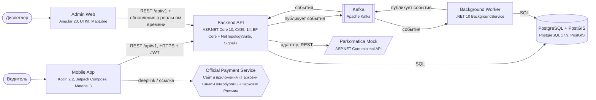
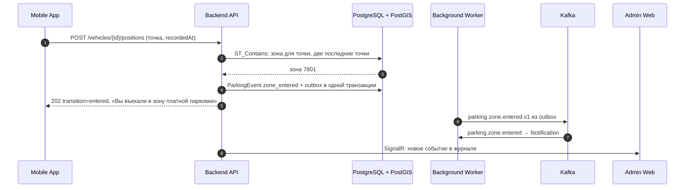
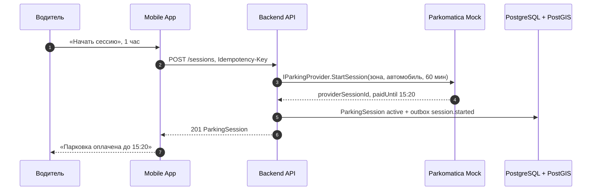
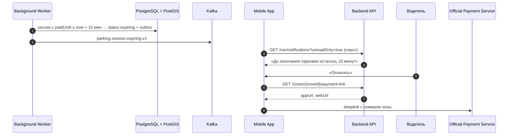
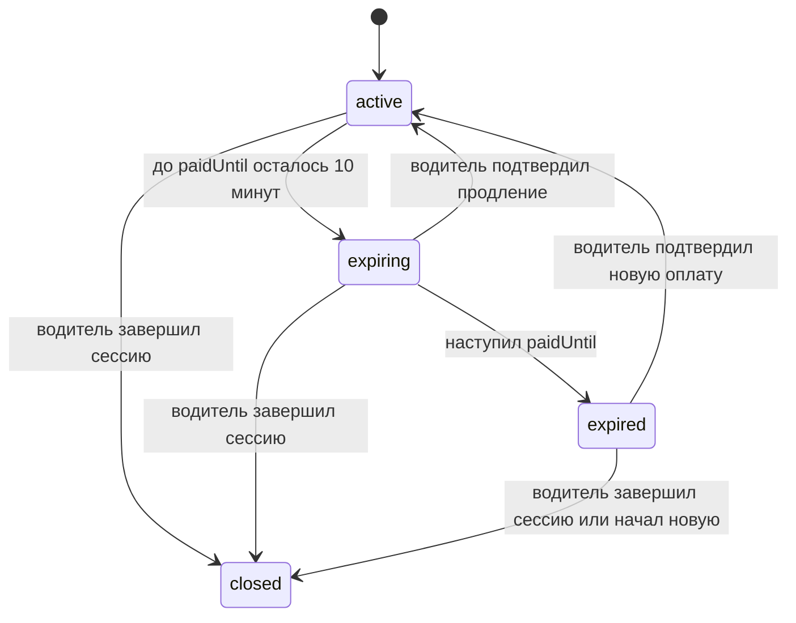

# Архитектура

## Компоненты

| Компонент | Тип | Технология | Ответственность |
| --- | --- | --- | --- |
| Mobile App | mobile | Kotlin 2.2, Jetpack Compose, Material 3 | Карта, текущая зона, статус и таймер сессии, уведомления, передача координат, переход к оплате |
| Admin Web | web | Angular 20, UI Kit, MapLibre | Просмотр автомобилей, зон, сессий, маршрутов, журнала событий; загрузка зон; запуск демо-маршрута |
| Backend API | backend | ASP.NET Core 10, C# 14, EF Core + NetTopologySuite, SignalR | REST API, определение зоны, жизненный цикл сессий, outbox событий, push обновлений в Admin Web |
| Background Worker | worker | .NET 10 BackgroundService | Таймеры сессий (expiring/expired), публикация outbox в Kafka, создание уведомлений, проигрывание демо-маршрутов |
| PostgreSQL + PostGIS | database | PostgreSQL 17.9, PostGIS | Данные, геозапросы, outbox, ключи идемпотентности |
| Kafka | broker | Apache Kafka | Доменные события между компонентами |
| Parkomatica Mock | mock | ASP.NET Core minimal API | Имитация API поставщика парковочных сессий за адаптером IParkingProvider |
| Official Payment Service | external | Сайт и приложения «Парковки Санкт-Петербурга» / «Парковки России» | Оплата парковки водителем |

## Ключевые решения

- Бизнес-логика определения зоны и жизненного цикла сессии выполняется на сервере: устройство только передаёт координаты, поэтому правила едины для мобильного приложения и демо-режима
- Зона определяется запросом ST_Contains по GIST-индексу; вход и выход фиксируются после двух подряд точек, чтобы дрожание GPS на границе не порождало ложных уведомлений
- Поставщик парковочных услуг скрыт за интерфейсом IParkingProvider; в прототипе реализацию даёт Parkomatica Mock, замена поставщика не затрагивает доменный слой
- События пишутся в outbox в одной транзакции с данными и публикуются в Kafka фоновым процессом, поэтому событие не теряется и не публикуется без изменения данных
- Таймеры окончания сессий выполняет Background Worker по времени paidUntil в UTC; мобильное приложение дублирует таймер локально на случай потери связи
- Административный интерфейс получает новые события через SignalR без перезагрузки страницы
- Доступ по JWT с ролями driver и dispatcher; водитель работает только с закреплённым за ним автомобилем

Подробно — в журнале решений:

- [ADR-001. Где определяется платная зона](adr/ADR-001.md)
- [ADR-002. Защита от дрожания GPS на границе зоны](adr/ADR-002.md)
- [ADR-003. Интеграция с поставщиком парковочных услуг](adr/ADR-003.md)
- [ADR-004. Источник времени окончания оплаты](adr/ADR-004.md)
- [ADR-005. Доставка событий между компонентами](adr/ADR-005.md)
- [ADR-006. Аутентификация пользователей](adr/ADR-006.md)

## Въезд в платную зону

## Запуск парковочной сессии

## Предупреждение об окончании и переход к оплате

## Жизненный цикл: ParkingSession.status

