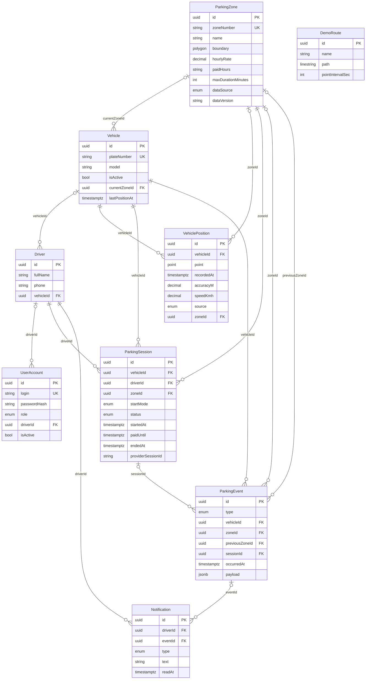

# Модель данных

Физическая схема: [schema.sql](contracts/schema.sql).

## UserAccount

Таблица `user_accounts`. Учётная запись пользователя системы

| Поле | Колонка | Тип | Обяз. | Ограничения |
| --- | --- | --- | :---: | --- |
| `id` | `id` | uuid | да | — |
| `login` | `login` | string | да | до 50 симв.; `^[a-z0-9._-]{3,50}$`; уникально |
| `passwordHash` | `password_hash` | string | да | до 200 симв. (только БД) |
| `role` | `role` | enum | да | `driver`, `dispatcher` |
| `driverId` | `driver_id` | uuid |  | → Driver |
| `isActive` | `is_active` | bool | да | — |
| `createdAt` | `created_at` | datetime | да | — |
| `updatedAt` | `updated_at` | datetime | да | — |

## Driver

Таблица `drivers`. Водитель служебного автомобиля

| Поле | Колонка | Тип | Обяз. | Ограничения |
| --- | --- | --- | :---: | --- |
| `id` | `id` | uuid | да | — |
| `fullName` | `full_name` | string | да | до 150 симв.; ПДн |
| `phone` | `phone` | string |  | до 12 симв.; `^\+7\d{10}$`; ПДн |
| `vehicleId` | `vehicle_id` | uuid |  | → Vehicle |
| `createdAt` | `created_at` | datetime | да | — |
| `updatedAt` | `updated_at` | datetime | да | — |

## Vehicle

Таблица `vehicles`. Служебный автомобиль

| Поле | Колонка | Тип | Обяз. | Ограничения |
| --- | --- | --- | :---: | --- |
| `id` | `id` | uuid | да | — |
| `plateNumber` | `plate_number` | string | да | до 9 симв.; `^[АВЕКМНОРСТУХ]\d{3}[АВЕКМНОРСТУХ]{2}\d{2,3}$`; уникально |
| `model` | `model` | string |  | до 100 симв. |
| `isActive` | `is_active` | bool | да | — |
| `currentZoneId` | `current_zone_id` | uuid |  | → ParkingZone |
| `lastPositionAt` | `last_position_at` | datetime |  | — |
| `createdAt` | `created_at` | datetime | да | — |
| `updatedAt` | `updated_at` | datetime | да | — |

## ParkingZone

Таблица `parking_zones`. Зона платной парковки

| Поле | Колонка | Тип | Обяз. | Ограничения |
| --- | --- | --- | :---: | --- |
| `id` | `id` | uuid | да | — |
| `zoneNumber` | `zone_number` | string | да | до 4 симв.; `^\d{4}$`; уникально |
| `name` | `name` | string |  | до 200 симв. |
| `boundary` | `boundary` | polygon | да | — |
| `hourlyRate` | `hourly_rate` | decimal |  | ≥ 0; ≤ 10000 |
| `paidHours` | `paid_hours` | string |  | до 100 симв. |
| `maxDurationMinutes` | `max_duration_minutes` | int |  | ≥ 1; ≤ 1440 |
| `dataSource` | `data_source` | enum | да | `open_data`, `demo` |
| `dataVersion` | `data_version` | string |  | до 50 симв. |
| `createdAt` | `created_at` | datetime | да | — |
| `updatedAt` | `updated_at` | datetime | да | — |

## VehiclePosition

Таблица `vehicle_positions`. Отметка местоположения автомобиля

| Поле | Колонка | Тип | Обяз. | Ограничения |
| --- | --- | --- | :---: | --- |
| `id` | `id` | uuid | да | — |
| `vehicleId` | `vehicle_id` | uuid | да | → Vehicle |
| `point` | `point` | point | да | ПДн |
| `recordedAt` | `recorded_at` | datetime | да | — |
| `accuracyM` | `accuracy_m` | decimal |  | ≥ 0; ≤ 10000 |
| `speedKmh` | `speed_kmh` | decimal |  | ≥ 0; ≤ 300 |
| `source` | `source` | enum | да | `gps`, `mock` |
| `zoneId` | `zone_id` | uuid |  | → ParkingZone |
| `createdAt` | `created_at` | datetime | да | — |
| `updatedAt` | `updated_at` | datetime | да | — |

## ParkingSession

Таблица `parking_sessions`. Парковочная сессия автомобиля в зоне

| Поле | Колонка | Тип | Обяз. | Ограничения |
| --- | --- | --- | :---: | --- |
| `id` | `id` | uuid | да | — |
| `vehicleId` | `vehicle_id` | uuid | да | → Vehicle |
| `driverId` | `driver_id` | uuid | да | → Driver |
| `zoneId` | `zone_id` | uuid | да | → ParkingZone |
| `startMode` | `start_mode` | enum | да | `started`, `confirmed` |
| `status` | `status` | enum | да | `active`, `expiring`, `expired`, `closed` |
| `startedAt` | `started_at` | datetime | да | — |
| `paidUntil` | `paid_until` | datetime | да | — |
| `endedAt` | `ended_at` | datetime |  | — |
| `providerSessionId` | `provider_session_id` | string |  | до 100 симв. |
| `createdAt` | `created_at` | datetime | да | — |
| `updatedAt` | `updated_at` | datetime | да | — |

## ParkingEvent

Таблица `parking_events`. Событие жизненного цикла: въезд, выход, смена зоны, этапы сессии

| Поле | Колонка | Тип | Обяз. | Ограничения |
| --- | --- | --- | :---: | --- |
| `id` | `id` | uuid | да | — |
| `type` | `type` | enum | да | `zone_entered`, `zone_exited`, `zone_changed`, `session_started`, `session_extended`, `session_expiring`, `session_expired`, `session_closed` |
| `vehicleId` | `vehicle_id` | uuid | да | → Vehicle |
| `zoneId` | `zone_id` | uuid |  | → ParkingZone |
| `previousZoneId` | `previous_zone_id` | uuid |  | → ParkingZone |
| `sessionId` | `session_id` | uuid |  | → ParkingSession |
| `occurredAt` | `occurred_at` | datetime | да | — |
| `payload` | `payload` | json |  | — |
| `createdAt` | `created_at` | datetime | да | — |
| `updatedAt` | `updated_at` | datetime | да | — |

## Notification

Таблица `notifications`. Уведомление водителю

| Поле | Колонка | Тип | Обяз. | Ограничения |
| --- | --- | --- | :---: | --- |
| `id` | `id` | uuid | да | — |
| `driverId` | `driver_id` | uuid | да | → Driver |
| `eventId` | `event_id` | uuid |  | уникально; → ParkingEvent |
| `type` | `type` | enum | да | `zone_entered`, `zone_exited`, `zone_changed`, `session_paid_until`, `session_expiring`, `payment_required` |
| `text` | `text` | string | да | до 300 симв. |
| `readAt` | `read_at` | datetime |  | — |
| `createdAt` | `created_at` | datetime | да | — |
| `updatedAt` | `updated_at` | datetime | да | — |

## DemoRoute

Таблица `demo_routes`. Демонстрационный mock-маршрут

| Поле | Колонка | Тип | Обяз. | Ограничения |
| --- | --- | --- | :---: | --- |
| `id` | `id` | uuid | да | — |
| `name` | `name` | string | да | до 100 симв. |
| `path` | `path` | linestring | да | — |
| `pointIntervalSec` | `point_interval_sec` | int | да | ≥ 1; ≤ 60 |
| `createdAt` | `created_at` | datetime | да | — |
| `updatedAt` | `updated_at` | datetime | да | — |
