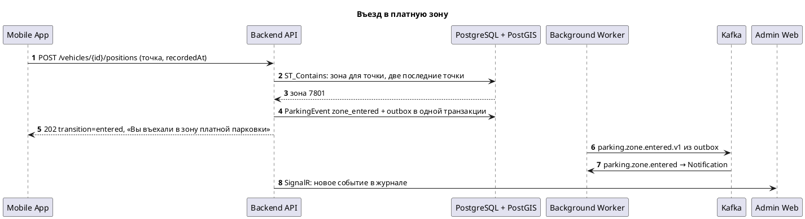
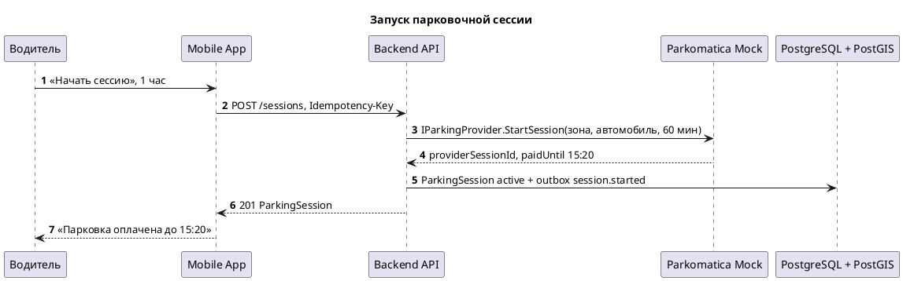
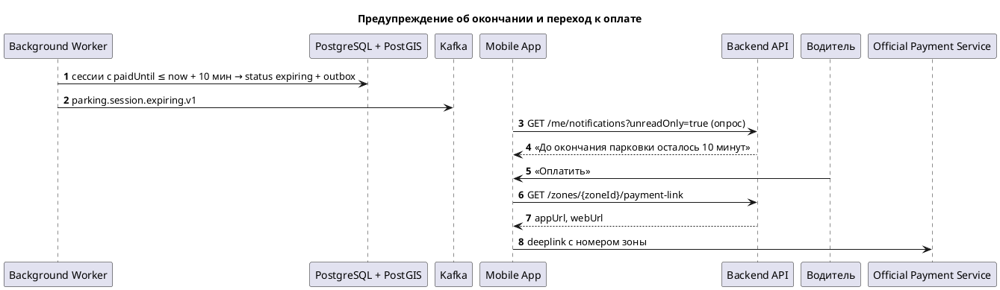
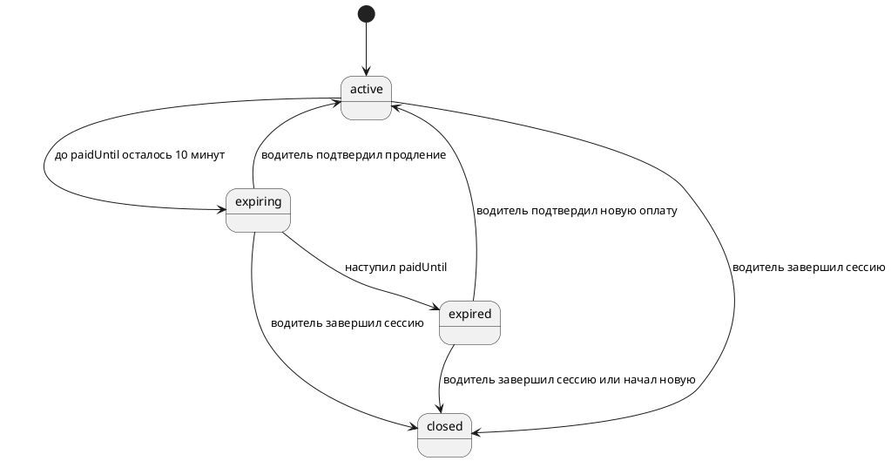
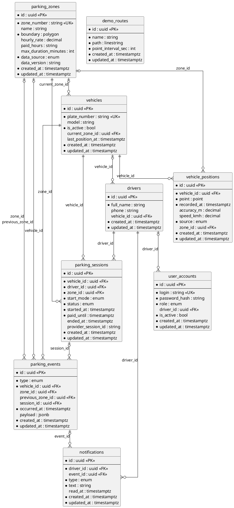

# ТЗ. Системный анализ: Помощник управления платными парковками Санкт-Петербурга

> Документ сформирован конвейером SpecForge по регламенту «Правила проектирования и ведения документации по системному анализу». Контракты: [`openapi.yaml`](contracts/openapi.yaml), [`asyncapi.yaml`](contracts/asyncapi.yaml), [`schema.sql`](contracts/schema.sql); методы API — в каталоге [`api-methods/`](api-methods/). Требования заказчика, выведенные требования и допущения системы разделены столбцом «Происхождение».

## 1 Оглавление

- 2 Общие положения
  - 2.1 История изменения
  - 2.2 Список ответственных лиц
  - 2.3 Лист согласования
  - 2.4 Общие сведения
    - 2.4.1 Термины и определения
    - 2.4.2 Используемые документы
    - 2.4.3 Общее описание изменений
    - 2.4.4 Цель доработки
    - 2.4.5 Условия и ограничения
    - 2.4.6 Критерии успеха, критерии приемки
  - 2.5 Сценарии использования (UseCase)
  - 2.6 Диаграммы
    - 2.6.1 Диаграммы последовательности UML
    - 2.6.2 Иные диаграммы
- 3 Функциональные требования
  - 3.1 Описание Frontend
    - 3.1.1 Спецификация на интерфейс пользователя
    - 3.1.2 Ссылки на макеты (Figma)
  - 3.2 Описание Backend
    - 3.2.1 Интерфейсы передачи информации
    - 3.2.2 Шаблон сервиса
    - 3.2.3 Модель данных. Описание БД
    - 3.2.4 Описание API
  - 3.3 Интеграции
    - 3.3.1 Внешние интеграции
    - 3.3.2 Внутренние интеграции
  - 3.4 Метрики
- 4 Нефункциональные требования
  - 4.1 Требования к безопасности
  - 4.2 Требования к производительности
  - 4.3 Требования к масштабируемости
  - 4.4 Требования к надежности
  - 4.5 Требования к сопровождению
- Приложение А. Допущения и открытые вопросы
- Приложение Б. Матрица трассируемости
- Приложение В. Соответствие разделам условия кейса

## 2 Общие положения

### 2.1 История изменения

| Версия | Ссылка на задачу Jira | Описание изменения | Автор | Дата |
| --- | --- | --- | --- | --- |
| 1.0 | — | Первичная версия по бизнес-требованиям `requirements.md` | SpecForge, агент системного анализа | 2026-10-31 |

### 2.2 Список ответственных лиц

| Роль | Структурное подразделение | ФИО |
| --- | --- | --- |
| Заказчик | — | — |
| Руководитель проекта | — | — |
| Разработчик ПО | — | — |
| Аналитик | — | SpecForge, агент системного анализа |

### 2.3 Лист согласования

Статус документа: **требуется согласование**.

| Роль | Статус | Комментарий | ФИО | Дата |
| --- | --- | --- | --- | --- |
| Заказчик | требуется согласование | — | — | — |
| Архитектор | требуется согласование | — | — | — |
| Сотрудник подразделения ИБ | требуется согласование | разделы 4.1 и 4.5 | — | — |

Матрица ответственных за согласование артефактов:

| Артефакт документации | Архитекторы | Product Owner | Системные аналитики | Разработка | Тестирование |
| --- | --- | --- | --- | --- | --- |
| Бизнес-требования | — | — | Согласование | — | — |
| Архитектура | Согласование | — | — | — | — |
| UseCase, варианты использования | — | Согласование | — | Согласование | Согласование |
| UI (макеты) | — | — | Согласование | — | — |

### 2.4 Общие сведения

#### 2.4.1 Термины и определения

| Термин | Определение |
| --- | --- |
| Парковочная зона | Территория платной парковки с номером, границами (полигон) и параметрами оплаты |
| Парковочная сессия | Период стоянки автомобиля в зоне от запуска или подтверждения до окончания оплаченного времени или закрытия |
| Оплачено до (paidUntil) | Момент окончания оплаченного периода сессии |
| Mock-маршрут | Заранее заданная последовательность координат, которую система проигрывает вместо реального GPS |
| Паркоматика | Внешний сервис парковок; в прототипе заменён mock-сервисом за адаптером |
| FR / NFR | функциональное / нефункциональное требование |
| BR | пункт бизнес-требований |
| UC | сценарий использования (UseCase) |
| AC | критерий приёмки |

#### 2.4.2 Используемые документы

| № | Наименование документа | Версия, дата | Ссылка или файл |
| --- | --- | --- | --- |
| 1 | Бизнес-требования | 2026-10-31 | `../01_requirements/normalized.md` (исходник `requirements.md`) |
| 2 | Описание архитектуры | 1.0 | раздел 2.6 и 3.2 настоящего документа |
| 3 | Роли и характеристика пользователей | 1.0 | раздел 3.1.1 настоящего документа |
| 4 | Связанные требования | 1.0 | `../01_requirements/requirements.md`, критерии приёмки `../01_requirements/acceptance/` |
| 5 | Контракты | 1.0 | `openapi.yaml`, `asyncapi.yaml`, `schema.sql` |

#### 2.4.3 Общее описание изменений

Система помогает водителям служебных автомобилей технических служб Санкт-Петербурга не пропускать оплату парковки. По координатам автомобиля она определяет платную зону, ведёт парковочную сессию, предупреждает об окончании оплаченного периода и о смене зоны и даёт переход к официальному сервису оплаты. Диспетчеры видят автомобили, зоны, сессии, маршруты и журнал событий в административном web-интерфейсе.

#### 2.4.4 Цель доработки

- GOAL-01: Снизить число повторных оплат, пропусков окончания сессии и штрафов за неоплаченную парковку служебных автомобилей
- GOAL-02: Автоматически определять нахождение автомобиля в зоне платной парковки и подсказывать водителю, требуется ли новая оплата
- GOAL-03: Дать руководителям служб прозрачность по автомобилям, парковочным сессиям, маршрутам и событиям

#### 2.4.5 Условия и ограничения

Входит в доработку:

- Мобильное Android-приложение водителя: карта, текущая зона, статус и таймер сессии, уведомления, переход к оплате
- Административный web-интерфейс диспетчера: автомобили, зоны, активные сессии, маршруты, журнал событий, история
- Backend: определение зоны по координатам, жизненный цикл парковочной сессии, журнал событий
- Загрузка границ и параметров зон из снимка открытых данных или демонстрационного набора
- Демонстрационный режим с проигрыванием mock-маршрута
- Адаптер поставщика парковочных услуг с mock-реализацией «Паркоматики»
- Модель событий в Kafka, документированный REST API, Docker-окружение и тестовые данные

Не входит в доработку:

- Реальная оплата парковки и промышленный доступ к внешним сервисам (CON-06)
- Собственный платёжный механизм (CON-07)
- Интеграция с корпоративным SSO — в прототипе собственные учётные записи (Q-01)
- Push-уведомления через FCM — уведомления доставляются опросом API и показываются локально
- Управление справочниками водителей и автомобилей через интерфейс — данные загружаются seed-скриптом
- Собственный платёжный механизм не разрабатывается (CON-08)

Бизнес- и системные ограничения:

| ID | Тип | Ограничение | Происхождение |
| --- | --- | --- | --- |
| CON-01 | technology | Мобильное приложение — Kotlin (Android) | заказчик |
| CON-02 | technology | Административный web-интерфейс — Angular | заказчик |
| CON-03 | technology | Backend — C# / ASP.NET Core | заказчик |
| CON-04 | technology | Хранилище — PostgreSQL с PostGIS | заказчик |
| CON-05 | technology | Запуск в Docker-окружении, сборка через CI/CD-пайплайн | заказчик |
| CON-06 | data | Решение поставляется с тестовыми данными | заказчик |
| CON-09 | integration | Внешний поставщик заменяем без изменения основной бизнес-логики | заказчик |

Допущения системы и вопросы к заказчику — в приложении А.

#### 2.4.6 Критерии успеха, критерии приемки

Definition of Done:

- реализованы все функциональные требования с приоритетом «обязательно» (раздел 3);
- выполняются все критерии приёмки (50 шт., исполняемые сценарии Gherkin в `../01_requirements/acceptance/`);
- API соответствует `openapi.yaml`, схема БД — `schema.sql`;
- выполнены требования раздела 4 к безопасности и надёжности;

| ID | FR | Тип | Дано | Когда | Тогда |
| --- | --- | --- | --- | --- | --- |
| AC-FR-1-01 | FR-1 | позитивный | водитель авторизован, за ним закреплён автомобиль А123ВС178 | приложение отправляет координату 59.9343, 30.3351 с временем фиксации и точностью 10 м | API отвечает 202; координата сохранена с vehicleId, recordedAt и accuracyM; последняя позиция автомобиля в административном интерфейсе обновлена |
| AC-FR-1-02 | FR-1 | негативный | водитель авторизован | приложение отправляет координату с широтой 95.0 | API отвечает 400 в формате application/problem+json с ошибкой по полю latitude; координата не сохранена |
| AC-FR-1-03 | FR-1 | граничный | связь с backend потеряна; приложение накопило 5 координат | связь восстановилась | все 5 координат сохранены в порядке recordedAt; повторная отправка тех же координат не создаёт дублей |
| AC-FR-2-01 | FR-2 | позитивный | загружена демо-зона 7801 с полигоном границ | поступают две подряд координаты внутри полигона зоны 7801 | текущая зона автомобиля — 7801 |
| AC-FR-2-02 | FR-2 | граничный | загружены демо-зоны 7801 и 7802 | поступает координата вне всех полигонов | текущая зона не определена; приложение показывает статус «Вне платной зоны» |
| AC-FR-3-01 | FR-3 | позитивный | текущая зона автомобиля — 7801 | водитель открывает главный экран | отображается номер зоны «7801»; полигон зоны 7801 нарисован на карте |
| AC-FR-3-02 | FR-3 | позитивный | диспетчер авторизован | диспетчер открывает раздел «Зоны» и выбирает зону 7801 | на карте показан полигон зоны 7801; в карточке показан номер зоны |
| AC-FR-4-01 | FR-4 | позитивный | у зоны 7801 заданы стоимость часа, часы платного режима и ограничение длительности | водитель открывает карточку зоны 7801 | отображаются стоимость часа, часы платного режима и ограничение длительности |
| AC-FR-4-02 | FR-4 | граничный | у зоны 7802 не задана стоимость часа | водитель открывает карточку зоны 7802 | вместо стоимости показано «нет данных», а не 0 |
| AC-FR-5-01 | FR-5 | позитивный | водитель подтвердил сессию в зоне 7801 с оплатой до 15:20 | приложение перезапущено и запрашивает активную сессию | API возвращает сессию с зоной 7801, startedAt, paidUntil 15:20 и статусом active |
| AC-FR-5-02 | FR-5 | негативный | у автомобиля есть активная сессия в зоне 7801 | запрашивается старт ещё одной сессии в зоне 7801 | API отвечает 409 в формате application/problem+json; у автомобиля по-прежнему одна активная сессия |
| AC-FR-6-01 | FR-6 | позитивный | mock-маршрут из 20 точек | маршрут полностью воспроизведён | в треке автомобиля 20 точек, упорядоченных по recordedAt |
| AC-FR-6-02 | FR-6 | негативный | водитель авторизован | приложение отправляет координату с recordedAt на 10 минут позже текущего времени сервера | API отвечает 400 с ошибкой по полю recordedAt; координата не попадает в трек |
| AC-FR-7-01 | FR-7 | позитивный | текущая зона автомобиля — 7801 | поступают две подряд координаты вне всех зон | публикуется событие zone_exited с зоной 7801; водителю показано уведомление «Вы покинули текущую парковочную зону» |
| AC-FR-7-02 | FR-7 | граничный | текущая зона автомобиля — 7801 | поступает одна координата вне зоны, а следующая снова внутри зоны 7801 | событие zone_exited не публикуется; уведомление о выходе не показывается |
| AC-FR-8-01 | FR-8 | позитивный | текущая зона автомобиля — 7801, есть активная сессия | поступают две подряд координаты внутри зоны 7802 | публикуется событие zone_changed из 7801 в 7802; водителю показано уведомление «Вы въехали в другую парковочную зону. Проверьте необходимость новой оплаты» |
| AC-FR-8-02 | FR-8 | граничный | зоны 7801 и 7802 смежные, текущая зона — 7801 | поступает координата на общей границе зон | текущей остаётся зона 7801; событие zone_changed не публикуется |
| AC-FR-9-01 | FR-9 | позитивный | активная сессия оплачена до 15:20 | наступает 15:10 | публикуется событие session_expiring; водителю показано уведомление «До окончания парковки осталось 10 минут» |
| AC-FR-9-02 | FR-9 | граничный | в 15:15 запущена сессия с оплатой до 15:20 | сессия создана | предупреждение «До окончания парковки осталось 5 минут» показано один раз сразу после старта |
| AC-FR-9-03 | FR-9 | граничный | активная сессия оплачена до 15:20 | наступает 15:20 | статус сессии меняется на expired; публикуется событие session_expired |
| AC-FR-10-01 | FR-10 | позитивный | сессия в зоне 7801 перешла в статус expired, автомобиль остаётся в зоне 7801 | водитель открывает приложение | показано уведомление о необходимости новой оплаты с кнопкой «Оплатить» |
| AC-FR-10-02 | FR-10 | негативный | уведомление по событию session_expiring уже показано | то же событие с тем же eventId доставлено повторно | второе уведомление не создаётся |
| AC-FR-11-01 | FR-11 | позитивный | текущая зона автомобиля — 7801; официальное приложение оплаты установлено | водитель нажимает «Оплатить» | открывается официальное приложение оплаты парковки с номером зоны 7801 |
| AC-FR-11-02 | FR-11 | граничный | текущая зона автомобиля — 7801; официальное приложение оплаты не установлено | водитель нажимает «Оплатить» | в браузере открывается веб-версия официального сервиса оплаты с номером зоны 7801 |
| AC-FR-11-03 | FR-11 | негативный | автомобиль вне платных зон | водитель открывает главный экран | кнопка «Оплатить» недоступна |
| AC-FR-12-01 | FR-12 | позитивный | за сегодня у автомобиля 3 завершённые сессии | водитель открывает раздел «История» за сегодня | показаны 3 сессии с зоной, началом, окончанием и статусом; маршрут за день нарисован на карте |
| AC-FR-12-02 | FR-12 | граничный | за выбранный период у автомобиля нет координат и сессий | водитель открывает историю за этот период | показано пустое состояние «Поездок за период нет» |
| AC-FR-13-01 | FR-13 | позитивный | автомобиль вне платных зон | поступают две подряд координаты внутри зоны 7801 | публикуется событие zone_entered с зоной 7801; водителю показано уведомление «Вы въехали в зону платной парковки» с номером 7801 |
| AC-FR-13-02 | FR-13 | негативный | автомобиль уже в зоне 7801, уведомление о въезде показано | поступают новые координаты внутри зоны 7801 | повторное уведомление о въезде не показывается |
| AC-FR-14-01 | FR-14 | позитивный | активная сессия с paidUntil 15:20 | водитель открывает главный экран | отображается текст «Парковка оплачена до 15:20» |
| AC-FR-14-02 | FR-14 | позитивный | активная сессия с paidUntil 15:20 | водитель подтверждает новую оплату до 16:20 | paidUntil сессии равен 16:20; отображается текст «Парковка оплачена до 16:20» |
| AC-FR-14-03 | FR-14 | негативный | текущее время 14:20 | водитель подтверждает оплату до 14:00 | API отвечает 422 с ошибкой по полю paidUntil; сессия не изменена |
| AC-FR-15-01 | FR-15 | позитивный | диспетчер авторизован; в системе есть автомобили, зоны, сессии и события из демо-данных | диспетчер по очереди открывает разделы «Автомобили», «Зоны», «Активные сессии», «Маршруты», «События», «История» | каждый раздел показывает данные, полученные от backend API |
| AC-FR-15-02 | FR-15 | негативный | пользователь с ролью «водитель» | он открывает административный интерфейс | API отвечает 403; показан экран «Нет доступа» |
| AC-FR-15-03 | FR-15 | граничный | активных сессий нет | диспетчер открывает раздел «Активные сессии» | показано пустое состояние «Активных сессий нет» |
| AC-FR-16-01 | FR-16 | позитивный | активная сессия в зоне 7801 до 15:20; текущее время 14:50 | водитель открывает приложение | на экране карта с позицией автомобиля, «Зона 7801», статус «Оплачено», оставшееся время «30 мин» и кнопка «Оплатить» |
| AC-FR-16-02 | FR-16 | граничный | связь с backend потеряна | водитель открывает приложение | показано последнее известное состояние с отметкой «Нет связи, данные на ЧЧ:ММ» |
| AC-FR-17-01 | FR-17 | позитивный | в конфигурации выбран поставщик mock | водитель запускает сессию | адаптер вызывает mock-сервис поставщика; у сессии сохранён providerSessionId |
| AC-FR-17-02 | FR-17 | негативный | mock-сервис поставщика остановлен | водитель запускает сессию | API отвечает 503 в формате application/problem+json; сессия не создаётся; водитель видит «Сервис поставщика недоступен, повторите позже» |
| AC-FR-17-03 | FR-17 | граничный | в конфигурации указан второй тестовый адаптер поставщика | выполняются интеграционные тесты парковочных сессий | тесты проходят без изменения кода доменного слоя |
| AC-FR-18-01 | FR-18 | позитивный | mock-маршрут проходит через зоны 7801 и 7802 | запускается воспроизведение маршрута с ускорением | координаты поступают в backend в порядке маршрута; в журнале появляются события zone_entered, zone_changed и zone_exited в порядке прохождения зон |
| AC-FR-18-02 | FR-18 | негативный | файл маршрута содержит меньше 2 точек | запускается воспроизведение | запуск отклонён с ошибкой валидации файла маршрута |
| AC-FR-19-01 | FR-19 | позитивный | автомобиль в зоне 7801, активной сессии нет; текущее время 14:20 | водитель нажимает «Начать сессию» и выбирает длительность 1 час | создана сессия со статусом active и paidUntil 15:20; публикуется событие session_started |
| AC-FR-19-02 | FR-19 | позитивный | водитель оплатил парковку в зоне 7801 вне системы до 15:20 | водитель нажимает «Подтвердить оплату» и указывает время 15:20 | создана сессия со статусом active и paidUntil 15:20 |
| AC-FR-19-03 | FR-19 | негативный | автомобиль вне платных зон | водитель нажимает «Начать сессию» | API отвечает 422; показано сообщение «Автомобиль не в платной зоне» |
| AC-FR-19-04 | FR-19 | граничный | запрос на старт сессии отправлен с заголовком Idempotency-Key | тот же запрос с тем же ключом отправлен повторно | возвращается та же сессия; в БД одна сессия |
| AC-FR-20-01 | FR-20 | позитивный | диспетчер открыл раздел «События» | воспроизводится демонстрационный маршрут | каждое событие сохраняется с типом, временем, автомобилем и зоной; новое событие появляется в разделе не позднее 5 секунд без перезагрузки страницы |
| AC-FR-20-02 | FR-20 | граничный | в журнале есть события двух автомобилей за два дня | диспетчер фильтрует по автомобилю А123ВС178 и сегодняшней дате | показаны только события автомобиля А123ВС178 за сегодня |
| AC-FR-21-01 | FR-21 | позитивный | файл GeoJSON с зонами 7801 и 7802 | система выполняет загрузку зон при старте | в БД 2 зоны с номерами и полигонами в SRID 4326 |
| AC-FR-21-02 | FR-21 | негативный | в файле GeoJSON у зоны 7803 самопересекающийся полигон | система выполняет загрузку зон | зона 7803 не загружена; в журнале загрузки ошибка с номером 7803; остальные зоны загружены |

### 2.5 Сценарии использования (UseCase)

#### UC_001. Сквозной демонстрационный сценарий

| Элемент | Описание |
| --- | --- |
| ID | UC_001 |
| Название | Сквозной демонстрационный сценарий |
| Акторы | Водитель; Система |
| Цель | Показать полный цикл: въезд, сессия, предупреждение, смена зоны, история |
| Требования | FR-18, FR-1, FR-2, FR-13, FR-19, FR-14, FR-9, FR-7, FR-8, FR-10, FR-20, FR-15 |

**Предусловия:**

- Загружены демо-зоны 7801 и 7802
- Водитель авторизован, за ним закреплён автомобиль А123ВС178
- Запущено воспроизведение mock-маршрута через зоны 7801 и 7802

**Основной поток:**

1. Автомобиль движется по заданному маршруту, приложение передаёт координаты в backend
2. Автомобиль въезжает в зону 7801
3. Система определяет зону 7801 и показывает уведомление «Вы въехали в зону платной парковки»
4. Водитель запускает сессию на 1 час в 14:20 или подтверждает оплаченную
5. Система показывает «Парковка оплачена до 15:20»
6. В 15:10 система показывает «До окончания парковки осталось 10 минут»
7. Автомобиль покидает зону 7801 или въезжает в зону 7802
8. Система показывает «Вы покинули текущую парковочную зону» или «Вы въехали в другую парковочную зону. Проверьте необходимость новой оплаты»
9. Все события видны в административном интерфейсе и сохранены в истории

**Альтернативные потоки:**

- AP1: Шаг 4: водитель не запускает сессию → система не создаёт сессию, через 5 минут после въезда повторяет напоминание один раз

**Исключения:**

- EX1: Шаг 1: нет связи с backend → приложение буферизует координаты и отправляет их после восстановления связи
- EX2: Шаг 4: mock-сервис поставщика недоступен → сессия не создаётся, водитель видит «Сервис поставщика недоступен, повторите позже»

**Постусловия:**

- Все события маршрута сохранены в журнале и видны в административном интерфейсе
- У автомобиля нет активной сессии в покинутой зоне без уведомления водителя

**Ожидаемый результат:** Водитель вовремя получил все пять типов уведомлений, диспетчер видит полную историю маршрута и сессии

#### UC_002. Въезд в платную зону

| Элемент | Описание |
| --- | --- |
| ID | UC_002 |
| Название | Въезд в платную зону |
| Акторы | Водитель; Система |
| Цель | Узнать, что автомобиль находится в платной зоне, и увидеть её параметры |
| Требования | FR-1, FR-2, FR-3, FR-4, FR-13 |

**Предусловия:**

- Водитель авторизован
- Приложению разрешён доступ к геолокации

**Основной поток:**

1. Приложение передаёт координаты автомобиля
2. Система по двум подряд точкам внутри полигона определяет зону 7801
3. Система публикует событие zone_entered
4. Приложение показывает уведомление «Вы въехали в зону платной парковки» с номером зоны
5. Водитель открывает карточку зоны и видит границы на карте, стоимость часа, часы платного режима и ограничение длительности

**Альтернативные потоки:**

- AP1: Шаг 2: точка лежит на границе зоны → зона не меняется до двух подряд точек внутри

**Исключения:**

- EX1: Шаг 1: доступ к геолокации запрещён → приложение показывает экран с просьбой выдать разрешение
- EX2: Шаг 5: у зоны нет параметров → показано «нет данных»

**Постусловия:**

- Текущая зона автомобиля сохранена
- Событие zone_entered записано в журнал

**Ожидаемый результат:** Водитель знает номер зоны, её границы и условия оплаты

#### UC_003. Запуск или подтверждение парковочной сессии

| Элемент | Описание |
| --- | --- |
| ID | UC_003 |
| Название | Запуск или подтверждение парковочной сессии |
| Акторы | Водитель; Система |
| Цель | Зафиксировать оплаченный период в зоне |
| Требования | FR-19, FR-5, FR-17, FR-14 |

**Предусловия:**

- Автомобиль находится в платной зоне
- Активной сессии в этой зоне нет

**Основной поток:**

1. Водитель нажимает «Начать сессию» или «Подтвердить оплату»
2. Водитель выбирает длительность или указывает время «оплачено до»
3. Backend через адаптер поставщика регистрирует сессию в mock-сервисе
4. Система сохраняет сессию со статусом active и paidUntil
5. Приложение показывает «Парковка оплачена до 15:20»

**Альтернативные потоки:**

- AP1: Шаг 1: повторное нажатие с тем же ключом идемпотентности → возвращается уже созданная сессия

**Исключения:**

- EX1: Шаг 1: автомобиль вне платной зоны → отказ «Автомобиль не в платной зоне»
- EX2: Шаг 3: поставщик недоступен → 503, сессия не создаётся
- EX3: Шаг 1: в зоне уже есть активная сессия → 409, показывается существующая

**Постусловия:**

- У автомобиля одна активная сессия в зоне с заданным paidUntil
- Событие session_started записано в журнал

**Ожидаемый результат:** Водитель видит «Парковка оплачена до ЧЧ:ММ» и оставшееся время

#### UC_004. Окончание оплаты и переход к оплате

| Элемент | Описание |
| --- | --- |
| ID | UC_004 |
| Название | Окончание оплаты и переход к оплате |
| Акторы | Водитель; Система |
| Цель | Не пропустить окончание оплаченного периода и продлить оплату |
| Требования | FR-9, FR-10, FR-11, FR-16 |

**Предусловия:**

- Есть активная сессия с paidUntil 15:20

**Основной поток:**

1. Главный экран показывает оставшееся время
2. В 15:10 система публикует session_expiring и показывает «До окончания парковки осталось 10 минут»
3. Водитель нажимает «Оплатить»
4. Открывается официальный сервис оплаты с номером зоны
5. После оплаты водитель подтверждает новое время окончания

**Альтернативные потоки:**

- AP1: Шаг 3: водитель не продлевает → в 15:20 статус expired и уведомление о необходимости новой оплаты

**Исключения:**

- EX1: Шаг 4: официальное приложение не установлено → открывается веб-версия сервиса в браузере
- EX2: Шаг 2: устройство было офлайн → предупреждение показывает локальный таймер устройства

**Постусловия:**

- Статус сессии отражает фактическое время оплаты: active после продления или expired

**Ожидаемый результат:** Водитель получил предупреждение за 10 минут и открыл сервис оплаты с номером зоны

#### UC_005. Выход из зоны и переход в другую зону

| Элемент | Описание |
| --- | --- |
| ID | UC_005 |
| Название | Выход из зоны и переход в другую зону |
| Акторы | Водитель; Система |
| Цель | Понять, нужна ли новая оплата после перемещения |
| Требования | FR-6, FR-7, FR-8, FR-10 |

**Предусловия:**

- Автомобиль находится в зоне 7801

**Основной поток:**

1. Система отслеживает поток координат
2. Две подряд точки вне всех зон → событие zone_exited и уведомление «Вы покинули текущую парковочную зону»
3. Две подряд точки внутри зоны 7802 → событие zone_changed и уведомление «Вы въехали в другую парковочную зону. Проверьте необходимость новой оплаты»

**Альтернативные потоки:**

- AP1: Шаг 2: одна точка вне зоны, следующая снова внутри → изменения нет, уведомления нет

**Исключения:**

- EX1: Шаг 1: точность координаты хуже 100 м → точка сохраняется, но не используется для определения зоны

**Постусловия:**

- Текущая зона автомобиля обновлена
- Событие zone_exited или zone_changed записано в журнал

**Ожидаемый результат:** Водитель получил уведомление о выходе или о необходимости проверить оплату в новой зоне

#### UC_006. Просмотр истории и маршрута

| Элемент | Описание |
| --- | --- |
| ID | UC_006 |
| Название | Просмотр истории и маршрута |
| Акторы | Водитель; Система |
| Цель | Посмотреть свои поездки и сессии за период |
| Требования | FR-12 |

**Предусловия:**

- Водитель авторизован

**Основной поток:**

1. Водитель открывает раздел «История»
2. Выбирает период (по умолчанию сегодня)
3. Система показывает список сессий и маршрут на карте

**Исключения:**

- EX1: Шаг 3: за период нет данных → пустое состояние «Поездок за период нет»

**Постусловия:**

- Данные не изменены

**Ожидаемый результат:** Водитель видит свои сессии и маршрут за выбранный период

#### UC_007. Мониторинг в административном интерфейсе

| Элемент | Описание |
| --- | --- |
| ID | UC_007 |
| Название | Мониторинг в административном интерфейсе |
| Акторы | Диспетчер; Система |
| Цель | Видеть автомобили, зоны, сессии, маршруты и события |
| Требования | FR-15, FR-20, FR-3, FR-12 |

**Предусловия:**

- Диспетчер авторизован в web-интерфейсе

**Основной поток:**

1. Диспетчер открывает раздел «Активные сессии»
2. Новые события появляются в журнале без перезагрузки страницы
3. Диспетчер выбирает автомобиль и открывает маршрут и историю сессий за период
4. Диспетчер открывает раздел «Зоны» и видит полигоны на карте

**Альтернативные потоки:**

- AP1: Шаг 3: фильтр по автомобилю и периоду

**Исключения:**

- EX1: Шаг 1: пользователь без роли диспетчера → экран «Нет доступа» (403)
- EX2: Шаг 2: потеряно соединение для обновлений → баннер «Обновления приостановлены» и автоматическое переподключение

**Постусловия:**

- Данные не изменены

**Ожидаемый результат:** Диспетчер видит актуальные сессии, события и маршруты без перезагрузки страницы

#### UC_008. Подготовка геоданных и демонстрационного маршрута

| Элемент | Описание |
| --- | --- |
| ID | UC_008 |
| Название | Подготовка геоданных и демонстрационного маршрута |
| Акторы | Диспетчер; Система |
| Цель | Загрузить зоны и запустить демо-маршрут |
| Требования | FR-21, FR-18 |

**Предусловия:**

- Система развёрнута, есть файл зон GeoJSON и файл маршрута

**Основной поток:**

1. При запуске системы загружаются зоны из файла GeoJSON
2. Диспетчер запускает воспроизведение mock-маршрута для автомобиля
3. Координаты поступают в backend так же, как от реального GPS

**Альтернативные потоки:**

- AP1: Шаг 2: воспроизведение с ускорением времени для демонстрации

**Исключения:**

- EX1: Шаг 1: невалидный полигон → зона пропускается, ошибка в журнале загрузки
- EX2: Шаг 2: файл маршрута невалиден → запуск отклонён с ошибкой валидации

**Постусловия:**

- Зоны загружены в БД, невалидные зоны перечислены в журнале загрузки
- Координаты маршрута поступают в обработку

**Ожидаемый результат:** Система готова к демонстрации на актуальных зонах

### 2.6 Диаграммы

#### 2.6.1 Диаграммы последовательности UML

Въезд в платную зону (UC_002):

Запуск парковочной сессии (UC_003):

Предупреждение об окончании и переход к оплате (UC_004):

#### 2.6.2 Иные диаграммы

Диаграмма компонентов:

```plantuml
@startuml
left to right direction
skinparam componentStyle rectangle
actor "Водитель" as role_driver
actor "Диспетчер" as role_dispatcher
component "Mobile App\n[Kotlin 2.2, Jetpack Compose, Material 3]" as Mobile_App
component "Admin Web\n[Angular 20, UI Kit, MapLibre]" as Admin_Web
component "Backend API\n[ASP.NET Core 10, C# 14, EF Core + NetTopologySuite, SignalR]" as Backend_API
component "Background Worker\n[.NET 10 BackgroundService]" as Background_Worker
database "PostgreSQL + PostGIS\n[PostgreSQL 17.9, PostGIS]" as PostgreSQL___PostGIS
queue "Kafka\n[Apache Kafka]" as Kafka
component "Parkomatica Mock\n[ASP.NET Core minimal API]" as Parkomatica_Mock <<mock>>
cloud "Official Payment Service\n[Сайт и приложения «Парковки Санкт-Петербурга» / «Парковки России»]" as Official_Payment_Service
role_driver --> Mobile_App
role_dispatcher --> Admin_Web
Backend_API --> Kafka : публикует события
Kafka --> Background_Worker : события
Kafka --> Backend_API : события
Background_Worker --> Kafka : публикует события
Mobile_App --> Backend_API : REST /api/v1, HTTPS + JWT
Admin_Web --> Backend_API : REST /api/v1 + обновления в реальном времени
Backend_API --> PostgreSQL___PostGIS : SQL
Background_Worker --> PostgreSQL___PostGIS : SQL
Backend_API --> Parkomatica_Mock : адаптер, REST
Mobile_App --> Official_Payment_Service : deeplink / ссылка
@enduml
```

Диаграмма состояний ParkingSession.status:

## 3 Функциональные требования

Функции пронумерованы FR-n; столбец BR — трассировка к пунктам бизнес-требований (полная матрица — приложение Б). Формат описания — to be (будущая реализация).

| FR | Требование | BR | Приоритет | Происхождение | API / события | Критерии |
| --- | --- | --- | --- | --- | --- | --- |
| FR-1 | **Определение местоположения автомобиля.** Система должна получать координаты служебного автомобиля от мобильного приложения (GPS или демонстрационный маршрут) и сохранять их с временем фиксации | BR-4 | обязательно | заказчик | POST /api/v1/vehicles/{vehicleId}/positions | AC-FR-1-01, AC-FR-1-02, AC-FR-1-03 |
| FR-2 | **Определение нахождения в платной зоне.** Система должна по последней координате определять, находится ли автомобиль внутри границ платной парковочной зоны, и какой именно | BR-5 | обязательно | заказчик | POST /api/v1/vehicles/{vehicleId}/positions; parking.zone.entered | AC-FR-2-01, AC-FR-2-02 |
| FR-3 | **Отображение номера и границ зоны.** Система должна показывать номер текущей зоны и её границы на карте | BR-6 | обязательно | заказчик | GET /api/v1/me/status; GET /api/v1/zones; GET /api/v1/zones/{zoneId} | AC-FR-3-01, AC-FR-3-02 |
| FR-4 | **Отображение параметров парковки.** Система должна отображать параметры парковки в зоне: стоимость часа, часы платного режима и ограничения по длительности | BR-7 | обязательно | заказчик | GET /api/v1/zones; GET /api/v1/zones/{zoneId} | AC-FR-4-01, AC-FR-4-02 |
| FR-5 | **Хранение активной парковочной сессии.** Система должна хранить активную парковочную сессию автомобиля: зону, время начала, время окончания оплаты, статус и идентификатор сессии у поставщика | BR-8 | обязательно | заказчик | POST /api/v1/sessions; GET /api/v1/vehicles/{vehicleId}/sessions/active; PATCH /api/v1/sessions/{sessionId}; parking.session.closed | AC-FR-5-01, AC-FR-5-02 |
| FR-6 | **Отслеживание перемещения.** Система должна отслеживать перемещение автомобиля по последовательности координат в течение рабочего дня | BR-9 | обязательно | заказчик | POST /api/v1/vehicles/{vehicleId}/positions; GET /api/v1/vehicles/{vehicleId}/route | AC-FR-6-01, AC-FR-6-02 |
| FR-7 | **Определение выхода из зоны.** Система должна определять выход автомобиля из текущей парковочной зоны и уведомлять водителя | BR-10 | обязательно | заказчик | POST /api/v1/vehicles/{vehicleId}/positions; GET /api/v1/me/notifications; parking.zone.exited | AC-FR-7-01, AC-FR-7-02 |
| FR-8 | **Определение перехода в другую зону.** Система должна определять переход автомобиля из одной платной зоны в другую и уведомлять водителя о необходимости проверить оплату | BR-11 | обязательно | заказчик | POST /api/v1/vehicles/{vehicleId}/positions; GET /api/v1/me/notifications; parking.zone.changed | AC-FR-8-01, AC-FR-8-02 |
| FR-9 | **Контроль окончания оплаченной сессии.** Система должна контролировать время окончания оплаченного периода активной сессии и за 10 минут до окончания предупреждать водителя | BR-12 | обязательно | заказчик | GET /api/v1/me/status; GET /api/v1/me/notifications; parking.session.expiring; parking.session.expired | AC-FR-9-01, AC-FR-9-02, AC-FR-9-03 |
| FR-10 | **Предупреждение о проверке или новой оплате.** Система должна предупреждать водителя о необходимости проверить оплату или оплатить заново при смене зоны и при истечении оплаченного периода | BR-13 | обязательно | заказчик | POST /api/v1/sessions/{sessionId}/extensions; GET /api/v1/me/notifications; parking.zone.changed; parking.session.expired | AC-FR-10-01, AC-FR-10-02 |
| FR-11 | **Переход к официальному сервису оплаты.** Система должна по действию водителя открывать официальный сервис или приложение оплаты парковки с переданным номером зоны | BR-14 | обязательно | заказчик | GET /api/v1/zones/{zoneId}/payment-link | AC-FR-11-01, AC-FR-11-02, AC-FR-11-03 |
| FR-12 | **Маршрут и история парковочных сессий.** Система должна отображать маршрут автомобиля за выбранный период и историю его парковочных сессий | BR-15 | обязательно | заказчик | GET /api/v1/vehicles/{vehicleId}/route; GET /api/v1/sessions | AC-FR-12-01, AC-FR-12-02 |
| FR-13 | **Уведомление о въезде в платную зону.** Система должна при въезде автомобиля в платную зону показывать водителю уведомление «Вы въехали в зону платной парковки» с номером зоны | BR-17 | обязательно | заказчик | POST /api/v1/vehicles/{vehicleId}/positions; GET /api/v1/me/notifications; parking.zone.entered | AC-FR-13-01, AC-FR-13-02 |
| FR-14 | **Отображение времени окончания оплаты.** Система должна показывать водителю время окончания оплаченного периода в формате «Парковка оплачена до ЧЧ:ММ» | BR-18 | обязательно | заказчик | GET /api/v1/me/status; POST /api/v1/sessions; POST /api/v1/sessions/{sessionId}/extensions; parking.session.extended | AC-FR-14-01, AC-FR-14-02, AC-FR-14-03 |
| FR-15 | **Административный просмотр данных.** Административный web-интерфейс должен позволять просматривать автомобили, парковочные зоны, активные сессии, маршруты, события и историю | BR-30 | обязательно | заказчик | POST /api/v1/auth/tokens; GET /api/v1/vehicles/{vehicleId}/route; GET /api/v1/vehicles; GET /api/v1/zones; GET /api/v1/sessions; GET /api/v1/events | AC-FR-15-01, AC-FR-15-02, AC-FR-15-03 |
| FR-16 | **Главный экран мобильного приложения.** Мобильное приложение должно показывать карту, текущую зону, статус сессии, оставшееся время, уведомления и действие перехода к оплате | BR-30 | обязательно | заказчик | POST /api/v1/auth/tokens; GET /api/v1/me/status; PATCH /api/v1/me/notifications/{notificationId} | AC-FR-16-01, AC-FR-16-02 |
| FR-17 | **Адаптер поставщика парковочных услуг.** Система должна работать с поставщиком парковочных услуг через адаптер с mock-реализацией, чтобы поставщика можно было заменить без изменения бизнес-логики | BR-36 | обязательно | заказчик | POST /api/v1/sessions | AC-FR-17-01, AC-FR-17-02, AC-FR-17-03 |
| FR-18 | **Демонстрационный маршрут.** Система должна поддерживать демонстрационный режим, в котором координаты автомобиля поступают из заданного mock-маршрута вместо реального GPS | BR-37 | обязательно | заказчик | GET /api/v1/demo/routes; POST /api/v1/demo/routes/{routeId}/runs | AC-FR-18-01, AC-FR-18-02 |
| FR-19 | **Запуск и подтверждение сессии.** Система должна позволять водителю запустить новую парковочную сессию в текущей зоне или подтвердить уже оплаченную | BR-40 | обязательно | заказчик | POST /api/v1/sessions; parking.session.started | AC-FR-19-01, AC-FR-19-02, AC-FR-19-03, AC-FR-19-04 |
| FR-20 | **Журнал событий.** Система должна сохранять события (въезд, выход, смена зоны, старт, предупреждение и окончание сессии) в истории и показывать их в административном интерфейсе | BR-45 | обязательно | заказчик | GET /api/v1/events; parking.zone.entered; parking.zone.exited; parking.zone.changed; parking.session.started; parking.session.extended; parking.session.expiring; parking.session.expired; parking.session.closed | AC-FR-20-01, AC-FR-20-02 |
| FR-21 | **Загрузка геоданных парковочных зон.** Система должна загружать границы и параметры парковочных зон из набора геоданных (снимок открытых данных Санкт-Петербурга или демонстрационный набор) | — | обязательно | выведено | POST /api/v1/zone-imports | AC-FR-21-01, AC-FR-21-02 |

### 3.1 Описание Frontend

#### 3.1.1 Спецификация на интерфейс пользователя

Клиентские приложения и роли:

| Приложение | Технология | Назначение |
| --- | --- | --- |
| Mobile App | Kotlin 2.2, Jetpack Compose, Material 3 | Карта, текущая зона, статус и таймер сессии, уведомления, передача координат, переход к оплате |
| Admin Web | Angular 20, UI Kit, MapLibre | Просмотр автомобилей, зон, сессий, маршрутов, журнала событий; загрузка зон; запуск демо-маршрута |

| Роль | Описание | Доступные методы BE |
| --- | --- | --- |
| Водитель | Сотрудник технической службы, управляющий служебным автомобилем; пользуется мобильным приложением | `GET /api/v1/me/status`, `POST /api/v1/vehicles/{vehicleId}/positions`, `GET /api/v1/vehicles/{vehicleId}/route`, `GET /api/v1/zones`, `GET /api/v1/zones/{zoneId}`, `GET /api/v1/zones/{zoneId}/payment-link`, `POST /api/v1/sessions`, `GET /api/v1/vehicles/{vehicleId}/sessions/active`, `POST /api/v1/sessions/{sessionId}/extensions`, `PATCH /api/v1/sessions/{sessionId}`, `GET /api/v1/sessions`, `GET /api/v1/me/notifications`, `PATCH /api/v1/me/notifications/{notificationId}` |
| Диспетчер | Сотрудник, который через административный web-интерфейс просматривает автомобили, зоны, сессии, маршруты и события | `GET /api/v1/vehicles/{vehicleId}/route`, `GET /api/v1/vehicles`, `GET /api/v1/zones`, `GET /api/v1/zones/{zoneId}`, `POST /api/v1/zone-imports`, `GET /api/v1/vehicles/{vehicleId}/sessions/active`, `GET /api/v1/sessions`, `GET /api/v1/events`, `GET /api/v1/demo/routes`, `POST /api/v1/demo/routes/{routeId}/runs` |

Формы ввода: элементы интерфейса, маппинг на поля метода BE и колонки БД, обязательность и формат ввода. Экранные формы (таблица «ЭФ — изображение — описание») формирует этап проектирования интерфейса (`artifacts/03_ux`) и включает в документацию.

Форма «Выдать JWT по логину и паролю» → `POST /api/v1/auth/tokens`:

| Поле формы | Элемент UI | Обязательность | Формат ввода / regex | Поле API | Поле БД |
| --- | --- | --- | --- | --- | --- |
| логин | input text | required | до 50 симв.; `^[a-z0-9._-]{3,50}$`; уникально | `login` | `user_accounts.login` |
| пароль | input password | required | до 128 симв. | `password` | — |

Форма «Передать координату автомобиля; ответ содержит определённую зону и переход» → `POST /api/v1/vehicles/{vehicleId}/positions`:

| Поле формы | Элемент UI | Обязательность | Формат ввода / regex | Поле API | Поле БД |
| --- | --- | --- | --- | --- | --- |
| координата | карта / геолокация устройства | required | ПДн | `point` | `vehicle_positions.point` |
| время фиксации на устройстве | input datetime-local | required | — | `recordedAt` | `vehicle_positions.recorded_at` |
| точность, м | input number | нет | ≥ 0; ≤ 10000 | `accuracyM` | `vehicle_positions.accuracy_m` |
| скорость, км/ч | input number | нет | ≥ 0; ≤ 300 | `speedKmh` | `vehicle_positions.speed_kmh` |
| источник координаты | select / radio | required | `gps`, `mock` | `source` | `vehicle_positions.source` |

Форма «Загрузить зоны из GeoJSON (снимок открытых данных или демо-набор)» → `POST /api/v1/zone-imports`:

| Поле формы | Элемент UI | Обязательность | Формат ввода / regex | Поле API | Поле БД |
| --- | --- | --- | --- | --- | --- |
| источник геоданных | select / radio | required | `open_data`, `demo` | `dataSource` | `parking_zones.data_source` |
| версия или дата снимка данных | input text | нет | до 50 симв. | `dataVersion` | `parking_zones.data_version` |
| GeoJSON FeatureCollection зон | input file (JSON) | required | — | `featureCollection` | — |

Форма «Запустить новую сессию или подтвердить оплаченную» → `POST /api/v1/sessions`:

| Поле формы | Элемент UI | Обязательность | Формат ввода / regex | Поле API | Поле БД |
| --- | --- | --- | --- | --- | --- |
| автомобиль | select (выбор из списка) | required | → Vehicle | `vehicleId` | `parking_sessions.vehicle_id` |
| зона | select (выбор из списка) | required | → ParkingZone | `zoneId` | `parking_sessions.zone_id` |
| запущена в системе или подтверждена оплаченная | select / radio | required | `started`, `confirmed` | `startMode` | `parking_sessions.start_mode` |
| длительность для режима started | input number | нет | ≥ 15; ≤ 1440 | `durationMinutes` | — |
| оплачено до, для режима confirmed | input datetime-local | нет | — | `confirmedPaidUntil` | — |

Форма «Подтвердить продление оплаты» → `POST /api/v1/sessions/{sessionId}/extensions`:

| Поле формы | Элемент UI | Обязательность | Формат ввода / regex | Поле API | Поле БД |
| --- | --- | --- | --- | --- | --- |
| новое время окончания оплаты | input datetime-local | required | — | `paidUntil` | — |

Форма «Завершить сессию (status = closed)» → `PATCH /api/v1/sessions/{sessionId}`:

| Поле формы | Элемент UI | Обязательность | Формат ввода / regex | Поле API | Поле БД |
| --- | --- | --- | --- | --- | --- |
| новый статус | select / radio | required | `closed` | `status` | — |

Форма «Отметить уведомление прочитанным» → `PATCH /api/v1/me/notifications/{notificationId}`:

| Поле формы | Элемент UI | Обязательность | Формат ввода / regex | Поле API | Поле БД |
| --- | --- | --- | --- | --- | --- |
| true — прочитано | checkbox | required | — | `isRead` | — |

Форма «Запустить проигрывание маршрута для автомобиля» → `POST /api/v1/demo/routes/{routeId}/runs`:

| Поле формы | Элемент UI | Обязательность | Формат ввода / regex | Поле API | Поле БД |
| --- | --- | --- | --- | --- | --- |
| автомобиль | select (выбор из списка) | required | — | `vehicleId` | — |
| ускорение времени | input number | нет | ≥ 1; ≤ 100 | `speedFactor` | — |

Тексты ошибок для пользователя приходят с BE в поле `title` ответа problem+json; если BE вернул нечитаемую ошибку (5xx, сеть), интерфейс показывает «Что-то пошло не так, попробуйте ещё раз». Все тексты экранов по возможности возвращает BE.

| Код ошибки | Сообщение пользователю | Когда |
| --- | --- | --- |
| `invalid_credentials` | Неверный логин или пароль | вход с неверными учётными данными |
| `vehicle_not_assigned` | Автомобиль не закреплён за вами | водитель обращается к данным чужого автомобиля |
| `vehicle_not_in_paid_zone` | Автомобиль не в платной зоне | запуск сессии, когда текущая зона не определена |
| `session_already_active` | В этой зоне уже есть активная сессия | повторный запуск сессии в той же зоне |
| `paid_until_in_past` | Время окончания оплаты уже прошло | подтверждение или продление с paidUntil раньше текущего времени |
| `session_not_active` | Сессия уже завершена | продление или закрытие закрытой сессии |
| `position_from_future` | Время координаты в будущем | recordedAt позже текущего времени сервера более чем на 5 минут |
| `external_provider_error` | Сервис поставщика недоступен, повторите позже | адаптер поставщика не получил ответ |
| `invalid_zone_geometry` | Некорректные границы зоны | при загрузке зон полигон невалиден |
| `invalid_demo_route` | Некорректный маршрут | в маршруте меньше двух точек |
| `demo_route_running` | Для автомобиля уже проигрывается маршрут | повторный запуск проигрывания |

#### 3.1.2 Ссылки на макеты (Figma)

Неприменимо: макеты в Figma не создаются — интерфейс строится на выбранном UI Kit, скриншоты экранных форм прикладываются в документации этапа UX.

### 3.2 Описание Backend

#### 3.2.1 Интерфейсы передачи информации

- Мобильное приложение и web-интерфейс ↔ Backend API: REST, JSON (UTF-8), HTTPS (TLS 1.2+), HTTP/1.1, синхронный запрос-ответ, JWT в заголовке Authorization
- Мобильное приложение передаёт координаты раз в 10 секунд в движении и раз в 60 секунд на стоянке; при потере связи буферизует и досылает в порядке recordedAt
- Backend API → Admin Web: SignalR (WebSocket) для новых событий журнала, переподключение автоматическое
- Компоненты backend между собой: события в Kafka в формате JSON-конверта с eventId и версией, доставка at-least-once через transactional outbox
- Backend API ↔ поставщик парковочных услуг: REST через адаптер IParkingProvider, таймаут 5 секунд, без повторов для операций создания

#### 3.2.2 Шаблон сервиса

Паспорт каждого сервиса оформляется по «Шаблону описания сервисов» и формируется на этапе документации (`09_docs/docs/services/`).

| Сервис | Тип | Технология | Ответственность |
| --- | --- | --- | --- |
| Backend API | backend | ASP.NET Core 10, C# 14, EF Core + NetTopologySuite, SignalR | REST API, определение зоны, жизненный цикл сессий, outbox событий, push обновлений в Admin Web |
| Background Worker | worker | .NET 10 BackgroundService | Таймеры сессий (expiring/expired), публикация outbox в Kafka, создание уведомлений, проигрывание демо-маршрутов |
| Parkomatica Mock | mock | ASP.NET Core minimal API | Имитация API поставщика парковочных сессий за адаптером IParkingProvider |

#### 3.2.3 Модель данных. Описание БД

СУБД: PostgreSQL 17 + PostGIS, SRID 4326. Имена таблиц и полей — snake_case (например `order_id`), таблицы во множественном числе. Физическая схема — [`schema.sql`](contracts/schema.sql).

Таблица `user_accounts` (UserAccount) — Учётная запись пользователя системы

| Поле | Тип | Обязательность | Ключ | Ограничения | Описание |
| --- | --- | --- | --- | --- | --- |
| `id` | uuid | да | PK | — | — |
| `login` | string | да | UK | до 50 симв.; `^[a-z0-9._-]{3,50}$`; уникально | логин |
| `password_hash` | string | да | — | до 200 симв. | хэш пароля (PBKDF2/bcrypt) (только БД) |
| `role` | enum | да | — | `driver`, `dispatcher` | роль |
| `driver_id` | uuid | нет | FK → drivers | → Driver | профиль водителя для роли driver |
| `is_active` | bool | да | — | — | учётная запись активна |
| `created_at` | datetime | да | — | — | время создания |
| `updated_at` | datetime | да | — | — | время изменения |

Таблица `drivers` (Driver) — Водитель служебного автомобиля

| Поле | Тип | Обязательность | Ключ | Ограничения | Описание |
| --- | --- | --- | --- | --- | --- |
| `id` | uuid | да | PK | — | — |
| `full_name` | string | да | — | до 150 симв.; ПДн | ФИО |
| `phone` | string | нет | — | до 12 симв.; `^\+7\d{10}$`; ПДн | телефон в формате +7XXXXXXXXXX |
| `vehicle_id` | uuid | нет | FK → vehicles | → Vehicle | закреплённый автомобиль |
| `created_at` | datetime | да | — | — | время создания |
| `updated_at` | datetime | да | — | — | время изменения |

Таблица `vehicles` (Vehicle) — Служебный автомобиль

| Поле | Тип | Обязательность | Ключ | Ограничения | Описание |
| --- | --- | --- | --- | --- | --- |
| `id` | uuid | да | PK | — | — |
| `plate_number` | string | да | UK | до 9 симв.; `^[АВЕКМНОРСТУХ]\d{3}[АВЕКМНОРСТУХ]{2}\d{2,3}$`; уникально | госномер, например А123ВС178 |
| `model` | string | нет | — | до 100 симв. | марка и модель |
| `is_active` | bool | да | — | — | в эксплуатации |
| `current_zone_id` | uuid | нет | FK → parking_zones | → ParkingZone | текущая платная зона по последним координатам |
| `last_position_at` | datetime | нет | — | — | время последней координаты |
| `created_at` | datetime | да | — | — | время создания |
| `updated_at` | datetime | да | — | — | время изменения |

Таблица `parking_zones` (ParkingZone) — Зона платной парковки

| Поле | Тип | Обязательность | Ключ | Ограничения | Описание |
| --- | --- | --- | --- | --- | --- |
| `id` | uuid | да | PK | — | — |
| `zone_number` | string | да | UK | до 4 симв.; `^\d{4}$`; уникально | номер зоны |
| `name` | string | нет | — | до 200 симв. | название или адресный ориентир |
| `boundary` | polygon | да | — | — | границы зоны |
| `hourly_rate` | decimal | нет | — | ≥ 0; ≤ 10000 | стоимость часа, руб. |
| `paid_hours` | string | нет | — | до 100 симв. | часы платного режима, например «пн–пт 08:00–20:00» |
| `max_duration_minutes` | int | нет | — | ≥ 1; ≤ 1440 | ограничение длительности стоянки |
| `data_source` | enum | да | — | `open_data`, `demo` | источник геоданных |
| `data_version` | string | нет | — | до 50 симв. | версия или дата снимка данных |
| `created_at` | datetime | да | — | — | время создания |
| `updated_at` | datetime | да | — | — | время изменения |

Таблица `vehicle_positions` (VehiclePosition) — Отметка местоположения автомобиля

| Поле | Тип | Обязательность | Ключ | Ограничения | Описание |
| --- | --- | --- | --- | --- | --- |
| `id` | uuid | да | PK | — | — |
| `vehicle_id` | uuid | да | FK → vehicles | → Vehicle | автомобиль (из пути запроса) |
| `point` | point | да | — | ПДн | координата |
| `recorded_at` | datetime | да | — | — | время фиксации на устройстве |
| `accuracy_m` | decimal | нет | — | ≥ 0; ≤ 10000 | точность, м |
| `speed_kmh` | decimal | нет | — | ≥ 0; ≤ 300 | скорость, км/ч |
| `source` | enum | да | — | `gps`, `mock` | источник координаты |
| `zone_id` | uuid | нет | FK → parking_zones | → ParkingZone | зона, вычисленная для точки |
| `created_at` | datetime | да | — | — | время создания |
| `updated_at` | datetime | да | — | — | время изменения |

Таблица `parking_sessions` (ParkingSession) — Парковочная сессия автомобиля в зоне

| Поле | Тип | Обязательность | Ключ | Ограничения | Описание |
| --- | --- | --- | --- | --- | --- |
| `id` | uuid | да | PK | — | — |
| `vehicle_id` | uuid | да | FK → vehicles | → Vehicle | автомобиль |
| `driver_id` | uuid | да | FK → drivers | → Driver | водитель (из токена) |
| `zone_id` | uuid | да | FK → parking_zones | → ParkingZone | зона |
| `start_mode` | enum | да | — | `started`, `confirmed` | запущена в системе или подтверждена оплаченная |
| `status` | enum | да | — | `active`, `expiring`, `expired`, `closed` | статус |
| `started_at` | datetime | да | — | — | начало |
| `paid_until` | datetime | да | — | — | оплачено до |
| `ended_at` | datetime | нет | — | — | фактическое завершение |
| `provider_session_id` | string | нет | — | до 100 симв. | идентификатор сессии у поставщика |
| `created_at` | datetime | да | — | — | время создания |
| `updated_at` | datetime | да | — | — | время изменения |

Таблица `parking_events` (ParkingEvent) — Событие жизненного цикла: въезд, выход, смена зоны, этапы сессии

| Поле | Тип | Обязательность | Ключ | Ограничения | Описание |
| --- | --- | --- | --- | --- | --- |
| `id` | uuid | да | PK | — | — |
| `type` | enum | да | — | `zone_entered`, `zone_exited`, `zone_changed`, `session_started`, `session_extended`, `session_expiring`, `session_expired`, `session_closed` | тип события |
| `vehicle_id` | uuid | да | FK → vehicles | → Vehicle | автомобиль |
| `zone_id` | uuid | нет | FK → parking_zones | → ParkingZone | зона |
| `previous_zone_id` | uuid | нет | FK → parking_zones | → ParkingZone | предыдущая зона для zone_changed |
| `session_id` | uuid | нет | FK → parking_sessions | → ParkingSession | сессия |
| `occurred_at` | datetime | да | — | — | время события |
| `payload` | json | нет | — | — | детали |
| `created_at` | datetime | да | — | — | время создания |
| `updated_at` | datetime | да | — | — | время изменения |

Таблица `notifications` (Notification) — Уведомление водителю

| Поле | Тип | Обязательность | Ключ | Ограничения | Описание |
| --- | --- | --- | --- | --- | --- |
| `id` | uuid | да | PK | — | — |
| `driver_id` | uuid | да | FK → drivers | → Driver | получатель |
| `event_id` | uuid | нет | FK → parking_events | уникально; → ParkingEvent | событие-основание, одно уведомление на событие |
| `type` | enum | да | — | `zone_entered`, `zone_exited`, `zone_changed`, `session_paid_until`, `session_expiring`, `payment_required` | тип уведомления |
| `text` | string | да | — | до 300 симв. | текст, например «Вы въехали в зону платной парковки» |
| `read_at` | datetime | нет | — | — | прочитано |
| `created_at` | datetime | да | — | — | время создания |
| `updated_at` | datetime | да | — | — | время изменения |

Таблица `demo_routes` (DemoRoute) — Демонстрационный mock-маршрут

| Поле | Тип | Обязательность | Ключ | Ограничения | Описание |
| --- | --- | --- | --- | --- | --- |
| `id` | uuid | да | PK | — | — |
| `name` | string | да | — | до 100 симв. | название маршрута |
| `path` | linestring | да | — | — | точки маршрута |
| `point_interval_sec` | int | да | — | ≥ 1; ≤ 60 | интервал между точками в реальном времени, с |
| `created_at` | datetime | да | — | — | время создания |
| `updated_at` | datetime | да | — | — | время изменения |

#### 3.2.4 Описание API

Общие положения: Security Scheme — HTTP Bearer (JWT); транспорт — HTTPS, HTTP/1.1; схема взаимодействия — синхронный запрос-ответ; версия в пути `/api/v1`; пути содержат только существительные, действие задаёт HTTP-метод; ошибки — RFC 9457; критичные операции — заголовок `Idempotency-Key`; превышение лимита — 429. Каждый метод описан на отдельной странице по шаблону API.

| Метод | Назначение | Роли | FR | Успех | Страница метода |
| --- | --- | --- | --- | --- | --- |
| `POST /api/v1/auth/tokens` | Выдать JWT по логину и паролю | anonymous | FR-15, FR-16 | 200 | [createToken](api-methods/createToken.md) |
| `GET /api/v1/me/status` | Состояние для главного экрана водителя: зона, сессия, оставшееся время | driver | FR-3, FR-9, FR-14, FR-16 | 200 | [getMyStatus](api-methods/getMyStatus.md) |
| `POST /api/v1/vehicles/{vehicleId}/positions` | Передать координату автомобиля; ответ содержит определённую зону и переход | driver | FR-1, FR-2, FR-6, FR-7, FR-8, FR-13 | 202 | [submitPosition](api-methods/submitPosition.md) |
| `GET /api/v1/vehicles/{vehicleId}/route` | Маршрут автомобиля за период | driver, dispatcher | FR-6, FR-12, FR-15 | 200 | [getRoute](api-methods/getRoute.md) |
| `GET /api/v1/vehicles` | Список автомобилей с текущей зоной | dispatcher | FR-15 | 200 | [listVehicles](api-methods/listVehicles.md) |
| `GET /api/v1/zones` | Парковочные зоны с границами и параметрами | driver, dispatcher | FR-3, FR-4, FR-15 | 200 | [listZones](api-methods/listZones.md) |
| `GET /api/v1/zones/{zoneId}` | Карточка зоны | driver, dispatcher | FR-3, FR-4 | 200 | [getZone](api-methods/getZone.md) |
| `GET /api/v1/zones/{zoneId}/payment-link` | Ссылки на официальный сервис оплаты с номером зоны | driver | FR-11 | 200 | [getPaymentLink](api-methods/getPaymentLink.md) |
| `POST /api/v1/zone-imports` | Загрузить зоны из GeoJSON (снимок открытых данных или демо-набор) | dispatcher | FR-21 | 200 | [createZoneImport](api-methods/createZoneImport.md) |
| `POST /api/v1/sessions` | Запустить новую сессию или подтвердить оплаченную | driver | FR-5, FR-14, FR-17, FR-19 | 201 | [startSession](api-methods/startSession.md) |
| `GET /api/v1/vehicles/{vehicleId}/sessions/active` | Активная сессия автомобиля | driver, dispatcher | FR-5 | 200 | [getActiveSession](api-methods/getActiveSession.md) |
| `POST /api/v1/sessions/{sessionId}/extensions` | Подтвердить продление оплаты | driver | FR-10, FR-14 | 200 | [createSessionExtension](api-methods/createSessionExtension.md) |
| `PATCH /api/v1/sessions/{sessionId}` | Завершить сессию (status = closed) | driver | FR-5 | 200 | [updateSession](api-methods/updateSession.md) |
| `GET /api/v1/sessions` | История парковочных сессий | driver, dispatcher | FR-12, FR-15 | 200 | [listSessions](api-methods/listSessions.md) |
| `GET /api/v1/events` | Журнал событий | dispatcher | FR-15, FR-20 | 200 | [listEvents](api-methods/listEvents.md) |
| `GET /api/v1/me/notifications` | Уведомления водителя | driver | FR-7, FR-8, FR-9, FR-10, FR-13 | 200 | [listMyNotifications](api-methods/listMyNotifications.md) |
| `PATCH /api/v1/me/notifications/{notificationId}` | Отметить уведомление прочитанным | driver | FR-16 | 204 | [updateMyNotification](api-methods/updateMyNotification.md) |
| `GET /api/v1/demo/routes` | Демонстрационные маршруты | dispatcher | FR-18 | 200 | [listDemoRoutes](api-methods/listDemoRoutes.md) |
| `POST /api/v1/demo/routes/{routeId}/runs` | Запустить проигрывание маршрута для автомобиля | dispatcher | FR-18 | 202 | [createDemoRouteRun](api-methods/createDemoRouteRun.md) |

### 3.3 Интеграции

#### 3.3.1 Внешние интеграции

| ID | Система | Направление | Способ | В прототипе |
| --- | --- | --- | --- | --- |
| INT-01 | Открытые данные о парковочных зонах Санкт-Петербурга | inbound | file | адаптер + mock-сервис |
| INT-02 | GPS устройства / демонстрационный mock-маршрут | inbound | device | адаптер + mock-сервис |
| INT-03 | Официальный сервис парковок Санкт-Петербурга / приложения «Парковки Санкт-Петербурга», «Парковки России» | outbound | deeplink | реальная (ссылка/вызов) |
| INT-04 | Паркоматика (API) | bidirectional | rest | адаптер + mock-сервис |

- Открытые данные о зонах: снимок в GeoJSON загружается при развёртывании через POST /zones/import, версия снимка хранится в dataVersion
- GPS: мобильное приложение передаёт координаты через FusedLocationProvider; в демо-режиме Background Worker проигрывает DemoRoute и отправляет точки по тому же пути обработки
- «Паркоматика»: адаптер IParkingProvider, в прототипе — Parkomatica Mock в отдельном контейнере
- Официальный сервис оплаты: backend формирует deeplink в приложение и ссылку на веб-версию с номером зоны, оплата выполняется вне системы

Вызовы внешних компонентов из методов API:

- `GET /api/v1/zones/{zoneId}/payment-link` → Official Payment Service (только ссылка)
- `POST /api/v1/sessions` → Parkomatica Mock (IParkingProvider)
- `POST /api/v1/sessions/{sessionId}/extensions` → Parkomatica Mock (IParkingProvider)
- `POST /api/v1/demo/routes/{routeId}/runs` → Background Worker

#### 3.3.2 Внутренние интеграции

События между компонентами — Kafka, спецификация [`asyncapi.yaml`](contracts/asyncapi.yaml). Конверт события: `{eventId, type, version, occurredAt, source, correlationId, key, data}`. Доставка at-least-once через transactional outbox; потребители идемпотентны по `eventId`; 3 повтора с задержкой 1, 5, 25 с, затем топик `<topic>.dlq`; несовместимые изменения схемы — новая версия топика.

| Событие | Топик | Производитель | Потребители | Ключ | Данные | Триггер (FR) |
| --- | --- | --- | --- | --- | --- | --- |
| `parking.zone.entered` | `parking.zone.entered.v1` | Backend API | Background Worker, Backend API | `vehicleId` | id, vehicleId, zoneId, occurredAt, zoneNumber | FR-2, FR-13, FR-20 |
| `parking.zone.exited` | `parking.zone.exited.v1` | Backend API | Background Worker, Backend API | `vehicleId` | id, vehicleId, zoneId, sessionId, occurredAt | FR-7, FR-20 |
| `parking.zone.changed` | `parking.zone.changed.v1` | Backend API | Background Worker, Backend API | `vehicleId` | id, vehicleId, previousZoneId, zoneId, sessionId, occurredAt, zoneNumber | FR-8, FR-10, FR-20 |
| `parking.session.started` | `parking.session.started.v1` | Backend API | Background Worker, Backend API | `vehicleId` | id, vehicleId, driverId, zoneId, startMode, startedAt, paidUntil | FR-19, FR-20 |
| `parking.session.extended` | `parking.session.extended.v1` | Backend API | Background Worker, Backend API | `vehicleId` | id, vehicleId, driverId, paidUntil | FR-14, FR-20 |
| `parking.session.expiring` | `parking.session.expiring.v1` | Background Worker | Background Worker, Backend API | `vehicleId` | id, vehicleId, driverId, zoneId, paidUntil, minutesLeft | FR-9, FR-20 |
| `parking.session.expired` | `parking.session.expired.v1` | Background Worker | Background Worker, Backend API | `vehicleId` | id, vehicleId, driverId, zoneId, paidUntil | FR-9, FR-10, FR-20 |
| `parking.session.closed` | `parking.session.closed.v1` | Backend API | Backend API | `vehicleId` | id, vehicleId, driverId, endedAt | FR-5, FR-20 |

### 3.4 Метрики

| Метрика | Описание | Источник |
| --- | --- | --- |
| Доля сессий с предупреждением до окончания | сколько сессий получили session_expiring до paidUntil | журнал событий ParkingEvent |
| Число смен зоны без новой сессии | переходы zone_changed, после которых в течение 10 минут не создана сессия | ParkingEvent + ParkingSession |
| Задержка определения зоны | время от recordedAt до записи события zone_entered, p95 | логи Backend API |
| Задержка доставки событий | время от occurredAt до публикации в Kafka (лаг outbox) | таблица outbox_events |
| Доля ошибок API | ответы 5xx от общего числа запросов | метрики ASP.NET Core / Prometheus |

## 4 Нефункциональные требования

### 4.1 Требования к безопасности

| ID | Категория | Требование | Связано |
| --- | --- | --- | --- |
| SEC-01 | authn | Пользователи входят по логину и паролю, доступ к API — по JWT с ограниченным сроком жизни | FR-15, FR-16 |
| SEC-02 | authz | Водитель видит и меняет только данные закреплённого за ним автомобиля; диспетчер читает данные всех автомобилей | FR-12, FR-15, FR-19 |
| SEC-03 | privacy | Координаты и треки передаются только по TLS и не попадают в логи в открытом виде | FR-1, FR-6 |
| SEC-04 | audit | Запуск, подтверждение и закрытие сессий журналируются с пользователем и временем | FR-19, FR-20 |
| SEC-05 | input_validation | API проверяет диапазоны координат (широта −90…90, долгота −180…180), формат госномера и время фиксации не позже текущего плюс 5 минут | FR-1, FR-6 |
| SEC-06 | rate_limiting | Приём координат ограничен частотой на автомобиль, превышение — ответ 429 | FR-1 |
| SEC-07 | secrets | Секреты и ключи поставщика передаются через переменные окружения, в репозитории только примеры | FR-17 |
| NFR-7 | privacy | Треки автомобилей хранятся ограниченный срок и доступны только водителю этого автомобиля и диспетчерам | — |

Раздел подлежит согласованию с подразделением информационной безопасности (п. 2.3).

### 4.2 Требования к производительности

| ID | Требование | Метрика |
| --- | --- | --- |
| NFR-3 | Определение зоны по новой координате и публикация события выполняются быстро | p95 ≤ 1 с при 100 автомобилях, отправляющих координату раз в 10 с (предлагаемая метрика) |

#### 4.2.1 Производительность операций пользовательского интерфейса

| № | Наименование операции | Уровень нагрузки в час пик |
| --- | --- | --- |
| 1 | Передача координаты (POST /vehicles/{vehicleId}/positions) | до 100 автомобилей × 6 запросов в минуту ≈ 10 запросов/с (предложение) |
| 2 | Главный экран водителя (GET /me/status) | до 2 запросов/с (предложение) |
| 3 | Запуск сессии (POST /sessions) | до 1 запроса/с (предложение) |
| 4 | Списки в административном интерфейсе | до 5 запросов/с (предложение) |

#### 4.2.2 Производительность вспомогательных операций

| № | Наименование операции | Уровень нагрузки в час пик |
| --- | --- | --- |
| 1 | Проверка окончания сессий (таймер Background Worker) | раз в 30 секунд по всем активным сессиям |
| 2 | Публикация outbox в Kafka | до 50 событий/с (предложение) |

#### 4.2.3 Производительность вспомогательных систем

| № | Наименование операции | Уровень нагрузки |
| --- | --- | --- |
| 1 | Проверка окончания сессий (таймер Background Worker) | раз в 30 секунд по всем активным сессиям |
| 2 | Публикация outbox в Kafka | до 50 событий/с (предложение) |

#### 4.2.4 Производительность внешних интерфейсов и информационных систем

| № | Наименование операции | Максимальная нагрузка |
| --- | --- | --- |
| 1 | Регистрация сессии у поставщика (IParkingProvider) | до 1 запроса/с |

#### 4.2.5 Время отклика операций пользовательского интерфейса

| № | Наименование операции | Время отклика |
| --- | --- | --- |
| 1 | Передача координаты (POST /vehicles/{vehicleId}/positions) | p95 ≤ 1 с |
| 2 | Главный экран водителя (GET /me/status) | p95 ≤ 500 мс |
| 3 | Запуск сессии (POST /sessions) | p95 ≤ 2 с с учётом поставщика |
| 4 | Списки в административном интерфейсе | p95 ≤ 1 с |

#### 4.2.6 Время обработки вспомогательных операций

| № | Наименование операции | Длительность |
| --- | --- | --- |
| 1 | Проверка окончания сессий (таймер Background Worker) | предупреждение не позже 1 минуты после наступления момента now = paidUntil − 10 мин |
| 2 | Публикация outbox в Kafka | лаг ≤ 5 с |

#### 4.2.7 Время обработки внешних интерфейсов и информационных систем

| № | Наименование операции | Длительность |
| --- | --- | --- |
| 1 | Регистрация сессии у поставщика (IParkingProvider) | таймаут 5 с |

### 4.3 Требования к масштабируемости

- Backend API без состояния: масштабируется горизонтально, состояние сессий и зон — в PostgreSQL
- Background Worker работает в одном экземпляре; при масштабировании таймеры распределяются по ключу автомобиля
- Топики Kafka партиционируются по vehicleId, что сохраняет порядок событий одного автомобиля

### 4.4 Требования к надежности

- Мягкий старт: после восстановления сервиса мобильные клиенты досылают буфер координат с паузой и ограничением частоты (429 + Retry-After)
- Отказ поставщика парковочных услуг не блокирует определение зон и уведомления; водитель может подтвердить оплату вручную
- Событие не теряется при сбое после записи данных: transactional outbox и повторная публикация
- Повтор координаты или запроса с тем же Idempotency-Key не создаёт дублей
- Контроль вводимых параметров: диапазоны координат, формат госномера, время фиксации не позже текущего плюс 5 минут
- NFR-4: Мобильное приложение буферизует координаты при потере связи и отправляет их после восстановления; локальный таймер окончания сессии работает офлайн (буфер не менее 500 точек (предлагаемая метрика))
- NFR-5: Запуск сессии идемпотентен по заголовку Idempotency-Key

### 4.5 Требования к сопровождению

#### 4.5.1 Требования к резервированию и восстановлению

- Ежедневная резервная копия PostgreSQL (pg_dump), хранение 7 дней; в прототипе — по команде из инструкции

#### 4.5.2 Требования к системе архивирования

- Точки треков старше 90 дней удаляются или переносятся в архивную таблицу фоновым заданием

#### 4.5.3 Требования к управлению доступом

- Учётные записи с ролями driver и dispatcher, JWT со сроком жизни 8 часов; водитель имеет доступ только к своему автомобилю

#### 4.5.4 Требования к протоколированию

- Структурированные логи JSON (Serilog) с traceId и correlationId; координаты в логи не пишутся
- NFR-8: Все компоненты пишут структурированные логи с correlationId и предоставляют health check

#### 4.5.5 Требования к мониторингу информационной системы

- Health checks /health/live и /health/ready у Backend API и Worker; метрики Prometheus: запросы, ошибки, лаг outbox

#### 4.5.6 Требования к подсистеме регистрации событий (аудит)

- Журнал действий с сессиями: запуск, продление, закрытие — пользователь, время, автомобиль

#### 4.5.7 Удаленный доступ к информационной системе

- Удалённый доступ сопровождения — по SSH к VM и через логи контейнеров; в прототипе отдельных требований нет

Прочие требования к сопровождению и совместимости:

- NFR-1: API системы должен быть документирован (OpenAPI)
- NFR-2: Обмен событиями между компонентами описывается документированной моделью событий
- NFR-6: Каждое уведомление показывается один раз на событие; вход и выход из зоны фиксируются после двух подряд точек
- NFR-9: Мобильное приложение работает на Android 8.0 и выше
- NFR-10: API версионируется в пути (/api/v1), ошибки возвращаются в едином формате application/problem+json

## Приложение А. Допущения и открытые вопросы

Вопросы к заказчику (не больше 5; без ответа применено умолчание):

| ID | Вопрос | Влияние | Статус | Принятое решение |
| --- | --- | --- | --- | --- |
| Q-01 | Как входят водители и диспетчеры: собственные учётные записи или корпоративный SSO? | security | умолчание | Собственные учётные записи, JWT, роли водитель и диспетчер |
| Q-02 | Реальная оплата не выполняется, но система должна показывать «Парковка оплачена до 15:20». Откуда система узнаёт время окончания? | architecture | умолчание | Водитель выбирает длительность при запуске, mock-поставщик возвращает paidUntil |
| Q-03 | Вход и выход из зоны вычисляются на сервере по потоку координат или на устройстве? | architecture | умолчание | На сервере (PostGIS), устройство только передаёт координаты |
| Q-04 | Сессия начинается автоматически при въезде в зону или только после действия водителя? | core_scenario | умолчание | Только после подтверждения водителем; при въезде — уведомление |
| Q-05 | Использовать снимок открытых данных Санкт-Петербурга или демонстрационный набор зон? | data | умолчание | Снимок открытых данных в seed-файле GeoJSON |

Допущения системы (не являются требованиями заказчика):

| ID | Допущение | Причина | Влияет на |
| --- | --- | --- | --- |
| ASM-01 | Частота передачи координат: Раз в 10 секунд в движении, раз в 60 секунд на стоянке | Как часто приложение передаёт координаты? | FR-1, FR-6 |
| ASM-02 | Закрытие сессии при выезде: Не закрывать: уведомить и оставить решение водителю | Закрывать ли сессию автоматически при выходе из зоны? | FR-7 |
| ASM-03 | Закрепление водителя за автомобилем: Водитель закреплён за автомобилем, сессия хранит и автомобиль, и водителя | Один водитель на автомобиль или водители меняются по сменам? | FR-19 |
| ASM-04 | Доставка уведомлений: Локальные уведомления Android по событиям, полученным с сервера | Push через FCM или локальные уведомления по данным с сервера? | FR-9, FR-13 |
| ASM-05 | Часовой пояс всех расчётов — Europe/Moscow, время хранится в UTC | Объекты находятся в Санкт-Петербурге | FR-9, FR-14 |
| ASM-06 | Организация одна; работа с организациями в Паркоматике сводится к одной настройке адаптера | Кейс описывает одну компанию с техническими службами | FR-17 |
| ASM-07 | Аутентификация: Собственные учётные записи, JWT, роли водитель и диспетчер | Принято по умолчанию без ответа на Q-01. Как входят водители и диспетчеры: собственные учётные записи или корпоративный SSO? | FR-15, FR-16 |
| ASM-08 | Источник времени окончания оплаты: Водитель выбирает длительность при запуске, mock-поставщик возвращает paidUntil | Принято по умолчанию без ответа на Q-02. Реальная оплата не выполняется, но система должна показывать «Парковка оплачена до 15:20». Откуда система узнаёт время окончания? | FR-5, FR-9, FR-14, FR-19 |
| ASM-09 | Где определяется зона: На сервере (PostGIS), устройство только передаёт координаты | Принято по умолчанию без ответа на Q-03. Вход и выход из зоны вычисляются на сервере по потоку координат или на устройстве? | FR-2, FR-7, FR-8, FR-13 |
| ASM-10 | Автоматический старт сессии: Только после подтверждения водителем; при въезде — уведомление | Принято по умолчанию без ответа на Q-04. Сессия начинается автоматически при въезде в зону или только после действия водителя? | FR-13, FR-19 |
| ASM-11 | Источник геоданных зон: Снимок открытых данных в seed-файле GeoJSON | Принято по умолчанию без ответа на Q-05. Использовать снимок открытых данных Санкт-Петербурга или демонстрационный набор зон? | FR-21, FR-2 |

Риски:

| ID | Риск | Вероятность / влияние | Снижение |
| --- | --- | --- | --- |
| RISK-01 | Дрожание GPS на границе зоны вызывает ложные входы и выходы | high / high | Гистерезис: две подряд точки, игнорирование точек с точностью хуже 100 м |
| RISK-02 | Границы зон в открытых данных неточны или устарели | medium / medium | Снимок данных с датой, проверка валидности полигонов при загрузке |
| RISK-03 | Android ограничивает фоновую геолокацию | high / medium | Foreground service с уведомлением, демо-режим с mock-маршрутом |
| RISK-04 | Недоступность поставщика парковочных услуг | medium / medium | Адаптер с таймаутами и понятной ошибкой, ручное подтверждение оплаты |

## Приложение Б. Матрица трассируемости

| BR | Бизнес-требование | FR | UC | AC | API / события |
| --- | --- | --- | --- | --- | --- |
| BR-1 | Сотрудники наших технических служб ежедневно выполняют работы на нескольких объектах Санкт-Петербурга, используя служебные автомобили. В течение рабочего дня водитель может перемещаться между объектами, расположенными в пределах одной или нескольких зон платной парковки | — | — | — | ROLE-driver, ENT-Vehicle, ENT-Driver |
| BR-2 | Сейчас водитель самостоятельно контролирует необходимость оплаты, время окончания оплаченного периода и переход между парковочными зонами. Это увеличивает вероятность повторной оплаты, пропуска окончания сессии и получения штрафа | — | — | — | GOAL-01 |
| BR-3 | Создать прототип мобильного помощника, который определяет нахождение автомобиля в зоне платной парковки, отслеживает активную парковочную сессию и помогает водителю понять, требуется ли новая оплата | — | — | — | GOAL-02 |
| BR-4 | определять местоположение автомобиля | FR-1 | UC_001, UC_002 | 3 | POST /api/v1/vehicles/{vehicleId}/positions |
| BR-5 | определять нахождение автомобиля в платной парковочной зоне | FR-2 | UC_001, UC_002 | 2 | POST /api/v1/vehicles/{vehicleId}/positions; parking.zone.entered |
| BR-6 | показывать номер и границы зоны | FR-3 | UC_002, UC_007 | 2 | GET /api/v1/me/status; GET /api/v1/zones; GET /api/v1/zones/{zoneId} |
| BR-7 | отображать доступные параметры парковки | FR-4 | UC_002 | 2 | GET /api/v1/zones; GET /api/v1/zones/{zoneId} |
| BR-8 | хранить информацию об активной парковочной сессии | FR-5 | UC_003 | 2 | POST /api/v1/sessions; GET /api/v1/vehicles/{vehicleId}/sessions/active; PATCH /api/v1/sessions/{sessionId}; parking.session.closed |
| BR-9 | отслеживать перемещение автомобиля | FR-6 | UC_005 | 2 | POST /api/v1/vehicles/{vehicleId}/positions; GET /api/v1/vehicles/{vehicleId}/route |
| BR-10 | определять выход из текущей зоны | FR-7 | UC_001, UC_005 | 2 | POST /api/v1/vehicles/{vehicleId}/positions; GET /api/v1/me/notifications; parking.zone.exited |
| BR-11 | определять переход в другую парковочную зону | FR-8 | UC_001, UC_005 | 2 | POST /api/v1/vehicles/{vehicleId}/positions; GET /api/v1/me/notifications; parking.zone.changed |
| BR-12 | контролировать время окончания оплаченной сессии | FR-9 | UC_001, UC_004 | 3 | GET /api/v1/me/status; GET /api/v1/me/notifications; parking.session.expiring; parking.session.expired |
| BR-13 | предупреждать о необходимости проверки или новой оплаты | FR-10 | UC_001, UC_004, UC_005 | 2 | POST /api/v1/sessions/{sessionId}/extensions; GET /api/v1/me/notifications; parking.zone.changed; parking.session.expired |
| BR-14 | предоставлять переход к официальному сервису оплаты | FR-11 | UC_004 | 3 | GET /api/v1/zones/{zoneId}/payment-link |
| BR-15 | отображать маршрут и историю парковочных сессий | FR-12 | UC_006, UC_007 | 2 | GET /api/v1/vehicles/{vehicleId}/route; GET /api/v1/sessions |
| BR-16 | Примеры уведомлений: | — | — | — | ENT-Notification |
| BR-17 | «Вы въехали в зону платной парковки» | FR-13 | UC_001, UC_002 | 2 | POST /api/v1/vehicles/{vehicleId}/positions; GET /api/v1/me/notifications; parking.zone.entered |
| BR-18 | «Парковка оплачена до 15:20» | FR-14 | UC_001, UC_003 | 3 | GET /api/v1/me/status; POST /api/v1/sessions; POST /api/v1/sessions/{sessionId}/extensions; parking.session.extended |
| BR-19 | «До окончания парковки осталось 10 минут» | FR-5 (кандидат) | — | — | — |
| BR-20 | «Вы покинули текущую парковочную зону» | FR-5 (кандидат) | — | — | — |
| BR-21 | «Вы въехали в другую парковочную зону. Проверьте необходимость новой оплаты» | FR-8 (кандидат) | — | — | — |
| BR-22 | мобильное приложение на Kotlin | — | — | — | CON-01 |
| BR-23 | административный web-интерфейс на Angular | — | — | — | CON-02 |
| BR-24 | backend на C# / ASP.NET Core | — | — | — | CON-03 |
| BR-25 | PostgreSQL/PostGIS | — | — | — | CON-04 |
| BR-26 | документированный API | — | — | — | NFR-1 |
| BR-27 | модель событий | — | — | — | NFR-2 |
| BR-28 | Docker-окружение | — | — | — | CON-05 |
| BR-29 | тестовые данные | — | — | — | CON-06 |
| BR-30 | Web-интерфейс должен позволять просматривать автомобили, парковочные зоны, активные сессии, маршруты, события и историю. Мобильный интерфейс должен содержать карту, текущую зону, статус сессии, оставшееся время, уведомления и действие для перехода к оплате | FR-15 | UC_001, UC_007 | 3 | POST /api/v1/auth/tokens; GET /api/v1/vehicles/{vehicleId}/route; GET /api/v1/vehicles; GET /api/v1/zones; GET /api/v1/sessions; GET /api/v1/events |
| BR-30 | Web-интерфейс должен позволять просматривать автомобили, парковочные зоны, активные сессии, маршруты, события и историю. Мобильный интерфейс должен содержать карту, текущую зону, статус сессии, оставшееся время, уведомления и действие для перехода к оплате | FR-16 | UC_004 | 2 | POST /api/v1/auth/tokens; GET /api/v1/me/status; PATCH /api/v1/me/notifications/{notificationId} |
| BR-31 | открытые данные о парковочных зонах Санкт-Петербурга | — | — | — | INT-01 |
| BR-32 | GPS-координаты или демонстрационный mock-маршрут | — | — | — | INT-02 |
| BR-33 | официальный сервис парковок Санкт-Петербурга | — | — | — | INT-03 |
| BR-34 | приложение «Парковки Санкт-Петербурга» или «Парковки России» | FR-21 (кандидат) | — | — | — |
| BR-35 | сервис и API «Паркоматика» | — | — | — | INT-04 |
| BR-36 | Получение промышленного доступа и выполнение реальной оплаты не требуются. Интеграция должна быть реализована через адаптер и mock-сервис, чтобы внешнего поставщика можно было заменить без изменения основной бизнес-логики. Собственный платежный механизм разрабатывать не требуется | FR-17 | UC_003 | 3 | POST /api/v1/sessions |
| BR-37 | служебный автомобиль движется по заданному маршруту | FR-18 | UC_001, UC_008 | 2 | GET /api/v1/demo/routes; POST /api/v1/demo/routes/{routeId}/runs |
| BR-38 | автомобиль въезжает в зону платной парковки | FR-13 (кандидат) | — | — | — |
| BR-39 | система определяет зону и уведомляет водителя | FR-8 (кандидат) | — | — | — |
| BR-40 | водитель запускает или подтверждает парковочную сессию | FR-19 | UC_001, UC_003 | 4 | POST /api/v1/sessions; parking.session.started |
| BR-41 | система показывает время ее окончания | FR-14 (кандидат) | — | — | — |
| BR-42 | за 10 минут до окончания поступает предупреждение | FR-9 (кандидат) | — | — | — |
| BR-43 | автомобиль покидает зону или перемещается в другую зону | FR-8 (кандидат) | — | — | — |
| BR-44 | система определяет изменение и предлагает проверить необходимость новой оплаты | FR-8 (кандидат) | — | — | — |
| BR-45 | события отображаются в административном интерфейсе и сохраняются в истории | FR-20 | UC_001, UC_007 | 2 | GET /api/v1/events; parking.zone.entered; parking.zone.exited; parking.zone.changed; parking.session.started; parking.session.extended; parking.session.expiring; parking.session.expired; parking.session.closed |
| — (выведено) | Загрузка геоданных парковочных зон | FR-21 | UC_008 | 2 | POST /api/v1/zone-imports |

## Приложение В. Соответствие разделам условия кейса

| Раздел из условия кейса | Где в документе |
| --- | --- |
| Назначение системы | 2.4.3, 2.4.4 |
| Границы решения | 2.4.5 |
| Роли и права доступа | 3.1.1 (роли и методы), страницы методов API («Кому разрешено вызывать метод»), 4.1 |
| Пользовательские сценарии | 2.5 |
| Функциональные требования | 3 |
| Нефункциональные требования | 4 |
| Описание компонентов | 2.6.2, 3.2.2 |
| Модель данных | 3.2.3 |
| API-контракты | 3.2.4, `openapi.yaml`, `api-methods/` |
| События и интеграции | 3.3 |
| Ограничения и проверки входных данных | 3.1.1 (формы ввода), страницы методов API |
| Обработка ошибок | 3.1.1 (тексты ошибок), страницы методов API («Неуспешная обработка запроса») |
| Критерии приёмки | 2.4.6 |
| Допущения и открытые вопросы | Приложение А |
