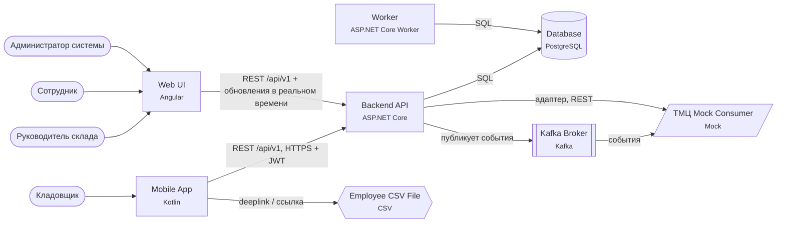
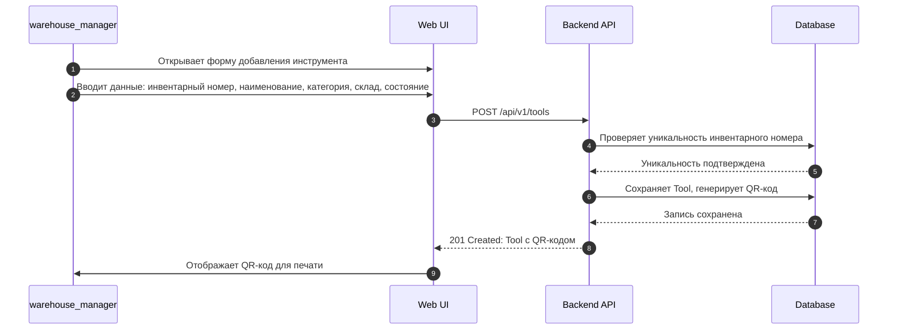
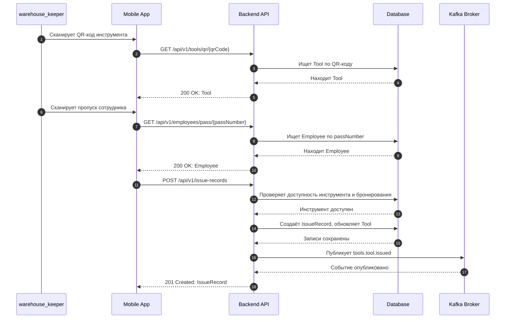
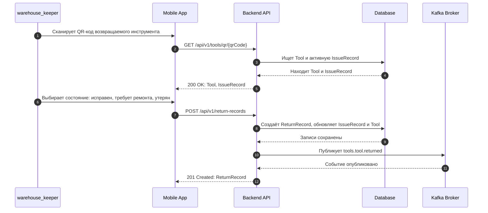
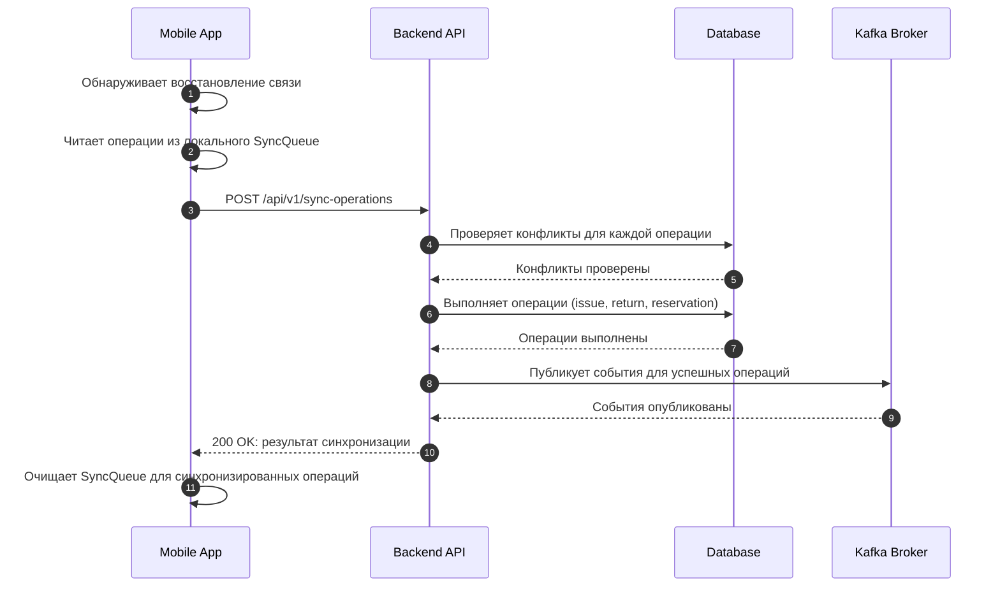
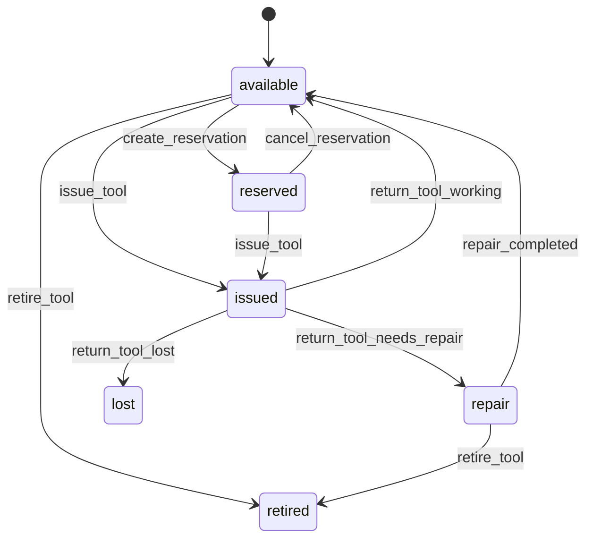
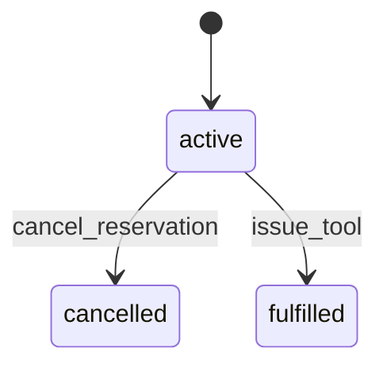
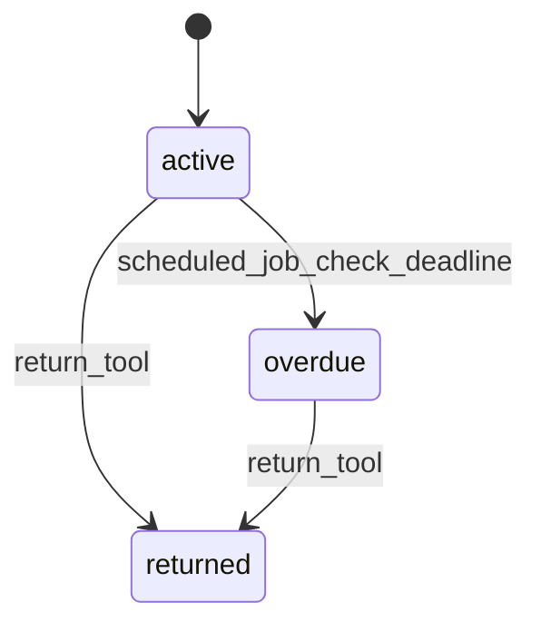
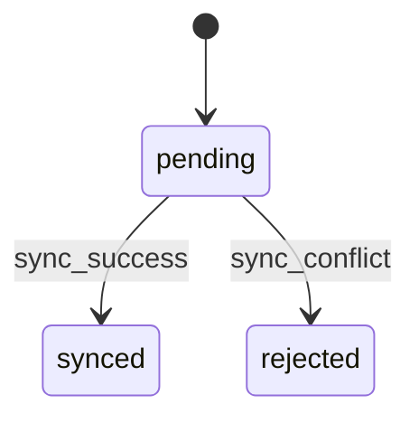

# Архитектура

## Компоненты

| Компонент | Тип | Технология | Ответственность |
| --- | --- | --- | --- |
| Mobile App | mobile | Kotlin | Мобильное приложение кладовщика: сканирование QR-кодов, локальное хранение операций при отсутствии связи, синхронизация с сервером |
| Web UI | web | Angular | Web-интерфейс для руководителя склада и администратора: каталог, история, список невозвращённого, загрузка справочника |
| Backend API | backend | ASP.NET Core | REST API, бизнес-логика, аутентификация, авторизация, публикация событий в Kafka |
| Worker | worker | ASP.NET Core Worker | Scheduled jobs: проверка сроков возврата, обновление статусов IssueRecord |
| Database | database | PostgreSQL | Хранение данных: Tool, Employee, Reservation, IssueRecord, ReturnRecord, MovementHistory, SyncQueue, AuditLog, SystemSetting |
| Kafka Broker | broker | Kafka | Передача событий выдачи, возврата и списания в корпоративную систему учёта ТМЦ |
| TMЦ Mock Consumer | mock | Mock | Mock-потребитель событий из Kafka для интеграции с корпоративной системой учёта ТМЦ |
| Employee CSV File | external | CSV | Файл справочника сотрудников и номеров пропусков для загрузки |

## Ключевые решения

- Бизнес-логика сосредоточена в ASP.NET Core Backend API, который обеспечивает атомарность операций и валидацию бизнес-правил.
- Внешняя система учёта ТМЦ подключена через событийную шину Kafka, что обеспечивает асинхронность и отказоустойчивость интеграции.
- Мобильное приложение использует локальную базу данных для хранения операций при отсутствии связи, синхронизируясь с сервером через очередь SyncQueue.
- Справочник сотрудников загружается из CSV-файла, что позволяет легко обновлять данные без изменения кода приложения.
- Данные защищены ролевой моделью доступа (RBAC), где каждый пользователь имеет строго определённые права на операции.
- События Kafka содержат минимальный набор данных (eventType, toolId, employeeId, timestamp) для обеспечения совместимости с внешними системами.

Подробно — в журнале решений:

- [ADR-001. Выбор стека технологий для клиентских приложений](adr/ADR-001.md)
- [ADR-002. Механизм передачи событий во внешнюю систему](adr/ADR-002.md)
- [ADR-003. Обработка работы без сети в мобильном приложении](adr/ADR-003.md)
- [ADR-004. Определение срока возврата инструмента](adr/ADR-004.md)
- [ADR-005. Формат загрузки справочника сотрудников](adr/ADR-005.md)

## Добавление инструмента и печать QR-кода

## Выдача инструмента сотруднику

## Возврат инструмента с оценкой состояния

## Синхронизация операций после появления связи

## Жизненный цикл: Tool.status

## Жизненный цикл: Reservation.status

## Жизненный цикл: IssueRecord.status

## Жизненный цикл: SyncQueue.status

