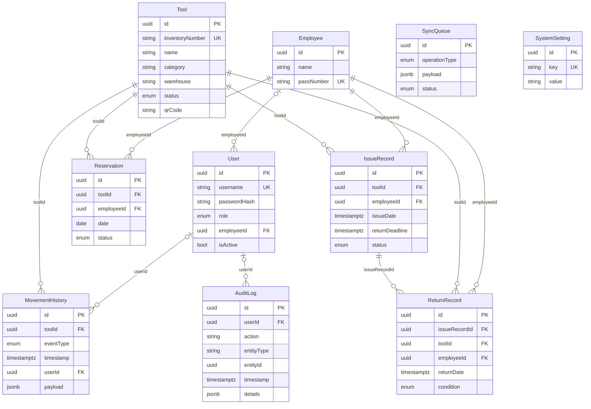

# Модель данных

Физическая схема: [schema.sql](contracts/schema.sql).

## User

Таблица `users`. Учётная запись пользователя системы с ролью и привязкой к сотруднику

| Поле | Колонка | Тип | Обяз. | Ограничения |
| --- | --- | --- | :---: | --- |
| `id` | `id` | uuid | да | — |
| `username` | `username` | string | да | до 50 симв.; `^[a-zA-Z0-9._-]{3,50}$`; уникально |
| `passwordHash` | `password_hash` | string | да | до 255 симв. (только БД) |
| `role` | `role` | enum | да | `warehouse_keeper`, `warehouse_manager`, `employee`, `system_admin` |
| `employeeId` | `employee_id` | uuid |  | → Employee |
| `isActive` | `is_active` | bool | да | — |
| `createdAt` | `created_at` | datetime | да | — |
| `updatedAt` | `updated_at` | datetime | да | — |

## Employee

Таблица `employees`. Сотрудник, получающий инструмент; данные загружаются из CSV-файла

| Поле | Колонка | Тип | Обяз. | Ограничения |
| --- | --- | --- | :---: | --- |
| `id` | `id` | uuid | да | — |
| `name` | `name` | string | да | до 200 симв.; ПДн |
| `passNumber` | `pass_number` | string | да | до 32 симв.; `^[A-Z0-9-]{4,32}$`; уникально |
| `createdAt` | `created_at` | datetime | да | — |
| `updatedAt` | `updated_at` | datetime | да | — |

## Tool

Таблица `tools`. Единица инструмента или оборудования в каталоге

| Поле | Колонка | Тип | Обяз. | Ограничения |
| --- | --- | --- | :---: | --- |
| `id` | `id` | uuid | да | — |
| `inventoryNumber` | `inventory_number` | string | да | до 50 симв.; `^[A-Z0-9-]{3,50}$`; уникально |
| `name` | `name` | string | да | до 200 симв. |
| `category` | `category` | string | да | до 100 симв. |
| `warehouse` | `warehouse` | string | да | до 100 симв. |
| `status` | `status` | enum | да | `available`, `issued`, `reserved`, `repair`, `lost`, `retired` |
| `qrCode` | `qr_code` | string | да | до 255 симв. |
| `createdAt` | `created_at` | datetime | да | — |
| `updatedAt` | `updated_at` | datetime | да | — |

## Reservation

Таблица `reservations`. Бронирование инструмента на дату

| Поле | Колонка | Тип | Обяз. | Ограничения |
| --- | --- | --- | :---: | --- |
| `id` | `id` | uuid | да | — |
| `toolId` | `tool_id` | uuid | да | → Tool |
| `employeeId` | `employee_id` | uuid | да | → Employee |
| `date` | `date` | date | да | — |
| `status` | `status` | enum | да | `active`, `cancelled`, `fulfilled` |
| `createdAt` | `created_at` | datetime | да | — |
| `updatedAt` | `updated_at` | datetime | да | — |

## IssueRecord

Таблица `issue_records`. Запись о выдаче инструмента сотруднику

| Поле | Колонка | Тип | Обяз. | Ограничения |
| --- | --- | --- | :---: | --- |
| `id` | `id` | uuid | да | — |
| `toolId` | `tool_id` | uuid | да | → Tool |
| `employeeId` | `employee_id` | uuid | да | → Employee |
| `issueDate` | `issue_date` | datetime | да | — |
| `returnDeadline` | `return_deadline` | datetime | да | — |
| `status` | `status` | enum | да | `active`, `returned`, `overdue` |
| `createdAt` | `created_at` | datetime | да | — |
| `updatedAt` | `updated_at` | datetime | да | — |

## ReturnRecord

Таблица `return_records`. Запись о возврате инструмента с оценкой состояния

| Поле | Колонка | Тип | Обяз. | Ограничения |
| --- | --- | --- | :---: | --- |
| `id` | `id` | uuid | да | — |
| `issueRecordId` | `issue_record_id` | uuid | да | → IssueRecord |
| `toolId` | `tool_id` | uuid | да | → Tool |
| `employeeId` | `employee_id` | uuid | да | → Employee |
| `returnDate` | `return_date` | datetime | да | — |
| `condition` | `condition` | enum | да | `working`, `needs_repair`, `lost` |
| `createdAt` | `created_at` | datetime | да | — |
| `updatedAt` | `updated_at` | datetime | да | — |

## MovementHistory

Таблица `movement_histories`. История движения каждой единицы инструмента

| Поле | Колонка | Тип | Обяз. | Ограничения |
| --- | --- | --- | :---: | --- |
| `id` | `id` | uuid | да | — |
| `toolId` | `tool_id` | uuid | да | → Tool |
| `eventType` | `event_type` | enum | да | `created`, `issued`, `returned`, `reserved`, `reservation_cancelled`, `retired` |
| `timestamp` | `timestamp` | datetime | да | — |
| `userId` | `user_id` | uuid |  | → User |
| `payload` | `payload` | json |  | — |
| `createdAt` | `created_at` | datetime | да | — |
| `updatedAt` | `updated_at` | datetime | да | — |

## SyncQueue

Таблица `sync_queues`. Очередь локальных операций для синхронизации после восстановления связи

| Поле | Колонка | Тип | Обяз. | Ограничения |
| --- | --- | --- | :---: | --- |
| `id` | `id` | uuid | да | — |
| `operationType` | `operation_type` | enum | да | `issue`, `return`, `reservation`, `reservation_cancel` |
| `payload` | `payload` | json | да | — |
| `status` | `status` | enum | да | `pending`, `synced`, `rejected` |
| `createdAt` | `created_at` | datetime | да | — |
| `updatedAt` | `updated_at` | datetime | да | — |

## AuditLog

Таблица `audit_logs`. Журнал аудита действий пользователей

| Поле | Колонка | Тип | Обяз. | Ограничения |
| --- | --- | --- | :---: | --- |
| `id` | `id` | uuid | да | — |
| `userId` | `user_id` | uuid |  | → User |
| `action` | `action` | string | да | до 100 симв. |
| `entityType` | `entity_type` | string | да | до 50 симв. |
| `entityId` | `entity_id` | uuid |  | — |
| `timestamp` | `timestamp` | datetime | да | — |
| `details` | `details` | json |  | — |
| `createdAt` | `created_at` | datetime | да | — |
| `updatedAt` | `updated_at` | datetime | да | — |

## SystemSetting

Таблица `system_settings`. Настройки системы, включая срок возврата

| Поле | Колонка | Тип | Обяз. | Ограничения |
| --- | --- | --- | :---: | --- |
| `id` | `id` | uuid | да | — |
| `key` | `key` | string | да | до 100 симв.; уникально |
| `value` | `value` | string | да | до 500 симв. |
| `createdAt` | `created_at` | datetime | да | — |
| `updatedAt` | `updated_at` | datetime | да | — |
