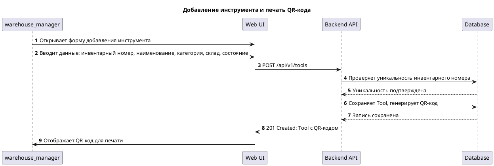
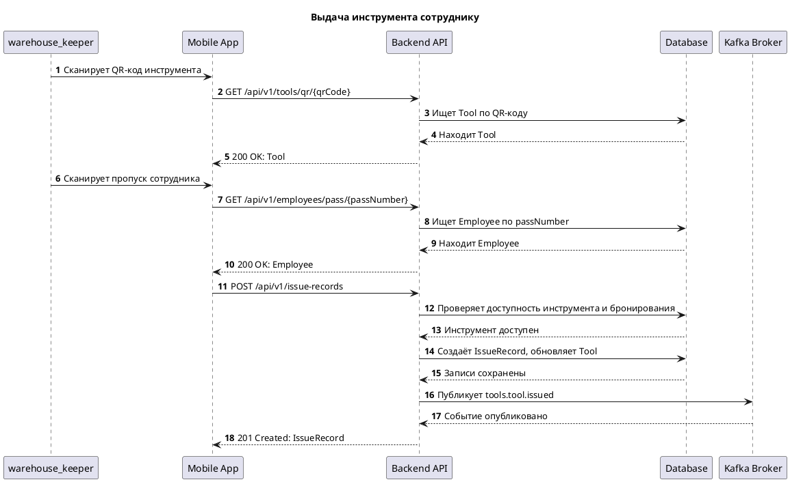
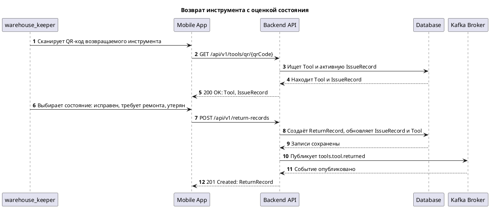
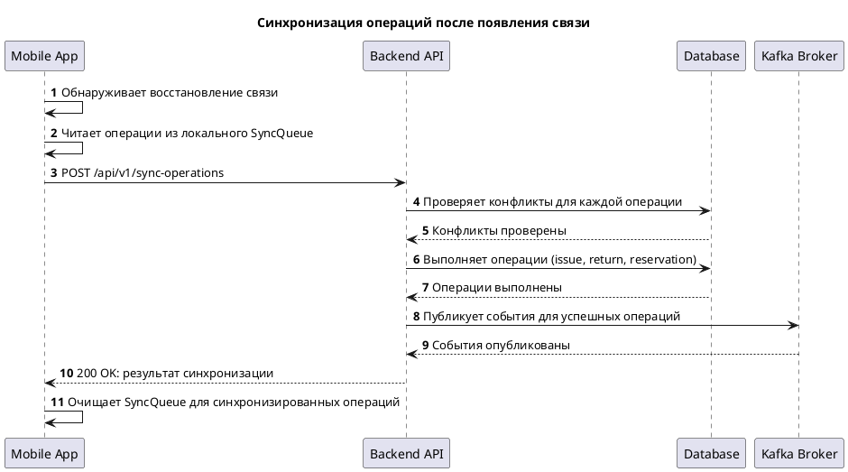
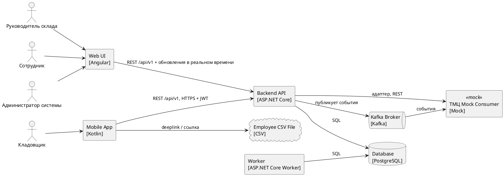
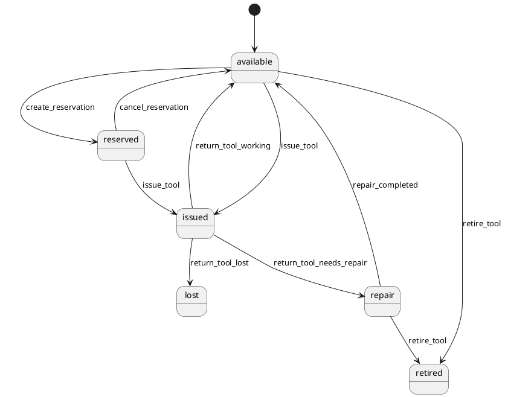
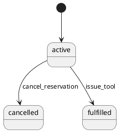
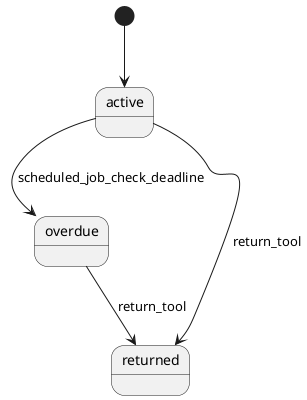
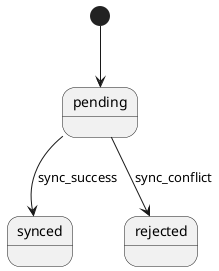
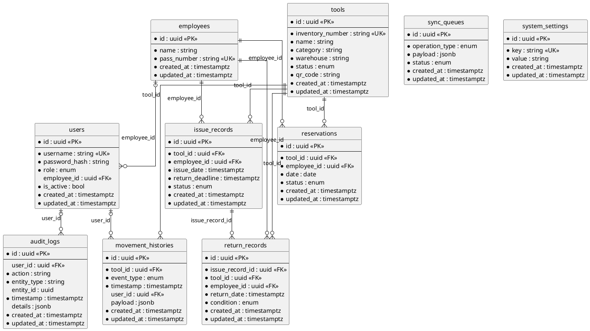

# ТЗ. Системный анализ: Система учёта выдачи и возврата инструмента

> Документ сформирован конвейером SpecForge по регламенту «Правила проектирования и ведения документации по системному анализу». Контракты: [`openapi.yaml`](contracts/openapi.yaml), [`asyncapi.yaml`](contracts/asyncapi.yaml), [`schema.sql`](contracts/schema.sql); методы API — в каталоге [`api-methods/`](api-methods/). Требования заказчика, выведенные требования и допущения системы разделены столбцом «Происхождение».

## 1 Оглавление

- 2 Общие положения
  - 2.1 История изменения
  - 2.2 Список ответственных лиц
  - 2.3 Лист согласования
  - 2.4 Общие сведения
    - 2.4.1 Термины и определения
    - 2.4.2 Используемые документы
    - 2.4.3 Общее описание изменений
    - 2.4.4 Цель доработки
    - 2.4.5 Условия и ограничения
    - 2.4.6 Критерии успеха, критерии приемки
  - 2.5 Сценарии использования (UseCase)
  - 2.6 Диаграммы
    - 2.6.1 Диаграммы последовательности UML
    - 2.6.2 Иные диаграммы
- 3 Функциональные требования
  - 3.1 Описание Frontend
    - 3.1.1 Спецификация на интерфейс пользователя
    - 3.1.2 Ссылки на макеты (Figma)
  - 3.2 Описание Backend
    - 3.2.1 Интерфейсы передачи информации
    - 3.2.2 Шаблон сервиса
    - 3.2.3 Модель данных. Описание БД
    - 3.2.4 Описание API
  - 3.3 Интеграции
    - 3.3.1 Внешние интеграции
    - 3.3.2 Внутренние интеграции
  - 3.4 Метрики
- 4 Нефункциональные требования
  - 4.1 Требования к безопасности
  - 4.2 Требования к производительности
  - 4.3 Требования к масштабируемости
  - 4.4 Требования к надежности
  - 4.5 Требования к сопровождению
- Приложение А. Допущения и открытые вопросы
- Приложение Б. Матрица трассируемости
- Приложение В. Соответствие разделам условия кейса

## 2 Общие положения

### 2.1 История изменения

| Версия | Ссылка на задачу Jira | Описание изменения | Автор | Дата |
| --- | --- | --- | --- | --- |
| 1.0 | — | Первичная версия по бизнес-требованиям `requirements.docx` | SpecForge, агент системного анализа | 2026-10-30 |

### 2.2 Список ответственных лиц

| Роль | Структурное подразделение | ФИО |
| --- | --- | --- |
| Заказчик | — | — |
| Руководитель проекта | — | — |
| Разработчик ПО | — | — |
| Аналитик | — | SpecForge, агент системного анализа |

### 2.3 Лист согласования

Статус документа: **требуется согласование**.

| Роль | Статус | Комментарий | ФИО | Дата |
| --- | --- | --- | --- | --- |
| Заказчик | требуется согласование | — | — | — |
| Архитектор | требуется согласование | — | — | — |
| Сотрудник подразделения ИБ | требуется согласование | разделы 4.1 и 4.5 | — | — |

Матрица ответственных за согласование артефактов:

| Артефакт документации | Архитекторы | Product Owner | Системные аналитики | Разработка | Тестирование |
| --- | --- | --- | --- | --- | --- |
| Бизнес-требования | — | — | Согласование | — | — |
| Архитектура | Согласование | — | — | — | — |
| UseCase, варианты использования | — | Согласование | — | Согласование | Согласование |
| UI (макеты) | — | — | Согласование | — | — |

### 2.4 Общие сведения

#### 2.4.1 Термины и определения

| Термин | Определение |
| --- | --- |
| Инструмент | Дорогостоящий инструмент и оборудование: перфораторы, тепловизоры, измерительные приборы, лестницы |
| QR-код | Код для идентификации единицы инструмента |
| Пропуск | Идентификационный документ сотрудника для получения инструмента |
| Бронирование | Зарезервирование инструмента на определённую дату |
| Срок возврата | Дедлайн, до которого инструмент должен быть возвращён |
| Списание | Удаление инструмента из учёта (например, при утере) |
| FR / NFR | функциональное / нефункциональное требование |
| BR | пункт бизнес-требований |
| UC | сценарий использования (UseCase) |
| AC | критерий приёмки |

#### 2.4.2 Используемые документы

| № | Наименование документа | Версия, дата | Ссылка или файл |
| --- | --- | --- | --- |
| 1 | Бизнес-требования | 2026-10-30 | `../01_requirements/normalized.md` (исходник `requirements.docx`) |
| 2 | Описание архитектуры | 1.0 | раздел 2.6 и 3.2 настоящего документа |
| 3 | Роли и характеристика пользователей | 1.0 | раздел 3.1.1 настоящего документа |
| 4 | Связанные требования | 1.0 | `../01_requirements/requirements.md`, критерии приёмки `../01_requirements/acceptance/` |
| 5 | Контракты | 1.0 | `openapi.yaml`, `asyncapi.yaml`, `schema.sql` |

#### 2.4.3 Общее описание изменений

Система предназначена для автоматизации учёта выдачи и возврата дорогостоящего инструмента и оборудования на складах технических служб. Основными пользователями являются кладовщики, руководители складов и сотрудники, которые получают инструмент. Система решает проблему ручного учёта, потерь и несвоевременного возврата оборудования, обеспечивая прозрачность движения активов. Результатом внедрения является снижение потерь, контроль сроков возврата и интеграция данных с корпоративной системой учёта ТМЦ.

#### 2.4.4 Цель доработки

- GOAL-01: Предотвратить потерю инструмента и обеспечить прозрачность его местонахождения
- GOAL-02: Заменить бумажный журнал учёта на цифровую систему

#### 2.4.5 Условия и ограничения

Входит в доработку:

- Ведение каталогизации инструмента с генерацией QR-кодов для идентификации.
- Бронирование инструмента сотрудниками на конкретные даты с проверкой доступности.
- Выдача и возврат инструмента с фиксацией состояния (исправен, требует ремонта, утерян).
- Контроль сроков возврата и формирование списка невозвращённого инструмента.
- Мобильное приложение для кладовщика с поддержкой офлайн-режима и синхронизацией.
- Загрузка справочника сотрудников из CSV-файла.
- Передача событий выдачи, возврата и списания в корпоративную систему учёта ТМЦ через Kafka.
- Ведение истории движения каждой единицы инструмента.
- Управление настройками системы (например, срок возврата по умолчанию).

Не входит в доработку:

- Управление закупками и поставками нового инструмента (вне рамок учёта выдачи).
- Расчёт стоимости ущерба при утере или поломке инструмента (только фиксация факта).
- Интеграция с системами бухгалтерского учёта напрямую (только передача событий в ТМЦ).
- Управление персоналом и расписанием сотрудников (только справочник для выдачи).
- Геолокационный контроль перемещения инструмента (отсутствует в требованиях).
- Многоуровневая иерархия складов (поддерживается только один уровень склада в атрибутах Tool).

Бизнес- и системные ограничения:

| ID | Тип | Ограничение | Происхождение |
| --- | --- | --- | --- |
| CON-01 | technology | Мобильное приложение должно быть на Kotlin | заказчик |
| CON-02 | technology | Web-интерфейс должен быть на Angular | заказчик |
| CON-03 | technology | Backend должен быть на C# / ASP.NET Core | заказчик |
| CON-04 | technology | База данных должна быть PostgreSQL | заказчик |
| CON-05 | technology | Для передачи событий должна использоваться Kafka | заказчик |
| CON-06 | technology | Должен быть документированный API и модель событий | заказчик |
| CON-07 | technology | Должно быть Docker-окружение, тестовые данные, автоматизированные тесты, CI/CD-пайплайн | заказчик |
| CON-08 | integration | Интеграция с корпоративной системой учёта ТМЦ реализуется через mock-потребителя | заказчик |
| CON-09 | data | Справочник сотрудников и номера пропусков загружаются из файла | заказчик |

Допущения системы и вопросы к заказчику — в приложении А.

#### 2.4.6 Критерии успеха, критерии приемки

Definition of Done:

- реализованы все функциональные требования с приоритетом «обязательно» (раздел 3);
- выполняются все критерии приёмки (31 шт., исполняемые сценарии Gherkin в `../01_requirements/acceptance/`);
- API соответствует `openapi.yaml`, схема БД — `schema.sql`;
- выполнены требования раздела 4 к безопасности и надёжности;

| ID | FR | Тип | Дано | Когда | Тогда |
| --- | --- | --- | --- | --- | --- |
| AC-FR-1-01 | FR-1 | позитивный | warehouse_manager аутентифицирован; Инвентарный номер уникален | warehouse_manager вводит инвентарный номер, наименование, категорию, склад и состояние и сохраняет | Запись Tool сохранена в базе данных; Инструмент отображается в каталоге |
| AC-FR-1-02 | FR-1 | негативный | warehouse_manager аутентифицирован; Инвентарный номер уже существует | warehouse_manager пытается сохранить инструмент с существующим инвентарным номером | Система показывает ошибку «Инвентарный номер уже существует»; Запись не сохранена |
| AC-FR-1-03 | FR-1 | негативный | warehouse_manager аутентифицирован; Существует инструмент с инвентарным номером INV-001; warehouse_manager редактирует инструмент с инвентарным номером INV-002 | warehouse_manager меняет инвентарный номер на INV-001 и сохраняет | Система показывает ошибку «Инвентарный номер уже существует»; Инвентарный номер инструмента INV-002 не изменен |
| AC-FR-2-01 | FR-2 | позитивный | Инструмент добавлен в каталог | Система генерирует QR-код | QR-код отображается для печати; QR-код содержит инвентарный номер |
| AC-FR-3-01 | FR-3 | позитивный | warehouse_keeper аутентифицирован; Инструмент доступен; Сотрудник найден по пропуску | warehouse_keeper сканирует QR-код инструмента и пропуск сотрудника | Запись IssueRecord создана; Событие выдачи зафиксировано в MovementHistory |
| AC-FR-3-02 | FR-3 | негативный | warehouse_keeper аутентифицирован; Связь с сервером отсутствует | warehouse_keeper сканирует QR-код инструмента и пропуск сотрудника | Операция сохранена локально в SyncQueue; warehouse_keeper видит подтверждение локальной выдачи |
| AC-FR-3-03 | FR-3 | негативный | warehouse_keeper аутентифицирован; Инструмент забронирован сотрудником A; Сотрудник B найден по пропуску | warehouse_keeper сканирует QR-код инструмента и пропуск сотрудника B | Система показывает отказ в выдаче; Запись IssueRecord не создана |
| AC-FR-4-01 | FR-4 | позитивный | employee аутентифицирован; Инструмент доступен на выбранную дату | employee бронирует инструмент на дату | Запись Reservation создана; employee видит подтверждение бронирования |
| AC-FR-4-02 | FR-4 | негативный | employee аутентифицирован; Инструмент уже забронирован на выбранную дату | employee пытается забронировать инструмент | Система показывает «Инструмент уже забронирован»; Запись Reservation не создана |
| AC-FR-4-03 | FR-4 | негативный | employee аутентифицирован; Выбранная дата в прошлом | employee пытается забронировать инструмент на прошедшую дату | Система показывает ошибку «Дата бронирования не может быть в прошлом»; Запись Reservation не создана |
| AC-FR-5-01 | FR-5 | позитивный | Инструмент забронирован сотрудником A; warehouse_keeper пытается выдать инструмент сотруднику B | warehouse_keeper сканирует QR-код инструмента и пропуск сотрудника B | Система показывает отказ в выдаче; Запись IssueRecord не создана |
| AC-FR-6-01 | FR-6 | позитивный | Инструмент выдан сотруднику; warehouse_keeper аутентифицирован | warehouse_keeper сканирует QR-код и выбирает состояние «исправен» | Запись ReturnRecord создана; Состояние инструмента обновлено на «исправен» |
| AC-FR-6-02 | FR-6 | негативный | Инструмент не выдан; warehouse_keeper аутентифицирован | warehouse_keeper пытается зафиксировать возврат | Система показывает «Нет активной выдачи»; Запись ReturnRecord не создана |
| AC-FR-6-03 | FR-6 | позитивный | Инструмент выдан сотруднику; warehouse_keeper аутентифицирован | warehouse_keeper сканирует QR-код и выбирает состояние «утерян» | Запись ReturnRecord создана; Инструмент помечен как списанный в каталоге; Событие списания опубликовано в Kafka |
| AC-FR-7-01 | FR-7 | позитивный | Есть выданный инструмент с истекшим сроком возврата; warehouse_manager аутентифицирован | warehouse_manager открывает раздел «Невозвращенный инструмент» | Инструмент отображается в списке |
| AC-FR-7-02 | FR-7 | негативный | Есть выданный инструмент с неистекшим сроком возврата; warehouse_manager аутентифицирован | warehouse_manager открывает раздел «Невозвращенный инструмент» | Инструмент не отображается в списке |
| AC-FR-8-01 | FR-8 | позитивный | Kafka доступна; Mock-потребитель подключен | Система публикует событие выдачи | Событие доставлено в mock-потребитель; В таблице EventDeliveryLog создана запись со статусом delivered и timestamp |
| AC-FR-8-02 | FR-8 | негативный | Kafka недоступна | Система пытается опубликовать событие | Событие сохранено локально; Система повторяет публикацию после восстановления |
| AC-FR-9-01 | FR-9 | позитивный | Инструмент имеет историю движений; warehouse_manager аутентифицирован | warehouse_manager открывает историю движения | История отображается в хронологическом порядке |
| AC-FR-10-01 | FR-10 | позитивный | Связь с сервером отсутствует; warehouse_keeper аутентифицирован | warehouse_keeper выполняет операцию выдачи | В локальной базе данных создана запись с статусом pending; Система возвращает HTTP 200 с локальным ID операции в SyncQueue |
| AC-FR-10-02 | FR-10 | негативный | Связь с сервером отсутствует; Локальная база данных на мобильном устройстве повреждена или недоступна | warehouse_keeper выполняет операцию выдачи | Система показывает ошибку «Локальное хранилище недоступно»; Введенные данные не потеряны и могут быть сохранены после восстановления БД |
| AC-FR-11-01 | FR-11 | позитивный | system_admin аутентифицирован; Файл справочника валиден | system_admin загружает файл | Данные импортированы в таблицу Employee; system_admin видит подтверждение |
| AC-FR-11-02 | FR-11 | негативный | system_admin аутентифицирован; Файл справочника невалиден | system_admin загружает файл | Система показывает ошибку валидации; Данные не импортированы |
| AC-FR-11-03 | FR-11 | негативный | system_admin аутентифицирован; Файл справочника содержит дубликаты номеров пропусков | system_admin загружает файл | Система отклоняет импорт; Система показывает список дубликатов |
| AC-FR-12-01 | FR-12 | позитивный | warehouse_manager аутентифицирован | warehouse_manager добавляет инструмент | Инструмент сохранен в каталоге |
| AC-FR-13-01 | FR-13 | позитивный | employee аутентифицирован | employee бронирует инструмент | Бронирование создано |
| AC-FR-14-01 | FR-14 | позитивный | Инструмент забронирован другим сотрудником | warehouse_keeper пытается выдать инструмент | Система показывает отказ |
| AC-FR-15-01 | FR-15 | позитивный | Есть локальные операции; Связь восстановлена | Система обнаруживает связь | Операции синхронизированы; SyncQueue очищен |
| AC-FR-16-01 | FR-16 | позитивный | Срок возврата истек | warehouse_manager открывает список | Инструмент отображается в списке невозвращенного |
| AC-FR-16-02 | FR-16 | негативный | Срок возврата не истек | warehouse_manager открывает список | Инструмент не отображается в списке невозвращенного |
| AC-FR-17-01 | FR-17 | позитивный | Инструмент выдан | warehouse_keeper фиксирует возврат с отметкой «требует ремонта» | Состояние инструмента обновлено на «требует ремонта» |

### 2.5 Сценарии использования (UseCase)

#### UC_001. Добавление инструмента и печать QR-кода

| Элемент | Описание |
| --- | --- |
| ID | UC_001 |
| Название | Добавление инструмента и печать QR-кода |
| Акторы | Руководитель склада; Система |
| Цель | Добавить новую единицу инструмента в каталог и получить QR-код для печати |
| Требования | FR-1, FR-2, FR-12 |

**Предусловия:**

- warehouse_manager аутентифицирован в web-интерфейсе
- Склад выбран в системе

**Основной поток:**

1. warehouse_manager открывает форму добавления инструмента
2. warehouse_manager вводит инвентарный номер, наименование, категорию, склад и состояние
3. Система проверяет уникальность инвентарного номера
4. Система сохраняет запись Tool и генерирует QR-код
5. Система отображает QR-код для печати

**Альтернативные потоки:**

- AP1: Шаг 3: инвентарный номер уже существует → Система показывает ошибку «Инвентарный номер уже существует» и не сохраняет запись

**Исключения:**

- EX1: Шаг 2: не заполнены обязательные поля → Система блокирует сохранение и подсвечивает пустые поля
- EX2: Шаг 4: сбой сохранения в PostgreSQL → Система показывает сообщение об ошибке и не создает QR-код

**Постусловия:**

- Запись Tool сохранена в базе данных
- QR-код сгенерирован и доступен для печати

**Ожидаемый результат:** warehouse_manager видит сохраненный инструмент в каталоге и QR-код для печати

#### UC_002. Бронирование инструмента сотрудником

| Элемент | Описание |
| --- | --- |
| ID | UC_002 |
| Название | Бронирование инструмента сотрудником |
| Акторы | Сотрудник; Система |
| Цель | Забронировать инструмент на конкретную дату |
| Требования | FR-4, FR-13 |

**Предусловия:**

- employee аутентифицирован в системе
- Инструмент доступен в каталоге

**Основной поток:**

1. employee выбирает инструмент из каталога
2. employee указывает дату бронирования
3. Система проверяет доступность инструмента на указанную дату
4. Система создает запись Reservation
5. Система подтверждает бронирование

**Альтернативные потоки:**

- AP1: Шаг 3: инструмент уже забронирован на эту дату → Система показывает сообщение «Инструмент уже забронирован»

**Исключения:**

- EX1: Шаг 2: дата в прошлом → Система показывает ошибку «Дата не может быть в прошлом»
- EX2: Шаг 4: сбой сохранения → Система показывает сообщение об ошибке

**Постусловия:**

- Запись Reservation сохранена в базе данных

**Ожидаемый результат:** employee видит подтверждение бронирования

#### UC_003. Выдача инструмента сотруднику

| Элемент | Описание |
| --- | --- |
| ID | UC_003 |
| Название | Выдача инструмента сотруднику |
| Акторы | Кладовщик; Система |
| Цель | Выдать инструмент сотруднику, отсканировав QR-код инструмента и пропуск сотрудника |
| Требования | FR-3, FR-5, FR-14, FR-10 |

**Предусловия:**

- warehouse_keeper аутентифицирован в мобильном приложении
- Инструмент находится на складе
- Сотрудник присутствует

**Основной поток:**

1. warehouse_keeper сканирует QR-код инструмента
2. Система идентифицирует инструмент по QR-коду
3. warehouse_keeper сканирует пропуск сотрудника
4. Система идентифицирует сотрудника по номеру пропуска
5. Система проверяет, не забронирован ли инструмент другим сотрудником
6. Система создает запись IssueRecord
7. Система фиксирует событие выдачи в MovementHistory

**Альтернативные потоки:**

- AP1: Шаг 5: инструмент забронирован другим сотрудником → Система показывает отказ в выдаче

**Исключения:**

- EX1: Шаг 2: QR-код не найден → Система показывает «Инструмент не найден»
- EX2: Шаг 4: пропуск не найден → Система показывает «Сотрудник не найден»
- EX3: Шаг 6: потеря связи с сервером → Система сохраняет операцию локально в SyncQueue

**Постусловия:**

- Запись IssueRecord сохранена
- Событие выдачи зафиксировано в MovementHistory
- Инструмент помечен как выданный

**Ожидаемый результат:** warehouse_keeper видит подтверждение выдачи

#### UC_004. Возврат инструмента с оценкой состояния

| Элемент | Описание |
| --- | --- |
| ID | UC_004 |
| Название | Возврат инструмента с оценкой состояния |
| Акторы | Кладовщик; Система |
| Цель | Зафиксировать возврат инструмента с оценкой состояния |
| Требования | FR-6, FR-17 |

**Предусловия:**

- warehouse_keeper аутентифицирован в мобильном приложении
- Инструмент выдан сотруднику

**Основной поток:**

1. warehouse_keeper сканирует QR-код возвращаемого инструмента
2. Система находит активную запись IssueRecord
3. warehouse_keeper выбирает состояние: исправен, требует ремонта, утерян
4. Система создает запись ReturnRecord
5. Система фиксирует событие возврата в MovementHistory
6. Система обновляет состояние инструмента

**Альтернативные потоки:**

- AP1: Шаг 3: состояние «требует ремонта» → Система помечает инструмент как требующий ремонта

**Исключения:**

- EX1: Шаг 2: нет активной выдачи → Система показывает «Нет активной выдачи для этого инструмента»
- EX2: Шаг 4: потеря связи → Система сохраняет операцию локально

**Постусловия:**

- Запись ReturnRecord сохранена
- Событие возврата зафиксировано
- Состояние инструмента обновлено

**Ожидаемый результат:** warehouse_keeper видит подтверждение возврата

#### UC_005. Контроль срока возврата и список невозвращенного

| Элемент | Описание |
| --- | --- |
| ID | UC_005 |
| Название | Контроль срока возврата и список невозвращенного |
| Акторы | Руководитель склада; Система |
| Цель | Просмотреть список инструментов, срок возврата которых истек |
| Требования | FR-7, FR-16 |

**Предусловия:**

- warehouse_manager аутентифицирован в web-интерфейсе
- Есть выданные инструменты с истекшим сроком возврата

**Основной поток:**

1. Система периодически проверяет срок возврата выданных инструментов
2. warehouse_manager открывает раздел «Невозвращенный инструмент»
3. Система отображает список инструментов с истекшим сроком возврата

**Альтернативные потоки:**

- AP1: Шаг 3: нет невозвращенного инструмента → Система показывает «Нет невозвращенного инструмента»

**Исключения:**

- EX1: Шаг 1: сбой scheduled job → Система логирует ошибку и повторяет проверку

**Постусловия:**

- Список невозвращенного инструмента отображен

**Ожидаемый результат:** warehouse_manager видит список инструментов, срок возврата которых истек

#### UC_006. Передача событий в систему учета ТМЦ

| Элемент | Описание |
| --- | --- |
| ID | UC_006 |
| Название | Передача событий в систему учета ТМЦ |
| Акторы | Администратор системы; Система |
| Цель | Обеспечить передачу событий выдачи, возврата и списания в корпоративную систему учета ТМЦ |
| Требования | FR-8 |

**Предусловия:**

- Kafka настроена
- Mock-потребитель подключен

**Основной поток:**

1. Система публикует событие выдачи/возврата/списания в Kafka
2. Mock-потребитель получает событие
3. Система фиксирует статус доставки

**Альтернативные потоки:**

- AP1: Шаг 2: mock-потребитель недоступен → Система сохраняет событие в очереди для повторной отправки

**Исключения:**

- EX1: Шаг 1: Kafka недоступна → Система сохраняет событие локально и повторяет публикацию

**Постусловия:**

- Событие опубликовано в Kafka
- Статус доставки зафиксирован

**Ожидаемый результат:** Событие доставлено в mock-потребитель

#### UC_007. История движения инструмента

| Элемент | Описание |
| --- | --- |
| ID | UC_007 |
| Название | История движения инструмента |
| Акторы | Руководитель склада; Система |
| Цель | Просмотреть историю движения конкретной единицы инструмента |
| Требования | FR-9 |

**Предусловия:**

- warehouse_manager аутентифицирован
- Инструмент имеет историю движений

**Основной поток:**

1. warehouse_manager выбирает инструмент из каталога
2. Система отображает историю движений из MovementHistory

**Альтернативные потоки:**

- AP1: Шаг 2: история пуста → Система показывает «История пуста»

**Исключения:**

- EX1: Шаг 2: сбой загрузки → Система показывает сообщение об ошибке

**Постусловия:**

- История движения отображена

**Ожидаемый результат:** warehouse_manager видит полную историю движения инструмента

#### UC_008. Синхронизация операций после появления связи

| Элемент | Описание |
| --- | --- |
| ID | UC_008 |
| Название | Синхронизация операций после появления связи |
| Акторы | Кладовщик; Система |
| Цель | Синхронизировать локальные операции с сервером после восстановления связи |
| Требования | FR-10, FR-15 |

**Предусловия:**

- Есть локальные операции в SyncQueue
- Связь с сервером восстановлена

**Основной поток:**

1. Система обнаруживает восстановление связи
2. Система отправляет операции из SyncQueue на сервер
3. Сервер обрабатывает операции и публикует события в Kafka
4. Система очищает SyncQueue

**Альтернативные потоки:**

- AP1: Шаг 3: сервер отклоняет операцию → Система помечает операцию как ошибочную и показывает уведомление

**Исключения:**

- EX1: Шаг 2: связь снова потеряна → Система сохраняет операции в SyncQueue и повторяет попытку позже

**Постусловия:**

- Операции синхронизированы
- SyncQueue очищен

**Ожидаемый результат:** Операции синхронизированы с сервером

#### UC_009. Загрузка справочника сотрудников из файла

| Элемент | Описание |
| --- | --- |
| ID | UC_009 |
| Название | Загрузка справочника сотрудников из файла |
| Акторы | Администратор системы; Система |
| Цель | Загрузить справочник сотрудников и номеров пропусков из файла |
| Требования | FR-11 |

**Предусловия:**

- system_admin аутентифицирован
- Файл справочника подготовлен

**Основной поток:**

1. system_admin загружает файл справочника
2. Система валидирует формат файла
3. Система импортирует данные в таблицу Employee
4. Система подтверждает успешную загрузку

**Альтернативные потоки:**

- AP1: Шаг 2: формат файла неверен → Система показывает ошибку валидации

**Исключения:**

- EX1: Шаг 3: сбой импорта → Система откатывает транзакцию и показывает ошибку

**Постусловия:**

- Справочник сотрудников загружен

**Ожидаемый результат:** system_admin видит подтверждение загрузки

#### UC_010. Сквозной демонстрационный сценарий

| Элемент | Описание |
| --- | --- |
| ID | UC_010 |
| Название | Сквозной демонстрационный сценарий |
| Акторы | Руководитель склада; Система |
| Цель | Пройти полный демонстрационный сценарий от добавления инструмента до возврата |
| Требования | FR-1, FR-2, FR-3, FR-4, FR-5, FR-6, FR-7, FR-8, FR-9, FR-10, FR-13, FR-14, FR-15, FR-16, FR-17 |

**Предусловия:**

- Система развернута
- Mock-потребитель Kafka подключен

**Основной поток:**

1. warehouse_manager добавляет тепловизор и печатает QR-код
2. employee бронирует тепловизор на завтра
3. warehouse_keeper пытается выдать тепловизор другому сотруднику и получает отказ
4. warehouse_keeper выдаёт тепловизор забронировавшему сотруднику без связи с сервером
5. После появления связи операция синхронизируется, событие выдачи уходит во внешнюю систему
6. Срок возврата истёк — инструмент появляется в списке невозвращённого
7. employee возвращает инструмент с отметкой «требует ремонта»

**Альтернативные потоки:**

- AP1: Шаг 3: отказ в выдаче → Система показывает «Инструмент забронирован другим сотрудником»

**Исключения:**

- EX1: Шаг 4: потеря связи → Система сохраняет операцию локально
- EX2: Шаг 5: сбой синхронизации → Система повторяет попытку

**Постусловия:**

- Тепловизор возвращен с отметкой «требует ремонта»
- События опубликованы в Kafka
- История движения заполнена

**Ожидаемый результат:** Полный цикл работы с инструментом выполнен

### 2.6 Диаграммы

#### 2.6.1 Диаграммы последовательности UML

Добавление инструмента и печать QR-кода (UC_001):

Выдача инструмента сотруднику (UC_003):

Возврат инструмента с оценкой состояния (UC_004):

Синхронизация операций после появления связи (UC_008):

#### 2.6.2 Иные диаграммы

Диаграмма компонентов:

Диаграмма состояний Tool.status:

Диаграмма состояний Reservation.status:

Диаграмма состояний IssueRecord.status:

Диаграмма состояний SyncQueue.status:

## 3 Функциональные требования

Функции пронумерованы FR-n; столбец BR — трассировка к пунктам бизнес-требований (полная матрица — приложение Б). Формат описания — to be (будущая реализация).

| FR | Требование | BR | Приоритет | Происхождение | API / события | Критерии |
| --- | --- | --- | --- | --- | --- | --- |
| FR-1 | **Ведение каталога инструмента.** Система должна вести каталог инструмента с атрибутами: инвентарный номер, наименование, категория, склад, состояние | BR-3 | обязательно | заказчик | POST /api/v1/tools; GET /api/v1/tools/{id}; GET /api/v1/tools | AC-FR-1-01, AC-FR-1-02, AC-FR-1-03 |
| FR-2 | **Печать QR-кода для инструмента.** Система должна печатать QR-код для каждой единицы инструмента | BR-4 | обязательно | заказчик | POST /api/v1/tools | AC-FR-2-01 |
| FR-3 | **Выдача инструмента сотруднику.** Система должна позволять кладовщику выдать инструмент сотруднику, отсканировав QR-код инструмента и пропуск сотрудника | BR-5 | обязательно | заказчик | GET /api/v1/tools/qr/{qrCode}; POST /api/v1/issue-records; GET /api/v1/employees/pass/{passNumber}; GET /api/v1/audit-logs; POST /api/v1/users; GET /api/v1/users | AC-FR-3-01, AC-FR-3-02, AC-FR-3-03 |
| FR-4 | **Бронирование инструмента на дату.** Система должна позволять бронировать инструмент на дату заранее | BR-6 | обязательно | заказчик | POST /api/v1/reservations; POST /api/v1/reservations/{id}/cancellations; GET /api/v1/reservations; GET /api/v1/audit-logs; POST /api/v1/users; GET /api/v1/users | AC-FR-4-01, AC-FR-4-02, AC-FR-4-03 |
| FR-5 | **Запрет выдачи забронированного инструмента.** Система должна запрещать выдачу забронированного инструмента другому сотруднику | BR-6 | обязательно | заказчик | POST /api/v1/issue-records | AC-FR-5-01 |
| FR-6 | **Фиксация возврата инструмента.** Система должна фиксировать возврат инструмента с оценкой состояния: исправен, требует ремонта, утерян | BR-7 | обязательно | заказчик | POST /api/v1/return-records; GET /api/v1/return-records; GET /api/v1/audit-logs; POST /api/v1/users; GET /api/v1/users | AC-FR-6-01, AC-FR-6-02, AC-FR-6-03 |
| FR-7 | **Контроль срока возврата.** Система должна контролировать срок возврата и показывать список невозвращённого инструмента | BR-8 | обязательно | заказчик | GET /api/v1/issue-records; GET /api/v1/system-settings; PATCH /api/v1/system-settings/{key}; без API: Scheduled job проверки сроков возврата выполняется Worker, не через REST API | AC-FR-7-01, AC-FR-7-02 |
| FR-8 | **Передача событий в систему учёта ТМЦ.** Система должна передавать события выдачи, возврата и списания в корпоративную систему учёта ТМЦ | BR-9 | обязательно | заказчик | POST /api/v1/tools/{id}/retirements; tools.tool.issued; tools.tool.returned; tools.tool.retired | AC-FR-8-01, AC-FR-8-02 |
| FR-9 | **История движения инструмента.** Система должна показывать историю движения каждой единицы инструмента | BR-10 | обязательно | заказчик | GET /api/v1/tools/{id}/movements | AC-FR-9-01 |
| FR-10 | **Работа в мобильном приложении без связи.** Система должна работать в мобильном приложении при отсутствии связи на складе и синхронизировать операции после её появления | BR-11 | обязательно | заказчик | POST /api/v1/synchronization-operations; без API: Локальное хранение операций при отсутствии связи выполняется на устройстве (Mobile App), синхронизация — через syncOperations | AC-FR-10-01, AC-FR-10-02 |
| FR-11 | **Загрузка справочника сотрудников из файла.** Система должна загружать справочник сотрудников и номера пропусков из файла | BR-19 | обязательно | заказчик | POST /api/v1/employee-imports; GET /api/v1/employees; GET /api/v1/audit-logs; POST /api/v1/users; GET /api/v1/users | AC-FR-11-01, AC-FR-11-02, AC-FR-11-03 |
| FR-12 | **Добавление инструмента руководителем.** Система должна позволять руководителю склада добавлять инструмент в каталог | — | обязательно | выведено | POST /api/v1/tools; GET /api/v1/audit-logs; POST /api/v1/users; GET /api/v1/users | AC-FR-12-01 |
| FR-13 | **Бронирование сотрудником.** Система должна позволять сотруднику бронировать инструмент на дату | — | обязательно | выведено | POST /api/v1/reservations; GET /api/v1/audit-logs; POST /api/v1/users; GET /api/v1/users | AC-FR-13-01 |
| FR-14 | **Отказ в выдаче забронированного инструмента.** Система должна показывать отказ при попытке выдать забронированный инструмент другому сотруднику | — | обязательно | выведено | POST /api/v1/issue-records | AC-FR-14-01 |
| FR-15 | **Синхронизация операций после появления связи.** Система должна синхронизировать операции после появления связи с сервером | — | обязательно | выведено | POST /api/v1/synchronization-operations; без API: Синхронизация операций после появления связи выполняется через syncOperations | AC-FR-15-01 |
| FR-16 | **Показ невозвращённого инструмента при истечении срока.** Система должна показывать инструмент в списке невозвращённого при истечении срока возврата | — | обязательно | выведено | без API: Показ списка невозвращённого при истечении срока — через listIssueRecords с фильтром overdueOnly | AC-FR-16-01, AC-FR-16-02 |
| FR-17 | **Возврат инструмента с отметкой ремонта.** Система должна фиксировать возврат инструмента с отметкой «требует ремонта» | — | обязательно | выведено | POST /api/v1/return-records | AC-FR-17-01 |

### 3.1 Описание Frontend

#### 3.1.1 Спецификация на интерфейс пользователя

Клиентские приложения и роли:

| Приложение | Технология | Назначение |
| --- | --- | --- |
| Mobile App | Kotlin | Мобильное приложение кладовщика: сканирование QR-кодов, локальное хранение операций при отсутствии связи, синхронизация с сервером |
| Web UI | Angular | Web-интерфейс для руководителя склада и администратора: каталог, история, список невозвращённого, загрузка справочника |

| Роль | Описание | Доступные методы BE |
| --- | --- | --- |
| Кладовщик | Выдаёт и принимает инструмент, сканирует QR-коды и пропуска, работает в мобильном приложении | `GET /api/v1/tools/{id}`, `GET /api/v1/tools`, `GET /api/v1/tools/qr/{qrCode}`, `GET /api/v1/reservations`, `POST /api/v1/issue-records`, `GET /api/v1/issue-records`, `POST /api/v1/return-records`, `GET /api/v1/return-records`, `GET /api/v1/tools/{id}/movements`, `GET /api/v1/employees`, `GET /api/v1/employees/pass/{passNumber}`, `POST /api/v1/synchronization-operations` |
| Руководитель склада | Управляет каталогом инструмента, печатает QR-коды, контролирует возвраты через web-интерфейс | `POST /api/v1/tools`, `GET /api/v1/tools/{id}`, `GET /api/v1/tools`, `POST /api/v1/reservations`, `POST /api/v1/reservations/{id}/cancellations`, `GET /api/v1/reservations`, `GET /api/v1/issue-records`, `GET /api/v1/return-records`, `GET /api/v1/tools/{id}/movements`, `GET /api/v1/employees`, `GET /api/v1/system-settings`, `POST /api/v1/tools/{id}/retirements` |
| Сотрудник | Получает инструмент на смену, бронирует его заранее, возвращает после работ | `GET /api/v1/tools/{id}`, `GET /api/v1/tools`, `POST /api/v1/reservations`, `POST /api/v1/reservations/{id}/cancellations`, `GET /api/v1/reservations` |
| Администратор системы | Настраивает систему, управляет справочниками и интеграциями | `POST /api/v1/employee-imports`, `GET /api/v1/employees`, `GET /api/v1/system-settings`, `PATCH /api/v1/system-settings/{key}`, `GET /api/v1/audit-logs`, `POST /api/v1/users`, `GET /api/v1/users` |

Формы ввода: элементы интерфейса, маппинг на поля метода BE и колонки БД, обязательность и формат ввода. Экранные формы (таблица «ЭФ — изображение — описание») формирует этап проектирования интерфейса (`artifacts/03_ux`) и включает в документацию.

Форма «Добавить инструмент в каталог» → `POST /api/v1/tools`:

| Поле формы | Элемент UI | Обязательность | Формат ввода / regex | Поле API | Поле БД |
| --- | --- | --- | --- | --- | --- |
| inventoryNumber | input text | required | до 50 симв.; `^[A-Z0-9-]{3,50}$`; уникально | `inventoryNumber` | `tools.inventory_number` |
| name | input text | required | до 200 симв. | `name` | `tools.name` |
| category | input text | required | до 100 симв. | `category` | `tools.category` |
| warehouse | input text | required | до 100 симв. | `warehouse` | `tools.warehouse` |
| status | select / radio | required | `available`, `issued`, `reserved`, `repair`, `lost`, `retired` | `status` | `tools.status` |

Форма «Забронировать инструмент на дату» → `POST /api/v1/reservations`:

| Поле формы | Элемент UI | Обязательность | Формат ввода / regex | Поле API | Поле БД |
| --- | --- | --- | --- | --- | --- |
| toolId | select (выбор из списка) | required | → Tool | `toolId` | `reservations.tool_id` |
| employeeId | select (выбор из списка) | required | → Employee | `employeeId` | `reservations.employee_id` |
| date | input date | required | — | `date` | `reservations.date` |

Форма «Выдать инструмент сотруднику» → `POST /api/v1/issue-records`:

| Поле формы | Элемент UI | Обязательность | Формат ввода / regex | Поле API | Поле БД |
| --- | --- | --- | --- | --- | --- |
| toolId | select (выбор из списка) | required | → Tool | `toolId` | `issue_records.tool_id` |
| employeeId | select (выбор из списка) | required | → Employee | `employeeId` | `issue_records.employee_id` |
| issueDate | input datetime-local | required | — | `issueDate` | `issue_records.issue_date` |
| returnDeadline | input datetime-local | required | — | `returnDeadline` | `issue_records.return_deadline` |

Форма «Зафиксировать возврат инструмента» → `POST /api/v1/return-records`:

| Поле формы | Элемент UI | Обязательность | Формат ввода / regex | Поле API | Поле БД |
| --- | --- | --- | --- | --- | --- |
| issueRecordId | select (выбор из списка) | required | → IssueRecord | `issueRecordId` | `return_records.issue_record_id` |
| toolId | select (выбор из списка) | required | → Tool | `toolId` | `return_records.tool_id` |
| employeeId | select (выбор из списка) | required | → Employee | `employeeId` | `return_records.employee_id` |
| returnDate | input datetime-local | required | — | `returnDate` | `return_records.return_date` |
| condition | select / radio | required | `working`, `needs_repair`, `lost` | `condition` | `return_records.condition` |

Форма «Загрузить справочник сотрудников из CSV-файла» → `POST /api/v1/employee-imports`:

| Поле формы | Элемент UI | Обязательность | Формат ввода / regex | Поле API | Поле БД |
| --- | --- | --- | --- | --- | --- |
| CSV-файл с сотрудниками | input text | required | до 255 симв. | `file` | — |

Форма «Синхронизировать локальные операции с сервером» → `POST /api/v1/synchronization-operations`:

| Поле формы | Элемент UI | Обязательность | Формат ввода / regex | Поле API | Поле БД |
| --- | --- | --- | --- | --- | --- |
| Массив локальных операций из SyncQueue | input file (JSON) | required | — | `operations` | — |

Форма «Обновить настройку системы» → `PATCH /api/v1/system-settings/{key}`:

| Поле формы | Элемент UI | Обязательность | Формат ввода / regex | Поле API | Поле БД |
| --- | --- | --- | --- | --- | --- |
| value | input text | required | до 500 симв. | `value` | `system_settings.value` |

Форма «Создать пользователя системы» → `POST /api/v1/users`:

| Поле формы | Элемент UI | Обязательность | Формат ввода / regex | Поле API | Поле БД |
| --- | --- | --- | --- | --- | --- |
| username | input text | required | до 50 симв.; `^[a-zA-Z0-9._-]{3,50}$`; уникально | `username` | `users.username` |
| role | select / radio | required | `warehouse_keeper`, `warehouse_manager`, `employee`, `system_admin` | `role` | `users.role` |
| employeeId | select (выбор из списка) | нет | → Employee | `employeeId` | `users.employee_id` |
| isActive | checkbox | required | — | `isActive` | `users.is_active` |

Тексты ошибок для пользователя приходят с BE в поле `title` ответа problem+json; если BE вернул нечитаемую ошибку (5xx, сеть), интерфейс показывает «Что-то пошло не так, попробуйте ещё раз». Все тексты экранов по возможности возвращает BE.

| Код ошибки | Сообщение пользователю | Когда |
| --- | --- | --- |
| `tool-already-issued` | Инструмент уже выдан | Попытка выдать инструмент, который уже находится в статусе 'выдан' другому сотруднику. |
| `tool-reserved-by-other` | Инструмент забронирован другим сотрудником | Попытка выдать инструмент сотруднику, который не является владельцем активного бронирования на текущую дату. |
| `reservation-date-conflict` | Конфликт дат бронирования | Попытка забронировать инструмент на дату, когда он уже забронирован или выдан. |
| `employee-not-found` | Сотрудник не найден | Сканирование пропуска сотрудника, которого нет в справочнике. |
| `sync-conflict` | Конфликт синхронизации | Операция из локальной очереди синхронизации отклоняется, так как состояние инструмента на сервере изменилось (например, инструмент уже выдан). |

#### 3.1.2 Ссылки на макеты (Figma)

Неприменимо: макеты в Figma не создаются — интерфейс строится на выбранном UI Kit, скриншоты экранных форм прикладываются в документации этапа UX.

### 3.2 Описание Backend

#### 3.2.1 Интерфейсы передачи информации

- REST API использует протокол HTTPS с форматом данных JSON для обмена данными между клиентом и сервером.
- События Kafka передаются в формате JSON с обязательными полями eventType, toolId, employeeId, timestamp.
- Синхронизация мобильного приложения с сервером происходит через REST API с использованием механизма очереди SyncQueue для обеспечения целостности данных.
- Загрузка справочника сотрудников выполняется через multipart/form-data с валидацией формата CSV на стороне сервера.
- Аутентификация осуществляется через JWT-токены, которые передаются в заголовке Authorization.

#### 3.2.2 Шаблон сервиса

Паспорт каждого сервиса оформляется по «Шаблону описания сервисов» и формируется на этапе документации (`09_docs/docs/services/`).

| Сервис | Тип | Технология | Ответственность |
| --- | --- | --- | --- |
| Backend API | backend | ASP.NET Core | REST API, бизнес-логика, аутентификация, авторизация, публикация событий в Kafka |
| Worker | worker | ASP.NET Core Worker | Scheduled jobs: проверка сроков возврата, обновление статусов IssueRecord |
| TMЦ Mock Consumer | mock | Mock | Mock-потребитель событий из Kafka для интеграции с корпоративной системой учёта ТМЦ |

#### 3.2.3 Модель данных. Описание БД

СУБД: PostgreSQL 17 + PostGIS, SRID 4326. Имена таблиц и полей — snake_case (например `order_id`), таблицы во множественном числе. Физическая схема — [`schema.sql`](contracts/schema.sql).

Таблица `users` (User) — Учётная запись пользователя системы с ролью и привязкой к сотруднику

| Поле | Тип | Обязательность | Ключ | Ограничения | Описание |
| --- | --- | --- | --- | --- | --- |
| `id` | uuid | да | PK | — | — |
| `username` | string | да | UK | до 50 симв.; `^[a-zA-Z0-9._-]{3,50}$`; уникально | — |
| `password_hash` | string | да | — | до 255 симв. | — (только БД) |
| `role` | enum | да | — | `warehouse_keeper`, `warehouse_manager`, `employee`, `system_admin` | — |
| `employee_id` | uuid | нет | FK → employees | → Employee | — |
| `is_active` | bool | да | — | — | — |
| `created_at` | datetime | да | — | — | время создания |
| `updated_at` | datetime | да | — | — | время изменения |

Таблица `employees` (Employee) — Сотрудник, получающий инструмент; данные загружаются из CSV-файла

| Поле | Тип | Обязательность | Ключ | Ограничения | Описание |
| --- | --- | --- | --- | --- | --- |
| `id` | uuid | да | PK | — | — |
| `name` | string | да | — | до 200 симв.; ПДн | — |
| `pass_number` | string | да | UK | до 32 симв.; `^[A-Z0-9-]{4,32}$`; уникально | — |
| `created_at` | datetime | да | — | — | время создания |
| `updated_at` | datetime | да | — | — | время изменения |

Таблица `tools` (Tool) — Единица инструмента или оборудования в каталоге

| Поле | Тип | Обязательность | Ключ | Ограничения | Описание |
| --- | --- | --- | --- | --- | --- |
| `id` | uuid | да | PK | — | — |
| `inventory_number` | string | да | UK | до 50 симв.; `^[A-Z0-9-]{3,50}$`; уникально | — |
| `name` | string | да | — | до 200 симв. | — |
| `category` | string | да | — | до 100 симв. | — |
| `warehouse` | string | да | — | до 100 симв. | — |
| `status` | enum | да | — | `available`, `issued`, `reserved`, `repair`, `lost`, `retired` | — |
| `qr_code` | string | да | — | до 255 симв. | — |
| `created_at` | datetime | да | — | — | время создания |
| `updated_at` | datetime | да | — | — | время изменения |

Таблица `reservations` (Reservation) — Бронирование инструмента на дату

| Поле | Тип | Обязательность | Ключ | Ограничения | Описание |
| --- | --- | --- | --- | --- | --- |
| `id` | uuid | да | PK | — | — |
| `tool_id` | uuid | да | FK → tools | → Tool | — |
| `employee_id` | uuid | да | FK → employees | → Employee | — |
| `date` | date | да | — | — | — |
| `status` | enum | да | — | `active`, `cancelled`, `fulfilled` | — |
| `created_at` | datetime | да | — | — | время создания |
| `updated_at` | datetime | да | — | — | время изменения |

Таблица `issue_records` (IssueRecord) — Запись о выдаче инструмента сотруднику

| Поле | Тип | Обязательность | Ключ | Ограничения | Описание |
| --- | --- | --- | --- | --- | --- |
| `id` | uuid | да | PK | — | — |
| `tool_id` | uuid | да | FK → tools | → Tool | — |
| `employee_id` | uuid | да | FK → employees | → Employee | — |
| `issue_date` | datetime | да | — | — | — |
| `return_deadline` | datetime | да | — | — | — |
| `status` | enum | да | — | `active`, `returned`, `overdue` | — |
| `created_at` | datetime | да | — | — | время создания |
| `updated_at` | datetime | да | — | — | время изменения |

Таблица `return_records` (ReturnRecord) — Запись о возврате инструмента с оценкой состояния

| Поле | Тип | Обязательность | Ключ | Ограничения | Описание |
| --- | --- | --- | --- | --- | --- |
| `id` | uuid | да | PK | — | — |
| `issue_record_id` | uuid | да | FK → issue_records | → IssueRecord | — |
| `tool_id` | uuid | да | FK → tools | → Tool | — |
| `employee_id` | uuid | да | FK → employees | → Employee | — |
| `return_date` | datetime | да | — | — | — |
| `condition` | enum | да | — | `working`, `needs_repair`, `lost` | — |
| `created_at` | datetime | да | — | — | время создания |
| `updated_at` | datetime | да | — | — | время изменения |

Таблица `movement_histories` (MovementHistory) — История движения каждой единицы инструмента

| Поле | Тип | Обязательность | Ключ | Ограничения | Описание |
| --- | --- | --- | --- | --- | --- |
| `id` | uuid | да | PK | — | — |
| `tool_id` | uuid | да | FK → tools | → Tool | — |
| `event_type` | enum | да | — | `created`, `issued`, `returned`, `reserved`, `reservation_cancelled`, `retired` | — |
| `timestamp` | datetime | да | — | — | — |
| `user_id` | uuid | нет | FK → users | → User | — |
| `payload` | json | нет | — | — | — |
| `created_at` | datetime | да | — | — | время создания |
| `updated_at` | datetime | да | — | — | время изменения |

Таблица `sync_queues` (SyncQueue) — Очередь локальных операций для синхронизации после восстановления связи

| Поле | Тип | Обязательность | Ключ | Ограничения | Описание |
| --- | --- | --- | --- | --- | --- |
| `id` | uuid | да | PK | — | — |
| `operation_type` | enum | да | — | `issue`, `return`, `reservation`, `reservation_cancel` | — |
| `payload` | json | да | — | — | — |
| `status` | enum | да | — | `pending`, `synced`, `rejected` | — |
| `created_at` | datetime | да | — | — | — |
| `updated_at` | datetime | да | — | — | время изменения |

Таблица `audit_logs` (AuditLog) — Журнал аудита действий пользователей

| Поле | Тип | Обязательность | Ключ | Ограничения | Описание |
| --- | --- | --- | --- | --- | --- |
| `id` | uuid | да | PK | — | — |
| `user_id` | uuid | нет | FK → users | → User | — |
| `action` | string | да | — | до 100 симв. | — |
| `entity_type` | string | да | — | до 50 симв. | — |
| `entity_id` | uuid | нет | — | — | — |
| `timestamp` | datetime | да | — | — | — |
| `details` | json | нет | — | — | — |
| `created_at` | datetime | да | — | — | время создания |
| `updated_at` | datetime | да | — | — | время изменения |

Таблица `system_settings` (SystemSetting) — Настройки системы, включая срок возврата

| Поле | Тип | Обязательность | Ключ | Ограничения | Описание |
| --- | --- | --- | --- | --- | --- |
| `id` | uuid | да | PK | — | — |
| `key` | string | да | UK | до 100 симв.; уникально | — |
| `value` | string | да | — | до 500 симв. | — |
| `created_at` | datetime | да | — | — | время создания |
| `updated_at` | datetime | да | — | — | время изменения |

#### 3.2.4 Описание API

Общие положения: Security Scheme — HTTP Bearer (JWT); транспорт — HTTPS, HTTP/1.1; схема взаимодействия — синхронный запрос-ответ; версия в пути `/api/v1`; пути содержат только существительные, действие задаёт HTTP-метод; ошибки — RFC 9457; критичные операции — заголовок `Idempotency-Key`; превышение лимита — 429. Каждый метод описан на отдельной странице по шаблону API.

| Метод | Назначение | Роли | FR | Успех | Страница метода |
| --- | --- | --- | --- | --- | --- |
| `POST /api/v1/tools` | Добавить инструмент в каталог | warehouse_manager | FR-1, FR-2, FR-12 | 201 | [createTool](api-methods/createTool.md) |
| `GET /api/v1/tools/{id}` | Получить инструмент по ID | warehouse_manager, warehouse_keeper, employee | FR-1 | 200 | [getTool](api-methods/getTool.md) |
| `GET /api/v1/tools` | Получить список инструментов | warehouse_manager, warehouse_keeper, employee | FR-1 | 200 | [listTools](api-methods/listTools.md) |
| `GET /api/v1/tools/qr/{qrCode}` | Получить инструмент по QR-коду | warehouse_keeper | FR-3 | 200 | [getToolByQrCode](api-methods/getToolByQrCode.md) |
| `POST /api/v1/reservations` | Забронировать инструмент на дату | employee, warehouse_manager | FR-4, FR-13 | 201 | [createReservation](api-methods/createReservation.md) |
| `POST /api/v1/reservations/{id}/cancellations` | Отменить бронирование | employee, warehouse_manager | FR-4 | 200 | [cancelReservation](api-methods/cancelReservation.md) |
| `GET /api/v1/reservations` | Получить список бронирований | warehouse_manager, warehouse_keeper, employee | FR-4 | 200 | [listReservations](api-methods/listReservations.md) |
| `POST /api/v1/issue-records` | Выдать инструмент сотруднику | warehouse_keeper | FR-3, FR-5, FR-14 | 201 | [issueTool](api-methods/issueTool.md) |
| `GET /api/v1/issue-records` | Получить список записей о выдаче | warehouse_manager, warehouse_keeper | FR-7 | 200 | [listIssueRecords](api-methods/listIssueRecords.md) |
| `POST /api/v1/return-records` | Зафиксировать возврат инструмента | warehouse_keeper | FR-6, FR-17 | 201 | [returnTool](api-methods/returnTool.md) |
| `GET /api/v1/return-records` | Получить список записей о возврате | warehouse_manager, warehouse_keeper | FR-6 | 200 | [listReturnRecords](api-methods/listReturnRecords.md) |
| `GET /api/v1/tools/{id}/movements` | Получить историю движения инструмента | warehouse_manager, warehouse_keeper | FR-9 | 200 | [getToolMovementHistory](api-methods/getToolMovementHistory.md) |
| `POST /api/v1/employee-imports` | Загрузить справочник сотрудников из CSV-файла | system_admin | FR-11 | 201 | [importEmployees](api-methods/importEmployees.md) |
| `GET /api/v1/employees` | Получить список сотрудников | warehouse_manager, warehouse_keeper, system_admin | FR-11 | 200 | [listEmployees](api-methods/listEmployees.md) |
| `GET /api/v1/employees/pass/{passNumber}` | Получить сотрудника по номеру пропуска | warehouse_keeper | FR-3 | 200 | [getEmployeeByPassNumber](api-methods/getEmployeeByPassNumber.md) |
| `POST /api/v1/synchronization-operations` | Синхронизировать локальные операции с сервером | warehouse_keeper | FR-10, FR-15 | 200 | [syncOperations](api-methods/syncOperations.md) |
| `GET /api/v1/system-settings` | Получить настройки системы | system_admin, warehouse_manager | FR-7 | 200 | [getSystemSettings](api-methods/getSystemSettings.md) |
| `PATCH /api/v1/system-settings/{key}` | Обновить настройку системы | system_admin | FR-7 | 200 | [updateSystemSetting](api-methods/updateSystemSetting.md) |
| `GET /api/v1/audit-logs` | Получить журнал аудита | system_admin | FR-3, FR-4, FR-6, FR-11, FR-12, FR-13 | 200 | [listAuditLogs](api-methods/listAuditLogs.md) |
| `POST /api/v1/users` | Создать пользователя системы | system_admin | FR-3, FR-4, FR-6, FR-11, FR-12, FR-13 | 201 | [createUser](api-methods/createUser.md) |
| `GET /api/v1/users` | Получить список пользователей | system_admin | FR-3, FR-4, FR-6, FR-11, FR-12, FR-13 | 200 | [listUsers](api-methods/listUsers.md) |
| `POST /api/v1/tools/{id}/retirements` | Списать инструмент | warehouse_manager | FR-8 | 200 | [retireTool](api-methods/retireTool.md) |

### 3.3 Интеграции

#### 3.3.1 Внешние интеграции

| ID | Система | Направление | Способ | В прототипе |
| --- | --- | --- | --- | --- |
| INT-01 | Корпоративная система учёта ТМЦ | outbound | events | адаптер + mock-сервис |
| INT-02 | Файл справочника сотрудников | inbound | file | адаптер + mock-сервис |

- Корпоративная система учёта ТМЦ подключена через Kafka, где события публикуются в топик 'tools-events', а в прототипе используется mock-потребитель для валидации формата.
- Файл справочника сотрудников загружается через REST API в формате CSV, что позволяет администратору обновлять данные без прямого доступа к базе данных.

Вызовы внешних компонентов из методов API:

- `POST /api/v1/issue-records` → Kafka Broker
- `POST /api/v1/return-records` → Kafka Broker
- `POST /api/v1/synchronization-operations` → Kafka Broker
- `POST /api/v1/tools/{id}/retirements` → Kafka Broker

#### 3.3.2 Внутренние интеграции

События между компонентами — Kafka, спецификация [`asyncapi.yaml`](contracts/asyncapi.yaml). Конверт события: `{eventId, type, version, occurredAt, source, correlationId, key, data}`. Доставка at-least-once через transactional outbox; потребители идемпотентны по `eventId`; 3 повтора с задержкой 1, 5, 25 с, затем топик `<topic>.dlq`; несовместимые изменения схемы — новая версия топика.

| Событие | Топик | Производитель | Потребители | Ключ | Данные | Триггер (FR) |
| --- | --- | --- | --- | --- | --- | --- |
| `tools.tool.issued` | `tools.tool.issued.v1` | Backend API | TMЦ Mock Consumer | `toolId` | id, toolId, employeeId, issueDate, returnDeadline, eventType, timestamp | FR-8 |
| `tools.tool.returned` | `tools.tool.returned.v1` | Backend API | TMЦ Mock Consumer | `toolId` | id, toolId, employeeId, returnDate, condition, eventType, timestamp | FR-8 |
| `tools.tool.retired` | `tools.tool.retired.v1` | Backend API | TMЦ Mock Consumer | `toolId` | id, inventoryNumber, name, eventType, timestamp | FR-8 |

### 3.4 Метрики

| Метрика | Описание | Источник |
| --- | --- | --- |
| Время отклика API | Среднее время отклика на запросы к REST API | Логи приложения и мониторинг производительности |
| Количество невозвращённого инструмента | Число единиц инструмента, срок возврата которых истёк | База данных (таблица IssueRecord) |
| Успешность синхронизации | Процент успешно синхронизированных операций из локальной очереди | Логи мобильного приложения и сервера |
| Количество ошибок интеграции | Число неудачных попыток передачи событий в Kafka | Логи Kafka и приложения |

## 4 Нефункциональные требования

### 4.1 Требования к безопасности

| ID | Категория | Требование | Связано |
| --- | --- | --- | --- |
| SEC-01 | authn | Система должна аутентифицировать пользователей по ролям | FR-1, FR-3, FR-4 |
| SEC-02 | authz | Система должна ограничивать доступ по ролям: warehouse_manager, warehouse_keeper, employee, system_admin | FR-1, FR-3, FR-4, FR-11 |
| SEC-03 | audit | Система должна фиксировать все действия пользователей в журнале аудита | FR-3, FR-6, FR-9 |
| SEC-04 | input_validation | Система должна валидировать все входные данные | FR-1, FR-11 |
| SEC-05 | rate_limiting | Система должна ограничивать частоту запросов | FR-3, FR-4 |
| SEC-06 | secrets | Секреты (ключи API, пароли БД) должны храниться в защищенном хранилище | FR-8 |

Раздел подлежит согласованию с подразделением информационной безопасности (п. 2.3).

### 4.2 Требования к производительности

| ID | Требование | Метрика |
| --- | --- | --- |
| NFR-3 | Ключевые операции (выдача, возврат, бронирование) должны выполняться за не более 2 секунд | P95 < 2s |

#### 4.2.1 Производительность операций пользовательского интерфейса

| № | Наименование операции | Уровень нагрузки в час пик |
| --- | --- | --- |
| 1 | Выдача инструмента | 10 операций/сек |
| 2 | Бронирование инструмента | 5 операций/сек |

#### 4.2.2 Производительность вспомогательных операций

| № | Наименование операции | Уровень нагрузки в час пик |
| --- | --- | --- |
| 1 | Проверка сроков возврата | 1 раз в час |

#### 4.2.3 Производительность вспомогательных систем

| № | Наименование операции | Уровень нагрузки |
| --- | --- | --- |
| 1 | Проверка сроков возврата | 1 раз в час |

#### 4.2.4 Производительность внешних интерфейсов и информационных систем

| № | Наименование операции | Максимальная нагрузка |
| --- | --- | --- |
| 1 | Публикация события в Kafka | 10 событий/сек |

#### 4.2.5 Время отклика операций пользовательского интерфейса

| № | Наименование операции | Время отклика |
| --- | --- | --- |
| 1 | Выдача инструмента | < 2s (P95) |
| 2 | Бронирование инструмента | < 2s (P95) |

#### 4.2.6 Время обработки вспомогательных операций

| № | Наименование операции | Длительность |
| --- | --- | --- |
| 1 | Проверка сроков возврата | < 30s |

#### 4.2.7 Время обработки внешних интерфейсов и информационных систем

| № | Наименование операции | Длительность |
| --- | --- | --- |
| 1 | Публикация события в Kafka | < 500ms |

### 4.3 Требования к масштабируемости

- Система должна поддерживать до 1000 единиц инструмента и 1000 сотрудников без деградации производительности.
- API должен выдерживать пиковую нагрузку до 50 запросов в секунду.
- База данных должна поддерживать горизонтальное масштабирование при необходимости.

### 4.4 Требования к надежности

- Система должна быть доступна 99.5% времени.
- При потере связи мобильное приложение должно сохранять операции локально и синхронизировать их после восстановления.
- Система должна корректно обрабатывать конфликты при синхронизации, отклоняя дублирующие операции.
- Данные должны быть защищены от потери при сбое сервера.
- NFR-1: Система должна работать в мобильном приложении при отсутствии связи на складе
- NFR-2: Система должна синхронизировать операции после появления связи
- NFR-4: Система должна сохранять операции локально при потере связи и синхронизировать после восстановления (0 потерянных операций)
- NFR-6: Система должна быть доступна 99.5% времени (99.5% uptime)

### 4.5 Требования к сопровождению

#### 4.5.1 Требования к резервированию и восстановлению

- Резервное копирование базы данных должно выполняться ежедневно.
- Резервные копии должны храниться в защищённом месте с доступом только для администраторов.

#### 4.5.2 Требования к системе архивирования

- История движения инструмента должна архивироваться после 1 года хранения.
- Архивные данные должны быть доступны для запросов, но не участвовать в активных операциях.

#### 4.5.3 Требования к управлению доступом

- Доступ к базе данных должен быть ограничен только для сервисных аккаунтов приложения.
- Администраторы должны иметь доступ к журналу аудита для контроля действий пользователей.

#### 4.5.4 Требования к протоколированию

- Все операции и ошибки должны логироваться с указанием уровня важности.
- Логи должны храниться не менее 30 дней для анализа инцидентов.
- NFR-5: Система должна логировать все операции и ошибки

#### 4.5.5 Требования к мониторингу информационной системы

- Система должна мониторить доступность API и загрузку Kafka.
- Оповещения о сбоях должны отправляться администраторам в реальном времени.

#### 4.5.6 Требования к подсистеме регистрации событий (аудит)

- Все действия пользователей должны фиксироваться в журнале аудита.
- Журнал аудита должен быть защищён от изменения и удаления.

#### 4.5.7 Удаленный доступ к информационной системе

- Дистанционный доступ к серверу должен осуществляться только через защищённый канал (SSH/VPN).
- Доступ к серверу должен быть ограничен для администраторов системы.

## Приложение А. Допущения и открытые вопросы

Вопросы к заказчику (не больше 5; без ответа применено умолчание):

| ID | Вопрос | Влияние | Статус | Принятое решение |
| --- | --- | --- | --- | --- |
| Q-01 | Не указана структура событий для Kafka | architecture | умолчание | Событие содержит: eventType, toolId, employeeId, timestamp, payload |
| Q-02 | Не указано, как определяется срок возврата: фиксированный период или по дате бронирования | core_scenario | умолчание | Срок возврата = дата выдачи + N дней (N настраивается) |
| Q-03 | Не указано, как разрешаются конфликты при синхронизации локальных операций | core_scenario | умолчание | Операция отклоняется, если инструмент уже выдан |

Допущения системы (не являются требованиями заказчика):

| ID | Допущение | Причина | Влияет на |
| --- | --- | --- | --- |
| ASM-01 | Формат файла справочника: CSV | Не указан формат файла справочника сотрудников | FR-11 |
| ASM-02 | Срок возврата по умолчанию 1 день | Не указан в требованиях, но необходим для контроля | FR-7, FR-16 |
| ASM-03 | Файл справочника в формате CSV | Наиболее простой и универсальный формат | FR-11 |
| ASM-04 | QR-код содержит инвентарный номер | Наиболее простой способ идентификации | FR-2, FR-3 |
| ASM-05 | События Kafka содержат eventType, toolId, employeeId, timestamp | Минимальный набор данных для внешней системы | FR-8 |
| ASM-06 | Модель событий Kafka: Событие содержит: eventType, toolId, employeeId, timestamp, payload | Принято по умолчанию без ответа на Q-01. Не указана структура событий для Kafka | FR-8 |
| ASM-07 | Срок возврата: Срок возврата = дата выдачи + N дней (N настраивается) | Принято по умолчанию без ответа на Q-02. Не указано, как определяется срок возврата: фиксированный период или по дате бронирования | FR-7, FR-16 |
| ASM-08 | Конфликты при синхронизации: Операция отклоняется, если инструмент уже выдан | Принято по умолчанию без ответа на Q-03. Не указано, как разрешаются конфликты при синхронизации локальных операций | FR-10, FR-15 |

Риски:

| ID | Риск | Вероятность / влияние | Снижение |
| --- | --- | --- | --- |
| RISK-01 | Потеря данных при синхронизации | medium / high | Использование транзакций и повторных попыток с экспоненциальным бэкоффом |
| RISK-02 | Конфликты при одновременной выдаче | low / high | Использование оптимистической блокировки |
| RISK-03 | Недоступность Kafka | medium / medium | Локальная очередь событий с повторной отправкой |
| RISK-04 | Невалидные данные в файле справочника | medium / medium | Валидация файла перед импортом |

## Приложение Б. Матрица трассируемости

| BR | Бизнес-требование | FR | UC | AC | API / события |
| --- | --- | --- | --- | --- | --- |
| BR-1 | На складах технических служб хранится дорогостоящий инструмент и оборудование: перфораторы, тепловизоры, измерительные приборы, лестницы. Бригады получают их на смену и возвращают после работ. Учёт ведётся в бумажном журнале, поэтому инструмент теряется, а кладовщик не знает, у кого он находится | — | — | — | ROLE-employee, GOAL-01, GOAL-02 |
| BR-2 | Создать систему учёта выдачи и возврата инструмента: мобильное приложение кладовщика со сканированием QR-кодов и web-интерфейс для руководителя склада | — | — | — | ROLE-warehouse_keeper, ROLE-warehouse_manager |
| BR-3 | вести каталог инструмента: инвентарный номер, наименование, категория, склад, состояние | FR-1 | UC_001, UC_010 | 3 | POST /api/v1/tools; GET /api/v1/tools/{id}; GET /api/v1/tools |
| BR-4 | печатать QR-код для каждой единицы инструмента | FR-2 | UC_001, UC_010 | 1 | POST /api/v1/tools |
| BR-5 | позволять кладовщику выдать инструмент сотруднику, отсканировав QR-код инструмента и пропуск сотрудника | FR-3 | UC_003, UC_010 | 3 | GET /api/v1/tools/qr/{qrCode}; POST /api/v1/issue-records; GET /api/v1/employees/pass/{passNumber}; GET /api/v1/audit-logs; POST /api/v1/users; GET /api/v1/users |
| BR-6 | позволять бронировать инструмент на дату заранее; забронированный инструмент нельзя выдать другому сотруднику | FR-4 | UC_002, UC_010 | 3 | POST /api/v1/reservations; POST /api/v1/reservations/{id}/cancellations; GET /api/v1/reservations; GET /api/v1/audit-logs; POST /api/v1/users; GET /api/v1/users |
| BR-6 | позволять бронировать инструмент на дату заранее; забронированный инструмент нельзя выдать другому сотруднику | FR-5 | UC_003, UC_010 | 1 | POST /api/v1/issue-records |
| BR-7 | фиксировать возврат инструмента с оценкой состояния: исправен, требует ремонта, утерян | FR-6 | UC_004, UC_010 | 3 | POST /api/v1/return-records; GET /api/v1/return-records; GET /api/v1/audit-logs; POST /api/v1/users; GET /api/v1/users |
| BR-8 | контролировать срок возврата и показывать список невозвращённого инструмента | FR-7 | UC_005, UC_010 | 2 | GET /api/v1/issue-records; GET /api/v1/system-settings; PATCH /api/v1/system-settings/{key} |
| BR-9 | передавать события выдачи, возврата и списания в корпоративную систему учёта ТМЦ | FR-8 | UC_006, UC_010 | 2 | POST /api/v1/tools/{id}/retirements; tools.tool.issued; tools.tool.returned; tools.tool.retired |
| BR-10 | показывать историю движения каждой единицы инструмента | FR-9 | UC_007, UC_010 | 1 | GET /api/v1/tools/{id}/movements |
| BR-11 | работать в мобильном приложении при отсутствии связи на складе и синхронизировать операции после её появления | FR-10 | UC_003, UC_008, UC_010 | 2 | POST /api/v1/synchronization-operations |
| BR-12 | мобильное приложение на Kotlin для кладовщика | — | — | — | CON-01 |
| BR-13 | административный web-интерфейс на Angular | — | — | — | CON-02 |
| BR-14 | backend на C# / ASP.NET Core | — | — | — | CON-03 |
| BR-15 | PostgreSQL | — | — | — | CON-04 |
| BR-16 | Kafka для передачи событий во внешнюю систему учёта | — | — | — | CON-05 |
| BR-17 | документированный API и модель событий | — | — | — | CON-06 |
| BR-18 | Docker-окружение, тестовые данные, автоматизированные тесты, CI/CD-пайплайн | — | — | — | CON-07 |
| BR-19 | Корпоративная система учёта ТМЦ принимает события из Kafka. Промышленный доступ не предоставляется, интеграция реализуется через mock-потребителя. Справочник сотрудников и номера пропусков загружаются из файла | FR-11 | UC_009 | 3 | POST /api/v1/employee-imports; GET /api/v1/employees; GET /api/v1/audit-logs; POST /api/v1/users; GET /api/v1/users |
| — (выведено) | Добавление инструмента руководителем | FR-12 | UC_001 | 1 | POST /api/v1/tools; GET /api/v1/audit-logs; POST /api/v1/users; GET /api/v1/users |
| — (выведено) | Бронирование сотрудником | FR-13 | UC_002, UC_010 | 1 | POST /api/v1/reservations; GET /api/v1/audit-logs; POST /api/v1/users; GET /api/v1/users |
| — (выведено) | Отказ в выдаче забронированного инструмента | FR-14 | UC_003, UC_010 | 1 | POST /api/v1/issue-records |
| — (выведено) | Синхронизация операций после появления связи | FR-15 | UC_008, UC_010 | 1 | POST /api/v1/synchronization-operations |
| — (выведено) | Показ невозвращённого инструмента при истечении срока | FR-16 | UC_005, UC_010 | 2 | — |
| — (выведено) | Возврат инструмента с отметкой ремонта | FR-17 | UC_004, UC_010 | 1 | POST /api/v1/return-records |

## Приложение В. Соответствие разделам условия кейса

| Раздел из условия кейса | Где в документе |
| --- | --- |
| Назначение системы | 2.4.3, 2.4.4 |
| Границы решения | 2.4.5 |
| Роли и права доступа | 3.1.1 (роли и методы), страницы методов API («Кому разрешено вызывать метод»), 4.1 |
| Пользовательские сценарии | 2.5 |
| Функциональные требования | 3 |
| Нефункциональные требования | 4 |
| Описание компонентов | 2.6.2, 3.2.2 |
| Модель данных | 3.2.3 |
| API-контракты | 3.2.4, `openapi.yaml`, `api-methods/` |
| События и интеграции | 3.3 |
| Ограничения и проверки входных данных | 3.1.1 (формы ввода), страницы методов API |
| Обработка ошибок | 3.1.1 (тексты ошибок), страницы методов API («Неуспешная обработка запроса») |
| Критерии приёмки | 2.4.6 |
| Допущения и открытые вопросы | Приложение А |
