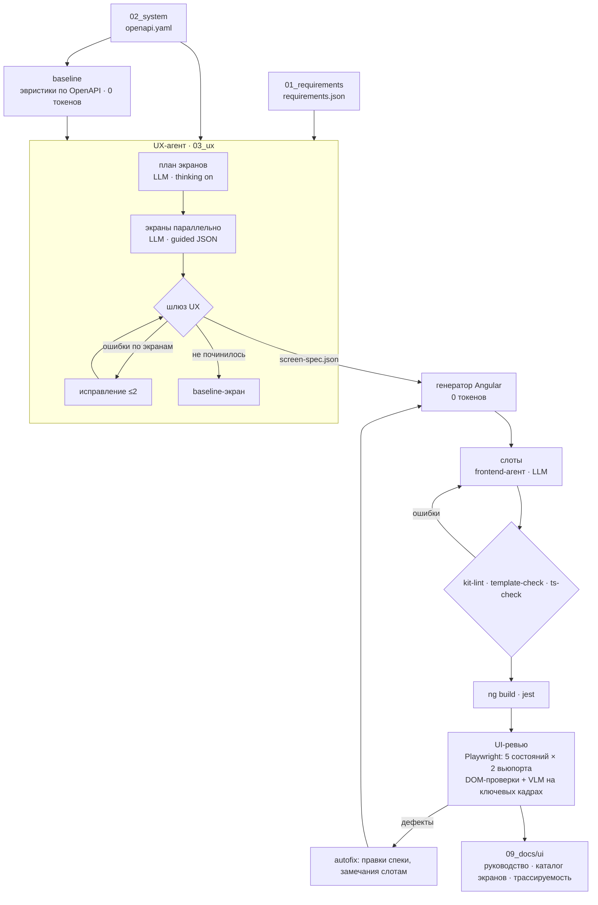

# Веб-ветка конвейера SpecForge

Отвечает за этапы **03_ux** (проектирование интерфейса), **05_web** (генерация админки), UI-часть **07_tests** (UI-ревью),
UI-часть **09_docs** (руководство пользователя, трассируемость) и за **веб-консоль** самого конвейера.

## Архитектура



## Решения (ADR)

| # | Решение | Почему | Альтернатива |
|---|---|---|---|
| 1 | UI Kit — **PrimeNG 20** | версия совпадает с Angular 20, полный набор для админки, модель хорошо знает API | Taiga UI 4 — меньше обучающих данных, API менялся между 3 и 4 |
| 2 | **Спека экранов как контракт** (JSON Schema, 9 архетипов, 5 обязательных состояний) | генерация кода детерминирована, LLM пишет короткий JSON вместо тысяч строк TS; шлюз проверяет спеку до кода | LLM пишет компоненты целиком — дорого, нестабильно на кейсе №2 |
| 3 | **Baseline из OpenAPI** как черновик и страховка | на любом API получается рабочая админка без LLM; модель только улучшает | без страховки сбой модели на скрытом кейсе = красная сборка |
| 4 | **Импорты собирает код**, модель возвращает список модулей из манифеста | модель физически не может подключить несуществующий компонент | модель пишет файл целиком — главный источник ошибок сборки |
| 5 | **Пре-шлюзы за секунды** (kit-lint, template-check, ts-check на нативном tsc) до `ng build` | ремонтный цикл в 10–50 раз дешевле по времени; ошибки с файлом и строкой | гонять `ng build` на каждую попытку — минуты на итерацию |
| 6 | **Состояния форсируются перехватом API** в UI-ревью | пустые/ошибочные/запрещённые экраны проверяются без подготовки данных и без backend | ручные тестовые данные под каждое состояние |
| 7 | **VLM только на 3 кадрах экрана**, остальное — DOM-проверки | токены на изображения — главная статья расхода ревью | VLM на всех 10 кадрах экрана — в 3 раза дороже |
| 8 | Линтер UI Kit на **Python**, не ESLint | не зависит от внутренностей angular-eslint, работает без npm, даёт подсказку замены | ESLint-плагин под шаблоны Angular |
| 9 | **TS-клиент API генерируется своим генератором** из OpenAPI | имена методов = operationId из спеки экранов, нет Java-зависимости openapi-generator | openapi-generator (typescript-angular) |
| 10 | Консоль конвейера **собрана тем же генератором** | демонстрирует универсальность; живой граф — реализованный вручную слот | отдельное приложение вне конвейера |
| 11 | **Откат слотов при падении `ng build`** (сначала виновные по файлу ошибки, затем все) | быстрые пре-шлюзы проверяют типы на заглушках и могут пропустить ошибку API PrimeNG; сборка не должна краснеть из-за слота | красная сборка и ручное вмешательство |
| 12 | **Русские подписи без LLM**: аннотации OpenAPI → глоссарий из плана модели → словарь типовых полей | страховочные экраны не должны показывать `camelCase`; глоссарий — часть уже существующего вызова плана, 0 лишних вызовов | отдельный вызов модели на перевод |
| 13 | **Карта без интернета**: нейтральный фон, объекты видны, пометка «Подложка карты недоступна», без ошибок в консоли | на площадке может не быть доступа к OSM; ревьюер не должен уходить в бесполезные круги исправлений | свой тайл-сервер (`APP_MAP_STYLE_URL`) — опционально |
| 14 | **Демо-оркестратор помечает прогоны `simulated`**, консоль показывает «Демо-режим» | цифры имитации нельзя выдавать за замер; настоящие — от оркестратора участника 1 | — |
| 15 | **Привязка FR к экранам по смыслу с оценкой уверенности** (`trace.py`): намерение (карта, сводка, журнал, вход, форма) ↔ архетип, глагол ↔ действие, предмет ↔ подписи | раньше непривязанные FR молча уходили на первый экран и давали «100%»; теперь слабая привязка помечается «не уверено — проверить» (`UX_FR_WEAK`, `trace.<platform>.json`, колонка в матрице) | считать покрытием любую привязку |
| 16 | **E2E-сценарии пользователя генерируются из спеки** (`scenarios.py`): создание → запись в списке, пустая и неверная форма, действия с ответом API, запрет по роли | ТЗ: «проверять фактическое выполнение сценария: данные сохраняются, ошибки и доступ обрабатываются»; значения полей строятся по `pattern` и примерам OpenAPI, невозможное — пропуск с причиной | только обход экранов |
| 17 | **Пользовательские потоки — артефакт 03_ux** (`user-flows.<platform>.md`) из той же спеки | документ не расходится с интерфейсом; основные и альтернативные сценарии по ролям, схема Mermaid | писать потоки моделью отдельно |
| 18 | **CSP на nginx и в локальном сервере ревью**; critical CSS не встраивается (`inlineCritical: false`) | иначе обработчик `onload` встраивания блокируется CSP и стили не применяются; нарушения CSP видны ревьюеру до Docker | без CSP — находка сканера ZAP |
| 19 | **axe-core в UI-ревью через протокол браузера** | `<script>` блокирует CSP сайта, `page.evaluate` — нет; critical → блокирует шлюз, serious и ниже — замечание | своя частичная проверка доступности |
| 20 | **Матрица трассируемости ссылается на пользовательские сценарии**, а не только на unit и «экран открывается»: `e2e/scenarios.trace.json` (FR → сценарий, вид main / alternative / access), теги `@FR-xx` в названиях тестов, счётчик «проверено пользовательским сценарием» | ТЗ требует проверять выполнение сценария; обход экранов честно назван **smoke**; запрет по роли проверяет доступ, а не требование, — в счётчик не входит; у требования без сценария написано «нет сценария — только открытие экрана» | считать smoke-обход проверкой требования |
| 21 | **Действие закрепляет за собой FR по глаголу** (`trace.link_actions` → необязательное `action.requirements`) | иначе все действия карточки ссылались на все FR экрана («Назначить» попадало в FR «Отменить»); если ни одно действие не закрепило FR, у действий — требования экрана | теги по экрану |
| 22 | **Подтверждение этапа в консоли — с вопросами и обязательным комментарием**: `Stage.summary`, `Stage.questions[{id, text, assumption, blocking}]`, `answers` в approve; «Принять» недоступна до ответа на блокирующие вопросы (сервер — 409), «Отклонить» без комментария — 422; reject перезапускает этап (attempts + 1) | без комментария агенту нечего исправлять; допущения аналитика должен видеть человек до того, как по ним построят код | одна кнопка «Принять / Отклонить» без контекста |

## Метрики (измерено на эталоне и репетициях, без LLM)

| Метрика | Значение |
|---|---|
| Кейсов в репетиции (кейс №1 + 5 синтетических из других доменов) | 6 из 6 проходят UX-шлюз и генерацию |
| Покрытие требований канала экранами | 100% формально; уверенно/вероятно — 100% (такси, обходы, заявки), 80% (бронирование), 75% (инвентарь) — остальное помечено «проверить» |
| Доля кода админки без LLM | 100% (кейс №1), 99% (кейс со слотом) |
| Ошибки kit-lint / template-check / ts-check | 0 на всех кейсах и консоли |
| Размер описания API в промпте | ≈ 870 токенов вместо ≈ 4600 (YAML) на кейсе №1 |
| Вызовов LLM на UX-этап кейса №1 | 1 план + 11 экранов (вход и «нет доступа» — без LLM) |
| Кадров UI-ревью на экран / из них VLM | 10 / 3 |
| Автотестов конвейера | 121 (поддельная LLM для агентов, Chromium для ревьюера) |
| Требований, проверенных пользовательским сценарием (без smoke и проверок доступа) | такси — 4 из 9 (`traceability.md`, счётчик в шапке) |

Метрики с моделью (токены, попытки, время) пишутся в `05_web/ui-pipeline.json` и показываются в консоли.

## Запуск

```bash
python -m agents.ui_pipeline --in artifacts --build --review    # вся ветка
python -m scripts.rehearse [--llm] [--build]                    # репетиция на всех кейсах fixtures/
python tools/ui_docs.py --in artifacts --out artifacts/09_docs/ui --project artifacts/05_web/admin --shots artifacts/07_tests/ui/screenshots
python tools/contract_diff.py --spec artifacts/03_ux/screen-spec.web.json --api http://localhost:8080/swagger/v1/swagger.json
```

## Сценарий видео (фрагмент веб-ветки, ~90 с)

Записывать только с настоящим оркестратором участника 1. Демо-оркестратор (`console/demo_server.py`) имитирует ход этапов,
токены и исправления — такие кадры допустимы только с видимой пометкой «Демо-режим» и словами «так выглядит интерфейс».

1. **Консоль, «Новый прогон»** (10 с): загружаем ТЗ кейса, режим «С подтверждением», «Запустить конвейер».
2. **Живой граф** (20 с): этапы загораются по зависимостям; на «Анализе требований» — «Ждёт решения»: в панели этапа итог,
   вопросы и допущения аналитика, файлы этапа. Отвечаем на блокирующий вопрос → «Принять». (Вариант: «Отклонить» с комментарием —
   этап перезапускается, попыток 2.) Если в прогоне был настоящий ремонт по ошибке шлюза — показать его; придуманные ошибки не показываем.
3. **Проектирование интерфейса** (15 с): открываем артефакт `screen-spec.web.json` — экраны, состояния, связь с FR.
4. **Админка** (25 с): сгенерированный интерфейс против поднятого backend — карта, события в ленте, список с фильтрами, форма с валидацией.
5. **Проверки** (15 с): `user-flows.web.md` (потоки по ролям), `ui-review.md` (5 состояний, альтернативные сценарии форм, доступность),
   прогон `e2e/scenarios.spec.ts` против стенда (создание → запись в списке, запрет по роли); `traceability.md` — какие FR
   проверены сценарием, а какие только открытием экрана.
6. **Метрики** (10 с): блок «Эффективность прогона» — только цифры настоящего прогона (токены, кэш, попытки, доля кода без LLM).

## Ограничения

- `ng build`/`jest` проверяются на машине с npm; в среде разработки конвейера доступна быстрая проверка типов без пакетов.
- Подписи в baseline-спеке: из аннотаций OpenAPI, глоссария модели и словаря типовых полей; предметные термины без аннотаций
  и без модели остаются именами из API — просьба к аналитику: русские `title` у свойств и `x-enum-labels` у перечислений.
- Подложка карты — OSM по сети; без сети карта показывает нейтральный фон, объекты и пометку (`APP_MAP_STYLE_URL` — свой стиль;
  его хосты добавить в `APP_MAP_ORIGINS`, иначе CSP заблокирует тайлы).
- E2E-сценарии против настоящего backend требуют учётных записей по ролям (`E2E_USERS`); без них сценарии с ролями пропускаются с причиной.
- Привязка FR без модели — эвристика: «не уверено — проверить» означает, что совпадения нет и нужна проверка человеком.
- Привязка FR к действию — по первому глаголу подписи действия; действие без совпадения остаётся без тега, его сценарий
  выполняется, но в матрице ни к какому FR не относится. Сценарии генерируются для форм создания, действий карточек и
  запрета по роли; экраны-карты, ленты и сводки проверяются только smoke и unit-тестами — в матрице это видно.
- Вопросы этапа в демо-оркестраторе берутся из `openQuestions` / `assumptions` в `01_requirements/requirements.json`
  (форму вопросов уточнить у участника 2), иначе выдаются общие вопросы; настоящие вопросы и перезапуск агента — у оркестратора участника 1.
- Демо-оркестратор (`console/demo_server.py`) имитирует прогон: в видео метрики — только от настоящего оркестратора.
- Realtime-обновления «без перезапроса» требуют, чтобы поля payload событий совпадали с полями REST-ресурса (`contracts/realtime/signalr-hub.md`); иначе экран просто перечитывает данные.
